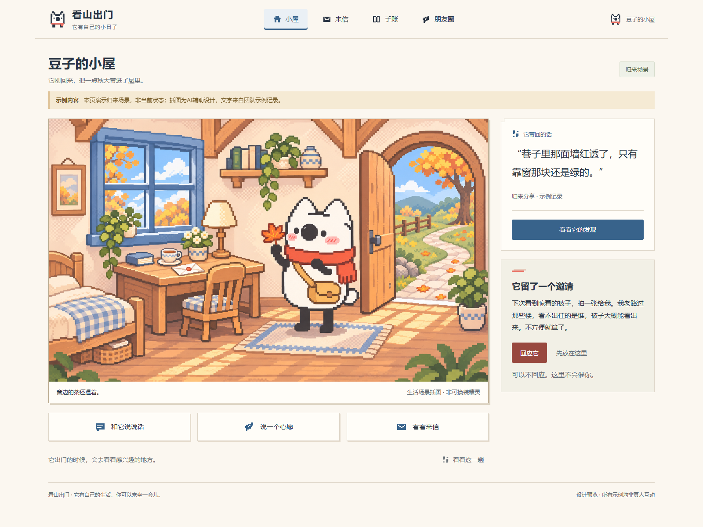
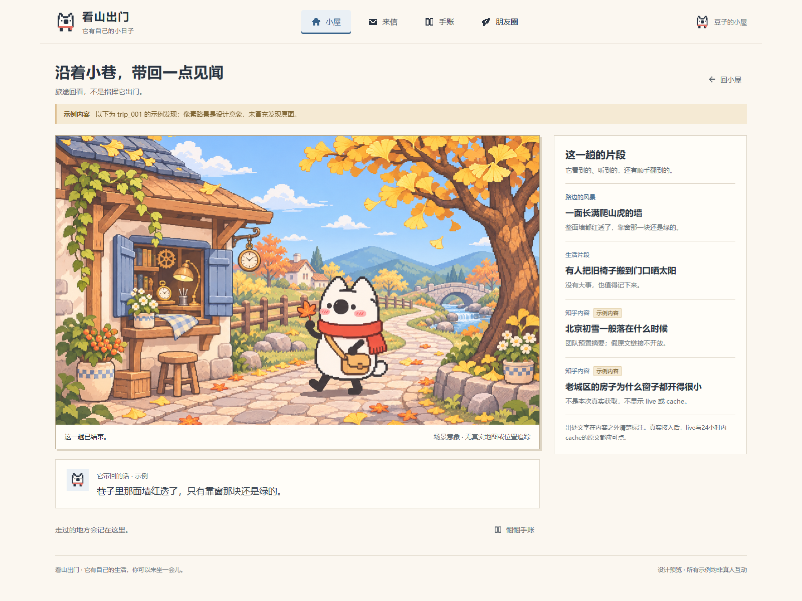
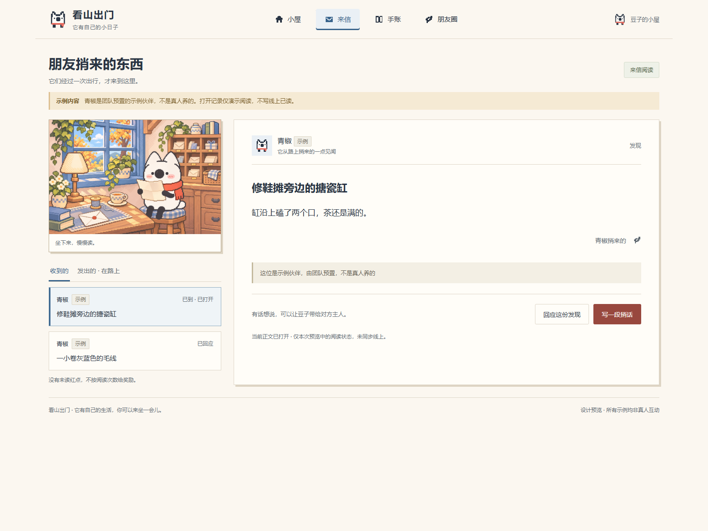

# E1 · 像素视觉基线与三页关键稿 v3

> E · 2026-11-16。用户明确：“团队选择了1像素风格”。方向已确定为方案1／A「像素生活小屋」。
> **批准的是风格方向；以下页面布局、色值与部件细节为首轮关键稿，仍可评审调整。** 不再并行推进3D／2D方案，不重新询问选择哪个风格。旧方向文档、概念和E2/E3交付保留，不覆盖。
> 本轮是页面设计稿＋独立本地预览，不是业务页面实现、正式素材包、可换装精灵或线上发布。

## 1. 已确定的设计原则

1. 主体是刘看山白色北极狐：短尖耳、大圆黑鼻、小黑眼、白色圆润身体、黑色手脚、白尾。跨页维持同一像素画风，不染成棕色犬类或条纹动物。
2. **像素负责生活世界，真实文字负责阅读。** 场景与少量图标像素化；长中文、错误提示、出处与示例说明不用装饰像素字体，也不烘焙进插图。
3. 主人是来坐一会儿的客人，不是操作者。没有出门命令、任务面板、签到、红点、计数、倒计时、奖励或不回应惩罚。
4. 三页同一世界、不同信息结构：小屋是空间与归来状态；旅途是路边切片与发现；朋友来信是收发列表和可阅读信件。
5. 角色、环境、场景图与正文分离。插图中的信封／叶子不等于业务已读或投递成功，必须以数据和真实文字表示事实。

团队原技术基线已有像素＋五层叠图，选择A与其方向一致，但**64／96px原生画布、锚点、衣服兼容、CSS filter及白色IP与skin占位映射仍须E2b/C/a确认**。本轮1536×1024整图不能替代这项工作。

## 2. 基础配色与可读性

| 用途 | 色值 | 使用方式 |
| --- | --- | --- |
| 页面底 | `#FBF7F0` | 干净浅底，托住像素场景，不铺满木纹 |
| 纸面 | `#FFFDF8` | 长正文、信件、邀请阅读层 |
| 正文 | `#293443` | 标题／正文／刘看山黑色识别细节 |
| 窗框蓝／阅读入口 | `#38638B` | 可读蓝按钮、当前导航；沿用蓝窗意象，较v2辅助蓝加深保证白字对比 |
| 围巾红 | `#E96E62` | 角色围巾、少量像素装饰；不直接用白色小字压在浅红上 |
| 主要动作红 | `#98483E` | “回应它”“写一段捎话”等明确操作；不是告警或催促红点 |
| 植物绿 | `#526447` | 平静状态文字，浅底`#EEF1E8`；不做生命／能量数值 |
| 木色 | `#DDBF91` | 场景木材、示例说明侧线 |
| 辅助文字／细边框 | `#626B73`／`#DED6C8` | 小字有足够对比；边框区分纸面而非每块都套重阴影 |
| 示例标签 | `#725520`／`#F5EAD4` | 醒目但不抢正文，不用淡到不可读的浅灰 |

本地计算的主要文字对比度：正文11.80:1、辅助文字5.34:1、红按钮白字6.30:1、蓝按钮白字6.31:1、示例标签5.80:1、状态绿字5.62:1。均高于普通正文4.5:1基准，最终组件仍需按实际状态检查。

- 中文字体：Microsoft YaHei、PingFang SC、Noto Sans CJK SC、sans-serif系统回退；不下载未知授权字体。
- 标题：桌面30px，手机25px；区块20px；正文16px；信件正文17–18px；辅助文字13px左右。
- 间距：4／8／12／16／24／32px为基线；桌面布局留28px主栏间距；手机18px边距，避免横向滚动。
- 圆角：普通按钮3px；像素阶梯角仅少量纸面或图标。避免全页厚黑框像游戏菜单。
- 触达：主要操作至少44px高；旁边保留间隔；键盘焦点显形，不依赖hover。
- 动效：本轮静态，不用自动闪烁或摇晃吸引互动；减少动态偏好保留所有信息。

本地设计建议检索返回了“Pixel Art”，但同时附带暗色霓虹、游戏得分、英文字体等不适合本项目的泛化项；未采用这些内容，也没有将其保存为团队方案。具体方案以团队已选的浅色生活像素和低压力原则为准。

## 3. 小屋关键稿

- 桌面：小屋场景占主栏；右侧两张不同用途纸面分别承载归来一句话、具体邀请。场景下方有交流／心愿／来信入口，不把全部按钮浮在插图上。
- 三页固定产品主导航：小屋／来信／手账／朋友圈；旅途从小屋进入，有回小屋入口，不额外挤进第五个主导航。
- 初稿演示“归来场景”，引用message fixture原话：“巷子里那面墙红透了，只有靠窗那块还是绿的。”不是声明当前最新出行状态。
- waiting邀请引用既有fixture原句；可回应，也可关闭／先留着，不写空回应。
- 手机：同一生活场景先显示，下方入口，再纵向呈现归来话和邀请。主导航放顶部，避免固定底栏压住正文。
- 图像中的斜挎包、围巾仅为风格表现，不代表Assembly增加了bag或scarf字段。

## 4. 旅途关键稿

- 桌面：户外像素路景＋归来一句话在主栏；右侧纵向发现列表，区分scene、moment和zhihu内容。不用同一个小屋卡片替换背景冒充旅途。
- 路景是插图意象，不是真实地图、路径追踪，也不是fixture发现的照片。浏览／刷新只是预览切换，不开始或结束出行。
- trip_001四条发现取自已有fixture；两条知乎内容即使内层写live/cache，也按实际fixture来源显示“示例内容”，假URL不开放。
- 手机：路景／归来话后接发现列表，保留返回；不把长标题挤入窄侧栏或用横向滑动隐藏出处。
- 真接口接入后，live必须为本次真获取；24小时内真cache仍有原文可点。历史离线内容不能继续冒充本次live。

## 5. 朋友来信关键稿

- 桌面：左侧近景书桌与收发列表，右侧独立纸面阅读；正文是DOM文字，可复制和朗读。
- 收件示例：青椒捎来的搪瓷缸发现、已回应的毛线礼物。礼物回应引用已有reply文字；缺失照片显示“示例回应照片未提供”，不换成别的照片。
- 本稿默认打开一条已到内容，局部“已打开”只是预览阅读状态，不写线上readAt；进入列表或滚动不声称线上已读成功。
- 现fixture的在路上记录属于**发件**，单独放“发出的·在路上”，不冒充收件箱来信；不提前展示未到payload或提供强制投递。
- 四处示例规范仍适用：本稿来信下方用“这位是示例伙伴，由团队预置，不是真人养的”，名字后标“示例”；写捎话时当场用“这是一位示例伙伴，可能不会回话。”。其他页的交换／朋友圈作者／手账关系标注按E3执行，本轮没实现那些完整页。
- 手机：隐藏装饰书桌图，先列表再正文，阅读优先。不因为少一张图就省略身份、来源、返回或关闭。

## 6. 控件、弹窗与四态设计

| 内容 | 本轮预览 | 正式实现边界 |
| --- | --- | --- |
| 卡片／纸面 | 细边框浅纸，关键场景少量阶梯阴影；信件阅读层留白更大 | E4组件化，不复制每页一套样式 |
| 按钮 | 深红主动作、深蓝阅读入口、浅底次动作；hover/按下/disabled与可见focus | E4需逐控件验证触屏和键盘，禁用时有原因 |
| 主导航 | 稳定文字＋像素图标，无未读角标 | C确认路由；本预览仅本地切换小屋／来信，其他入口显示范围说明 |
| 弹窗 | 明确标题、关闭、来源说明；Esc可关闭且焦点回触发按钮 | 草稿仅本次页面内存，不是线上／持久化保存 |
| 空 | 三页均有明确空状态；来信定稿原句保留 | 小屋暂无新旅途不等于伙伴不存在；领养不属于本轮三稿 |
| 加载 | 骨架反馈；本地示意1.9秒后转明确降级 | 不把2秒反馈误成必须2秒归来；不是已测真实接口耗时 |
| 失败 | 如实说读取失败，重试／回小屋；预览重试进入显形本地示例 | 不自动重复真实POST；E3的不确定提交规则仍待负责人确认 |
| 降级 | 本地示例显形，不称live/cache，不虚构发送／同步成功 | 实际离线存储和HTTP边界并未实现 |

表单只有“保留预览草稿”“关闭，不发送”，不使用假“发送成功”。照片上传、日常交流、心愿创建、回应、捎话未接后端。手账／朋友圈只展示可关闭的入口及定稿空状态，不伪称完整模块已完成。

## 7. 资产与代码取用

独立预览：`tools/e1-pixel-review/index.html`。本地可打开，无外部字体／图片／假原文链接，无fetch或XHR。渲染与验证脚本：`tools/e1-pixel-review/render-review.mjs`，通过环境变量BROWSER_EXE复用本机已安装Chromium；不安装依赖，不使用浏览器账号，也不操作团队接口。

三张新场景原图在`public/assets/concepts/2026-11-16/pixel/`：

| 用途 | 文件名 | 来源／性质 |
| --- | --- | --- |
| 小屋 | Create_ONE_wide_1536x1024_illu_2026-11-16T13-01-26.png | AI辅助，参考已选像素板和用户刘看山IP；仅页面设计插图；1536×1024，1,830,486B |
| 旅途 | Create_ONE_wide_1536x1024_illu_2026-11-16T13-02-32.png | 同上；户外意象非地图／来源照片；1536×1024，2,221,086B |
| 来信 | Create_ONE_wide_1536x1024_illu_2026-11-16T13-03-39.png | 同上；近景阅读意象，不代表真实投递状态；1536×1024，2,007,181B |

它们是整张位图，有生成像素风格，不承诺每个格点／色阶完全合规或可直接拆层。正式sprite必须再按原生网格、模板、锚点逐项制作与测试，不能把整图裁成“已交五层”。本轮PNG页面截图中的文字也不是可运行页面；真正可读文本位于独立HTML预览。

**时间关系：** E2 v2的“概念图3张、参考12张”是那份盘点完成时的快照。本轮随后新增3张像素场景原图，因此现在共有6张不同概念／设计插图；原有team副本不重复计数。E2 v2不覆盖修改，后续正式资产清单另出新版本。E2 v2／E3 v3中“风格待选”的历史表述由本文的团队选择记录取代，其五层、路径、业务、接口约束仍有效。

正式预算继续单张素材≤300KB、首屏素材≤1.5MB；这三张生成原图与页面评审截图不接入产品首屏，也不冒称预算通过。原包GIF／授权范围、白色IP皮肤映射、三模板锚点仍待a/C。用户参考原图不改、不移动、不重命名。

## 8. 交付范围与后续

本轮新增：本文件、三张1600×1200桌面关键稿、三张390×1200手机首段稿、三张场景设计原图、独立预览与本地验证脚本。手机稿用于首段布局参考，不代表完整页面长截图。实际成功的浏览器验证输出在`tools/e1-pixel-review/validation-v1.json`。

- 本机Chrome无头渲染通过：三页桌面无横向溢出且内容完整放进1200px高稿件；390px手机无横向溢出，页面纵向内容高度1515／1634／1260px，因此手机PNG是首段，不截断HTML中的后续操作。
- 预览交互检查通过：示例捎话当场警示、草稿本次预览保留且不发送、关闭焦点返回、收发选项卡键盘切换、缺图占位、在路上不展示未到正文、三页四态与1.9秒加载转显形降级、fixture假原文不可点；未捕获JavaScript运行异常。
- HTML层级／唯一ID／三张本地图片路径／脚本语法检查通过；没有外部URL、字体下载、fetch或XHR；未运行真实业务HTTP、持久化、真实移动设备或正式精灵性能验收。
- 初次导出发现img原始height属性导致画面过高、角色与下方内容被裁；已用height:auto修正。另一次焦点断言跑在dialog关闭事件之前失败，检查脚本改为等待关闭事件后验证，随后完整通过，不掩盖初次问题。
- 导出脚本完成后加入防覆盖检查：若v1图或验证结果已存在则直接停止；需要新交付时显式设置`REVIEW_VERSION=v2`或后续版本，不能覆盖已交付旧稿。后续真正修改还需同步新清单／HTML版本与实际交付日期。

## 9. 最终验收修正记录（2026-11-16）

- 查看`1116-e1-旅途手机稿-v1.png`发现标题行的“回小屋”按钮挤成两行。已只对`tools/e1-pixel-review/index.html`加`white-space:nowrap;flex-shrink:0`并保留按钮文字；不调整风格、配色或页面结构。
- 使用本机Chrome无头重新截取同一390×1200首段，新增`1116-e1-旅途手机稿-v2.png`；v1保留，不覆盖。为保持渲染验证记录与预览脚本版本一致，同时生成其余两份手机稿与三份桌面稿的逐字节同版v2副本；内容未变化，v1全部保留，不覆盖。若提交交付，v2作为本次验收版，v1作为历史版保留。
- 验收时当前磁盘缺少`1116-e1-立体方向-v2.png`和`1116-e1-平面方向-v2.png`。从对应两张未改概念原图按字节补回同名归档副本，校验SHA-256一致；3D／2D只是历史评审副本，不恢复为并行推进方向。
- 交叉检查发现E2 v2、E3 v3仍有“风格未选定”等历史表述，已在各自当前版本最小修正并指向E1 v3；E2的“40部件”“概念图3”同时修正，未改任何契约或旧版本文件。
- 验收结论：E1像素方向、三稿结构、独立预览、IP识别、示例标注和四态保持一致；E2五层／42部件／30场景与E3流程／C3接口无实质冲突。待C/a确认项保持待确认，没有因团队选风格而擅自定稿。

- 当前分支：`e1-e2-e3-20261116`；本轮未commit、未push、未fetch、未远程验证，没有本轮commit hash或已验证GitHub文件链接。
- 不改main、contracts、components/dog、components/scene、B/D业务、team/STATUS.md或旧版交付。独立预览代码在tools，不放进team当作产品代码。
- 下一步根据三张关键稿的具体反馈调整布局与IP表现；风格不重选。然后推进E2b单模板最小五层＋四表情，交C验证锚点与同一装配稳定渲染，再接E4组件／主画面。
- 不因为团队选择像素就将42部件／30场景写成已经制作，不把这三张关键稿说成已上线或页面联调通过。
