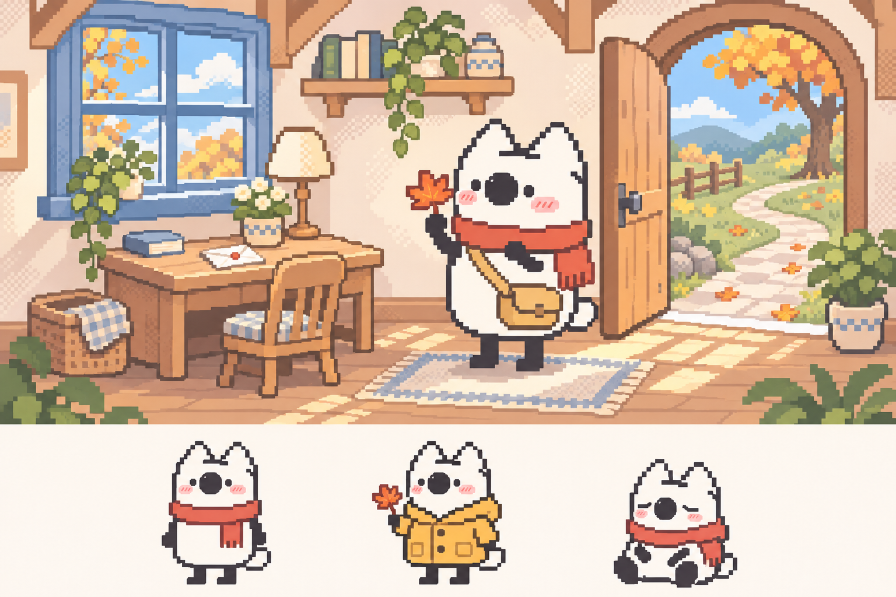
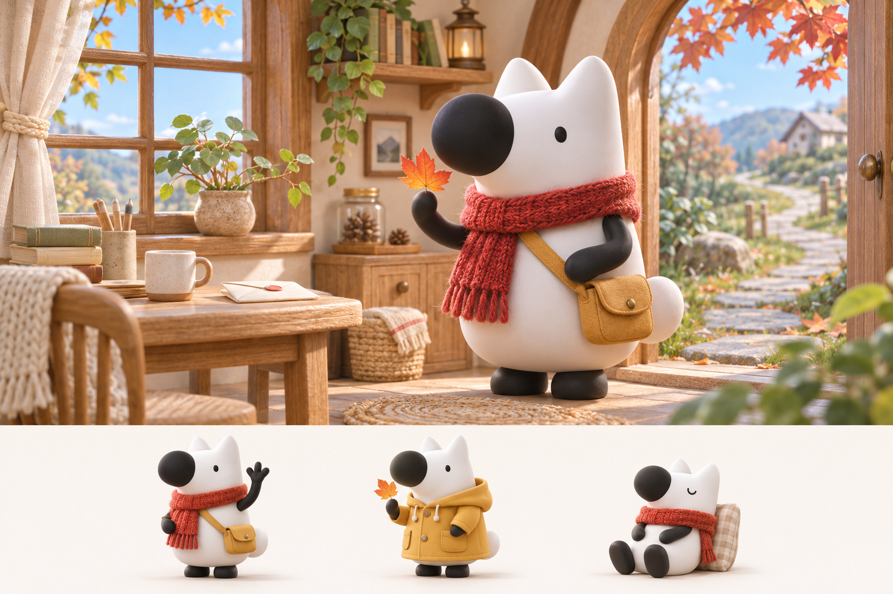
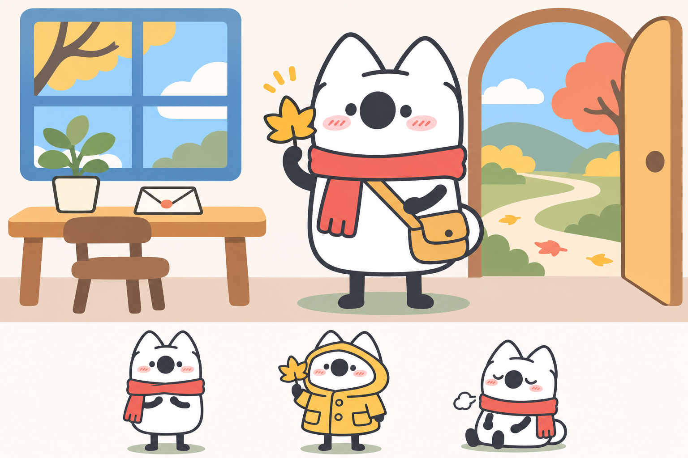

# E1 · 刘看山 IP 三套视觉方向 v2

> E · 2026-11-16 · 供选择与评审，尚未定稿。v1 保留；手绘路线不再参与本轮选择。
> 本轮交付：像素、3D、2D 三张风格概念图与方案说明。不是小屋／旅途／朋友来信的三张页面关键稿，也不是已实现的产品。

## 1. 主体与 IP 基线

主体是用户提供参考中的刘看山北极狐，不是泛化小狗。产品文案和契约中的 dog 命名暂不改；那是团队统一数据命名，不等于改变角色物种。

固定识别特征：白色圆润身体、短尖耳、大黑鼻、小黑眼、黑色手脚、短白尾。允许围巾、帽子、外套、包、拿在手中的物件及表情变化。不得把鼻子缩成普通狐狸尖鼻，不改成猫、熊或普通犬类，不靠改成棕毛、斑纹来区分伙伴。服装应露出核心识别区域，墨镜不能盖掉全部情绪表达。

参考包括用户给出的 2D 表情、3D 公仔场景和拼豆网格图；拼豆图用于像素轮廓参考，不直接把网格、编号和色号当作页面素材。参考原图没有修改。

来源口径：这些图片是用户提供、被描述为官方 IP 的视觉输入。具体素材授权范围、可用原包、GIF 清单仍需 a 确认；没有将授权审查标为完成。

## 2. 公平比较方式

三张概念图均以“它带着一片叶子从门外回来，桌上有封信”为生活切片，使用近似的白／黑／红围巾／蓝天／浅木色。因此差异来自造型、空间、材质、动效和界面，而不是换三套配色。

共同候选配色：主色围巾红 `#E96E62`，辅助蓝 `#4E83B7`、植物绿 `#8FA17A`、木色 `#DDBF91`，背景 `#FBF7F0`，正文 `#293443`。色值是方案阶段候选，不是已冻结的 token。

共同可读性候选：标题 28–32px、区块标题 20px、正文 16px、辅助标注 13–14px；系统中文无衬线正文（Microsoft YaHei／PingFang SC 回退）；基础间距 4／8／12／16／24／32px。长中文、出处、失败原因不采用装饰性像素字或手写字。

## 3. A · 像素生活小屋

- 关键词：像素精灵、小尺度生活、分层场景、安静的小世界。
- 角色：白色像素轮廓、大黑鼻与尖耳保留；围巾、帽子和外套作为格点对齐的部件。最终精灵需人工校正像素网格，不能将概念整图直接裁切当成合格 sprite。
- 场景：小屋用剖面／轻俯视的生活空间；旅途用可切换的路边生活切片，不做真实地理地图。有限像素色阶与同尺度道具产生世界感。
- 页面背景／卡片：淡奶白页面托住像素场景；正文卡片为干净浅底，少量阶梯角装饰，不把全文做成游戏对话框。
- 按钮：文字按钮加少量像素边角；可点击区域不少于 44px。导航是稳定的文字＋图标，没有未读红点或数字角标。弹窗清楚说明、关闭和返回，不做奖励弹窗。
- 字体／层级：栏目装饰可像素化，中文正文保持系统字体；用字号、留白和边框区分层级。
- 动效：少帧眨眼、围巾轻动、出门离场；无连续操作奖励、任务栏、签到、倒计时。
- 三页结构：小屋是“空间与状态”；旅途是“沿途切片＋发现”；朋友来信是“信封分组＋可读详情”。不能复制同一面板仅更换背景。
- 技术：最接近《02》现有像素＋五层叠图＋`image-rendering: pixelated` 基线。原生 64／96px 画布与交付大图尺寸是两件事，须在 e2b 确认。
- 优点：与当前团队分层计划兼容；组合一致性可检查；低压力世界感强。
- 代价：需要逐像素修轮廓与锚点；整张 AI 图不具备可拆分性；像素 UI 过量会把产品误读成养成游戏。
- 适配判断：适合“它自己过日子”；前提是主人没有任务控制台。

## 4. B · 3D 微缩生活剧场

- 关键词：公仔、微缩木屋、织物、自然光、可触摸的生活。
- 角色：与用户提供的立体刘看山更接近；白色哑光公仔身体、大黑鼻、黑色手脚；围巾有针织质感，包和衣服有材质区别，不变成写实毛茸茸狐狸。
- 场景：固定机位的小屋、带景深的旅途照片切片；少量物件承载它的经历。世界有体积和光影，但不靠复杂相机操作。
- 页面背景／卡片：立体场景与干净二维阅读层分离；暖白卡片／浅边框，不在木纹上堆小字，不让文字随相机转动。
- 按钮：柔和圆角、清楚文字；物件入口同时提供可读标签。导航使用轻量二维图标。弹窗／底部面板是平面内容层，不做需要旋转物体才能阅读的交互。
- 字体／层级：正文仍用系统中文无衬线；场景负责情绪，标题与信息卡负责阅读。
- 动效：眨眼、呼吸、围巾轻动或缓慢场景转场；减少动态偏好下提供静态版本。
- 三页结构：小屋是“固定机位生活剧场”；旅途是“大图见闻＋来源卡”；朋友来信是“桌面信件／礼物意象＋列表与详情”。
- 技术：本期建议评估“预渲染 3D 风格图片＋少量二维分层”，不是承诺实时 3D。生成一张立体图不等于已获得 3D 模型、动画、骨骼、换装部件或可运行场景。
- 优点：参考中的立体 IP 匹配度高；质感和演示吸引力强；容易营造亲密、治愈气质。
- 代价：同一姿态的帽子／围巾需统一视角、光照和遮挡；素材体积较高；会影响 C 的像素渲染／filter 基线，需 C 给替代实现并确认，必要时由 a 裁定。
- 适配判断：适合温暖的数字伙伴；不做公仔收藏商城、抽奖或换装任务。

## 5. C · 2D 动态贴纸舞台

- 关键词：官方表情感、平面动画、清晰轮廓、轻盈贴纸。
- 角色：借鉴参考中的白色轮廓、黑色手脚、表情符号；用规整曲线和纯色填充，不做水彩、手写线、绘本笔触。2D 不等于手绘风。
- 场景：正面平面舞台和图形层叠，物件少而大；刘看山与门、窗、植物形成清晰关系，而不是照片滤镜。
- 页面背景／卡片：白／奶白、大留白；卡片为正文底板，少量贴纸角标用于内容分类。角色可在卡片外侧出现，不遮挡出处和标注。
- 按钮：清楚的实心主按钮与描边次按钮；稳定文字导航；弹窗以平面底部面板为主，有明确取消／关闭，不强制回应。
- 字体／层级：系统中文无衬线；栏目可圆润，正文不使用难读手写体；靠布局和字重而非装饰堆叠。
- 动效：2–4 个固定表情／姿势之间切换，配合眨眼、拿信、离场；动效是自主生活反馈，不是点击奖励。
- 三页结构：小屋是“角色舞台＋日常入口”；旅途是“纵向明信片／见闻切片”；朋友来信是“信件内容列表＋贴纸寄件伙伴”。
- 技术：候选用二维透明分层 PNG／SVG 风格资产和 CSS 动效；保留五层逻辑，但抗锯齿、缩放和描边规则与像素风不同，需 C 确认，不擅改渲染组件。
- 优点：表情亲近且 IP 易辨认；信息阅读与手机操作轻量；比完整实时 3D 更容易控制复杂度。
- 代价：过度贴纸化会像表情包展示页；必须设计角色自主离场／归来，不让它成为静态吉祥物。
- 适配判断：适合低压力陪伴；需要以生活叙事避免只剩“可爱 UI”。

## 6. 选择对照

| 比较项 | A 像素 | B 3D 微缩 | C 2D 贴纸 |
| --- | --- | --- | --- |
| 最明显特征 | 方块边缘、精灵与生活场景 | 体积、光照、织物和摄影机位 | 纯色、清晰轮廓、平面舞台 |
| 角色一致性控制 | 原生像素网格＋共享锚点 | 固定视角／姿势／光照＋对齐 | 统一曲线／描边＋共享锚点 |
| 现有技术兼容 | 最接近团队基线 | 需确认预渲染方案与换装策略 | 需确认非像素缩放与动效 |
| 主要设计风险 | 游戏化过重 | 素材重且整图不可换装 | 静态表情包化 |
| 选择理由 | 优先已有分层实施计划 | 优先参考中公仔生活质感 | 优先官方表情感与轻量阅读 |

我的建议不是替你选择：若优先立体参考里的生活质感，重点看 B；若优先按现有技术里程碑推进，重点看 A；若希望清楚、轻巧且表达活泼，重点看 C。

## 7. 不因风格而改变的产品规则

- 主体是刘看山，主人是客人；没有命令它立即出门或操控另一位主人／伙伴的面板。
- 礼物／捎话经历投递与等待；没有即时聊天状态、催促或惩罚。不将等待表情表现为“你没回它所以它难过”。
- 页面四态必须单独覆盖：空、加载、失败、降级；加载最多 2 秒，结束加载反馈不等于旅程必须 2 秒内完成。在路上／已到未读／已读属于业务状态，不替代页面四态。
- 示例伙伴四处标注：来信、交换记录、朋友圈作者、手账关系回看；使用定稿文案，不在图像生成中烘焙小字。
- live＝本次真实获取、cache＝24h 内真实缓存且原文可点、fixture＝醒目示例且假原文链接不可点。整份 fixture 的预置假数据不能因内层写 live 就呈现为真实。
- 固定空文案原样保留：来信“还没有谁捎东西来。它出门的时候会看看信箱。”；在路上“有东西在路上，还没到。”；手账“走过的地方会记在这里。”；朋友圈“它还没发什么。等它觉得值得说的时候。”

## 8. 交付性质与后续步骤

三张图均为 AI 辅助的 PNG 位图概念板，实际为 1536×1024。像素板不是最终精灵表，立体板不是 3D 模型，平面板不是可拆分 SVG。概念板允许用于内部风格评审；当前单图超过正式资产 300KB 上限，不接入产品首屏。正式素材另按主画面长边1600、场景1200、头像256、图标64，以及单图≤300KB、首屏≤1.5MB 制作和验证。

顺序：你选择视觉方向 → a 确认产品／关键稿、C 核对技术影响 → 做小屋／旅途／朋友来信三张真正页面关键稿 → e2 路径规范与 e2b 最小部件 → e4 实现。没有擅改 contracts、components/dog、components/scene 或路由骨架。

投票只需回复：A／B／C + 保留什么 + 不喜欢什么。若混搭，先确定唯一角色渲染方式，再选 UI 语言，不能让同一角色跨页随机换成像素／3D／2D。
