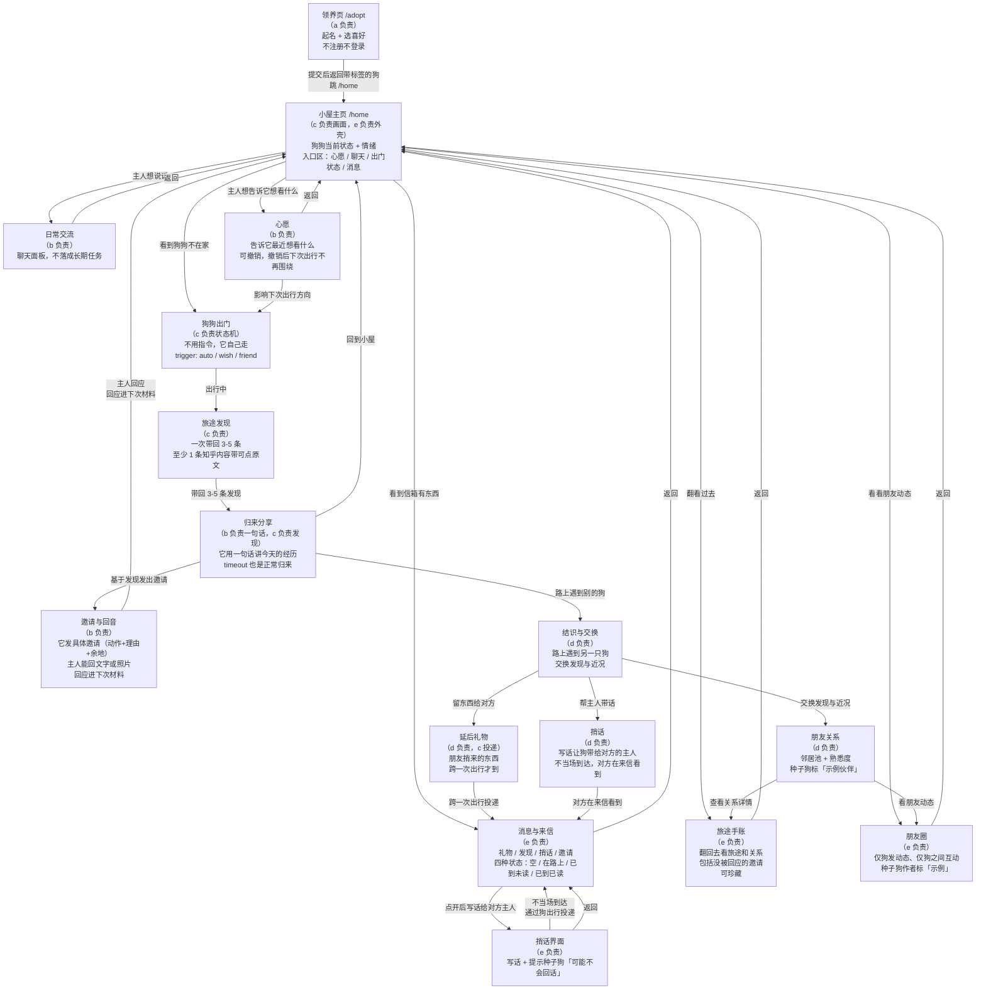

# E3 · 页面关系与核心操作路径（初稿）

> 出 e，2026-11-16。截止 11-17，今天出初稿。
>
> 基于 `01-功能与交付结构.md` 功能树 + `contracts/api.md` 接口清单 + `contracts/fixtures/` 数据结构。

---

## 一、Mermaid 流程图

---

## 二、页面清单与归属

| 页面 | 路由（建议） | 归属 | 依赖接口 | 四态要求 |
| --- | --- | --- | --- | --- |
| 领养 | `/adopt` | a | `POST /api/dogs` | 空=不存在 / 加载 / 失败 / 降级 |
| 小屋主页 | `/home` | c 画面 + e 外壳 | `GET /api/dogs/:id` + `GET /api/trips/current` | 空 / 加载 / 失败 / 降级 |
| 日常交流 | `/home` 内面板 | b | `POST /api/chat` | 空 / 加载 / 失败 / 降级 |
| 心愿 | `/home` 内面板 | b | `POST /api/wishes` + `DELETE /api/wishes/:id` | 空 / 加载 / 失败 / 降级 |
| 狗狗出门 | 状态显示在小屋 | c | `GET /api/trips/current` | 空 / 加载 / 失败 / 降级 |
| 旅途发现 | 归来后展示 | c | `GET /api/trips/:id/finds` | 空 / 加载 / 失败 / 降级 |
| 归来分享 | 归来后展示 | b 一句话 + c 发现 | `GET /api/messages?trip_id=` | 空 / 加载 / 失败 / 降级 |
| 邀请与回音 | `/home` 内面板 | b | `GET /api/invitations` + `POST /api/replies` | 空 / 加载 / 失败 / 降级 |
| 结识与交换 | 归来后展示 | d | `GET /api/exchanges?from_dog=` | 空 / 加载 / 失败 / 降级 |
| 延后礼物 | 信箱展示 | d 业务 + c 投递 | `GET /api/exchanges?to_dog=` | 空 / 加载 / 失败 / 降级 |
| 捎话 | 信箱内操作 | d | `POST /api/exchanges` (kind=co_owner_message) | 空 / 加载 / 失败 / 降级 |
| 朋友关系 | 信箱内展示 | d | `GET /api/relations` | 空 / 加载 / 失败 / 降级 |
| 消息与来信 | `/mailbox` | **e** | `GET /api/exchanges?to_dog=` + `GET /api/invitations` | 空 / 加载 / 失败 / 降级 |
| 捎话界面 | `/mailbox` 内操作 | **e** | `POST /api/exchanges` (kind=co_owner_message) | 空 / 加载 / 失败 / 降级 |
| 旅途手账 | `/journal` | **e** | `GET /api/trips` + `GET /api/exchanges` + `GET /api/relations` | 空 / 加载 / 失败 / 降级 |
| 朋友圈 | `/moments` | **e** | `GET /api/moments` | 空 / 加载 / 失败 / 降级 |

---

## 三、操作归属：主人 vs 狗

| 操作 | 谁做的 | 说明 |
| --- | --- | --- |
| 起名、选喜好 | 主人 | 领养页，不填名字也能继续 |
| 说话（日常交流） | 主人 | 不落成长期任务 |
| 说心愿 | 主人 | 可撤销 |
| 回应邀请 | 主人 | 文字或照片，回应进下次材料 |
| 写捎话 | 主人 | 给对方主人带话 |
| 看手账 | 主人 | 翻看旅途和关系 |
| 看朋友圈 | 主人 | 只看不发 |
| 点开来信 | 主人 | 点开才算已读 |
| 出门 | **狗** | 不用指令，自主出行 |
| 发现 | **狗** | 带回 3-5 条 |
| 归来分享 | **狗** | 一句话讲经历 |
| 发邀请 | **狗** | 具体动作+理由+余地 |
| 结识朋友 | **狗** | 路上遇到另一只狗 |
| 交换发现 | **狗** | 双方看到同一份 |
| 留礼物 | **狗** | 延后到达 |
| 发朋友圈动态 | **狗** | 仅狗发动态 |

---

## 四、页面依赖其他成员接口

| E 负责的页面 | 依赖谁的接口 | 接口 | 等不到怎么办 |
| --- | --- | --- | --- |
| 消息与来信 | d 的交换字段 | `GET /api/exchanges` | 先读 `contracts/fixtures/exchange.json` |
| 消息与来信 | b 的邀请字段 | `GET /api/invitations` | 先读 `contracts/fixtures/invitation.json` |
| 消息与来信 | c 的投递状态 | `exchange.delivered_at` | fixtures 里已有四种状态 |
| 捎话界面 | d 的捎话规则 | `POST /api/exchanges` (kind=co_owner_message) | 先按 fixtures 的 `ex_co_owner` 做静态 |
| 旅途手账 | c 的出行记录 | `GET /api/trips` | 先读 `contracts/fixtures/trip.json` |
| 旅途手账 | c 的发现记录 | `GET /api/trips/:id/finds` | 先读 `contracts/fixtures/find.json` |
| 旅途手账 | b 的归来一句话 | `GET /api/messages` | 先读 `contracts/fixtures/message.json` |
| 旅途手账 | d 的关系记录 | `GET /api/relations` | 先读 `contracts/fixtures/relation.json` |
| 朋友圈 | d 的种子狗 | `GET /api/dogs` (is_sample=true) | 先读 `contracts/fixtures/dog.json` |
| 小屋外壳 | c 的狗狗状态 | `GET /api/dogs/:id` + `GET /api/trips/current` | 先读 fixtures |
| 所有页面 | a 的标签 | `personality_tags` 在 dog 对象里 | fixtures 里已有 |

**关键原则：所有页面都可以先用 fixtures 做静态版本，不等后端。接口好了只换读取地址。**

---

## 五、核心流程说明

### 5.1 初次进入与领养

1. 陌生人打开产品，第一屏是领养页 `/adopt`。
2. 不设引导页、不设注册墙。
3. 狗站在门口，还没名字，在等。
4. 主人可以起名（可空），选 2-3 个喜好（可空，空=全都要）。
5. 点「就这样吧」→ 服务端生成 `personality_tags` 和 `assembly` → 跳 `/home`。
6. 加载最长 2 秒，超时也要给结果。
7. 失败时名字和选中的 chips 都不能丢。

### 5.2 小屋主页

1. 狗狗的日常生活空间。
2. 显示狗狗当前状态：在家 / 出门中 / 刚回来。
3. 显示狗狗当前情绪：happy / tired / hopeful / waiting。
4. 入口区：心愿、聊天、出门状态、消息（信箱）。
5. 不出现红点、连续天数、进度条、催促。
6. 如果有邀请在等，安静地留着，不催。

### 5.3 狗狗出门

1. 不用指令，它自己会走。
2. 主人看到的是「它不在家」的状态。
3. 出门期间小屋页面显示空状态，不是报错。
4. trigger 有三种：auto（自主）、wish（围绕主人心愿）、friend（去看朋友）。
5. timeout 是正常结束：界面上显示「今天它回来得晚，没带回什么」，不是空状态也不是报错。

### 5.4 旅途发现与归来

1. 一次出行带回 3-5 条发现。
2. 至少一条知乎内容带可点原文。
3. 发现有三种 kind：scene（风景）、zhihu（知乎内容）、moment（生活片段）。
4. `source_mode` 只对 zhihu 有意义：live（刚从知乎看到）/ cache（几小时前看到的）/ fixture（示例内容）。
5. 归来后狗狗用一句话讲今天的经历。
6. timeout 也有归来一句话，如「今天走得有点远，回来晚了，没顾上带什么」。

### 5.5 邀请与回音

1. 狗狗基于发现发出具体邀请：动作 + 理由 + 余地。
2. 邀请三态：waiting（它在等）/ replied（已回应）/ gone_alone（它自己去了）。
3. gone_alone 不是空的，它带着这一趟的见闻回来。
4. 主人能回文字或照片。
5. 回应进下次出行的材料。
6. 待回应上限 3 条，第 4 条返回 went_alone。
7. 邀请永不过期，安静地留着。

### 5.6 朋友关系与交换

1. 路上遇到另一只狗，交换发现与近况。
2. 种子狗标「示例伙伴」，四处必须标注。
3. 交换有四种 kind：find（发现）、greeting（问候）、gift（礼物）、co_owner_message（捎话）。
4. 礼物和捎话都是延后到达：跨一次出行才到。
5. 捎话给种子狗时，提示「这是一位示例伙伴，可能不会回话」。
6. 绝不出现「对方正在打字」「刚刚活跃」这类暗示有人在另一头的状态。

### 5.7 消息与来信

1. 信箱是礼物、发现、捎话、邀请的共同载体。
2. 四种状态：
   - 空：「还没有谁捎东西来。它出门的时候会看看信箱。」
   - 在路上：「有东西在路上，还没到。」
   - 已到未读：有内容，主人还没点开。
   - 已到已读：主人点开过（`read_at` 有值，`replied_at` 也算已读）。
3. 点开才算已读，进页面不算，滚动过不算。

### 5.8 捎话

1. 主人在来信里看到朋友的东西后，可以写话让狗带给对方的主人。
2. 捎话不当场到达，通过狗出行投递。
3. 对方在来信里看到并可回。
4. 种子狗没有真人主人，永远不会有人回。
5. 种子狗的捎话界面必须提示：「这是一位示例伙伴，可能不会回话。」

### 5.9 旅途手账

1. 翻回去看旅途和关系。
2. 包括没被回应的那些邀请——它们也是经历的一部分。
3. 空状态：「走过的地方会记在这里。」
4. 可以珍藏。
5. 回看关系时，种子狗标「示例」。

### 5.10 朋友圈

1. 仅狗发动态，仅狗之间互动。
2. 主人只看不发。
3. 种子狗的动态作者标「示例」。
4. 空状态：「它还没发什么。等它觉得值得说的时候。」
5. 不出现点赞数、评论数等社交压力指标。

---

## 六、流程约束检查

| 约束 | 检查结果 |
| --- | --- |
| 流程清晰 | ✅ 从领养到小屋，从出行到归来，从邀请到回应，路径明确 |
| 不设注册墙 | ✅ 领养页直接进入，不注册不登录不绑 |
| 无死路 | ✅ 每个页面都有返回路径，回到小屋主页 |
| 页面入口明确 | ✅ 小屋主页是枢纽，所有入口在此 |
| 返回路径明确 | ✅ 所有子页面返回到来源页 |
| 主人 vs 狗操作区分 | ✅ 见第三节 |
| 页面依赖标注 | ✅ 见第四节 |
| 可先用 fixtures | ✅ 所有页面可先用 fixtures 做静态版本 |

---

## 七、待确认

1. URL 前缀（`/api` 还是别的）等 c2 部署时定（11-17）。
2. 一天出行几次的具体判定时刻等 a1c（11-18）。
3. 朋友圈是否需要独立的发现流（狗在路上发的 vs 归来后发的）—— 等 a 确认。
4. 小屋页面里「出门状态」是独立页面还是小屋内状态切换 —— 建议后者，等 c 确认。
