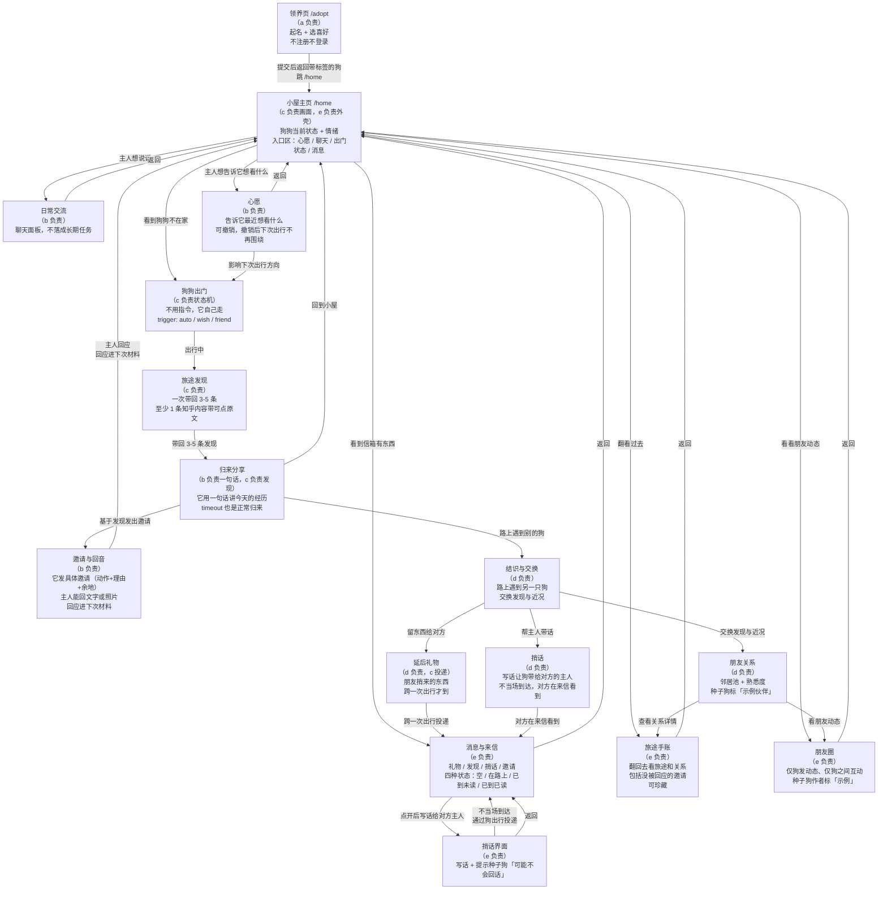

# E3 · 页面关系与核心操作路径（v2 · 接口对齐）

> 出 e，2026-11-16。v2 修订 2026-11-16。
>
> **v2 修订说明：** v1 中多处接口名称与 `contracts/api.md`（C 的权威契约）不一致。
> 本次按 C 提交到远程 `c3` 分支的 `1116-c3-接口补充-v2.md` 第五节「E3 API 兼容映射」逐条对齐。
> 修正依据：`origin/c3` 分支提交 `f5e607d`（`c3: 补齐关系与交换读取契约`）。
> 同时核对 C 更新后的 `contracts/api.md`（九组接口）和 `contracts/types.ts`（新增四个类型）。
> v1 原文件保留不动。
>
> 基于 `01-功能与交付结构.md` 功能树 + `contracts/api.md` 接口清单 + `contracts/fixtures/` 数据结构。

---

## 一、Mermaid 流程图

---

## 二、页面清单与归属

> **接口对齐说明：** 下表所有接口已按 C 的 `1116-c3-接口补充-v2.md` 第五节映射表核对。
> E 负责的页面（标记 **e**）只使用 C 契约中定义的接口；C 契约中尚未定义的接口标注为「⚠️ 待确认」。

| 页面 | 路由（建议） | 归属 | 依赖接口 | 四态要求 |
| --- | --- | --- | --- | --- |
| 领养 | `/adopt` | a | `POST /api/dogs` | 空=不存在 / 加载 / 失败 / 降级 |
| 小屋主页 | `/home` | c 画面 + e 外壳 | `GET /api/dogs/:id` + `GET /api/dogs/:id/trips?limit=1` | 空 / 加载 / 失败 / 降级 |
| 日常交流 | `/home` 内面板 | b | ⚠️ 待确认（C 尚未定义，见第八节） | 空 / 加载 / 失败 / 降级 |
| 心愿 | `/home` 内面板 | b | `POST /api/dogs/:id/wishes` + `PATCH /api/wishes/:id/revoke` + `GET /api/dogs/:id/wishes?includeRevoked=false` | 空 / 加载 / 失败 / 降级 |
| 狗狗出门 | 状态显示在小屋 | c | `POST /api/dogs/:id/trips` + `POST /api/trips/:id/start` + `POST /api/trips/:id/finish` + 轮询 `GET /api/trips/:id`（700ms） | 空 / 加载 / 失败 / 降级 |
| 旅途发现 | 归来后展示 | c | `GET /api/trips/:id/finds` | 空 / 加载 / 失败 / 降级 |
| 归来分享 | 归来后展示 | b 一句话 + c 发现 | `POST /api/trips/:id/finish`（响应含 `message: Message\|null`） | 空 / 加载 / 失败 / 降级 |
| 邀请与回音 | `/home` 内面板 | b | `GET /api/dogs/:id/invitations?state=all` + `POST /api/dogs/:id/invitations` + `POST /api/replies` | 空 / 加载 / 失败 / 降级 |
| 结识与交换 | 归来后展示 | d | `GET /api/exchanges?from_dog=:id` | 空 / 加载 / 失败 / 降级 |
| 延后礼物 | 信箱展示 | d 业务 + c 投递 | `POST /api/exchanges`（d 调） | 空 / 加载 / 失败 / 降级 |
| 捎话 | 信箱内操作 | d | `POST /api/exchanges`（kind=co_owner_message） | 空 / 加载 / 失败 / 降级 |
| 朋友关系 | 信箱内展示 | d | `GET /api/dogs/:id/relations` | 空 / 加载 / 失败 / 降级 |
| **消息与来信** | `/mailbox` | **e** | `GET /api/dogs/:id/inbox?filter=all` + `GET /api/dogs/:id/invitations?state=all` + `PATCH /api/exchanges/:id/read` | 空 / 加载 / 失败 / 降级 |
| **捎话界面** | `/mailbox` 内操作 | **e** | `POST /api/exchanges`（kind=co_owner_message） | 空 / 加载 / 失败 / 降级 |
| **旅途手账** | `/journal` | **e** | `GET /api/dogs/:id/trips?limit=10` + `GET /api/trips/:id/finds` + `GET /api/exchanges?from_dog=:id` + `GET /api/dogs/:id/inbox?filter=all` + `GET /api/dogs/:id/invitations?state=all` + `GET /api/dogs/:id/relations` | 空 / 加载 / 失败 / 降级 |
| **朋友圈** | `/moments` | **e** | ⚠️ 待确认（C 尚未定义，见第八节） | 空 / 加载 / 失败 / 降级 |

### E 负责页面的接口调用细节

#### 消息与来信 `/mailbox`

**收件箱列表（信箱主体）：**
- 接口：`GET /api/dogs/:id/inbox?filter=onTheWay|arrived|all`
- 方法：GET
- 路径参数：`:id` = 收件狗 ID
- 查询参数：`filter` = `onTheWay`（在路上）/ `arrived`（已到）/ `all`（全部）
- 返回：`{ exchanges: Exchange[] }`
- 状态语义（C 投递器 `inbox()` 函数实现）：
  - `delivered_at` 为 null → `onTheWay`
  - `delivered_at` 有值且 `read_at` 为 null 且 `replied_at` 为 null → `arrived`（已到未读）
  - `read_at` 或 `replied_at` 有值 → `read`（已到已读）
- **注意：** `replied_at` 也算已读（C 在投递器中明确要求）

**邀请列表（信箱中邀请部分）：**
- 接口：`GET /api/dogs/:id/invitations?state=all`
- 方法：GET
- 路径参数：`:id` = 狗 ID
- 查询参数：`state` = `all` / `waiting` / `replied` / `gone_alone`
- 返回：`{ invitations: InvitationView[] }`
- **注意：** 必须读 `v_invitation_state` 视图推导的状态，不许自己算

**标记已读（只有 E 调）：**
- 接口：`PATCH /api/exchanges/:id/read`
- 方法：PATCH
- 路径参数：`:id` = exchange ID
- 请求体：`{}`
- 返回：`{ exchange: Exchange }`
- **注意：** 只有 E 写 `read_at`。主人点开那条内容才算已读。

#### 捎话界面 `/mailbox` 内操作

**发送捎话：**
- 接口：`POST /api/exchanges`
- 方法：POST
- 请求体：`{ fromDog, toDog, kind: "co_owner_message", payload: { kind: "co_owner_message", message, fromOwnerOf } }`
- 返回：`{ exchange: Exchange }`
- **注意：** `deliver_after_trip_seq` 由 C 计算，E/D 不自己算。种子狗的捎话界面必须提示「这是一位示例伙伴，可能不会回话」。
- **注意：** C v2 已补齐 payload 中的 `kind` 字段，与外层 `kind` 一致。

#### 旅途手账 `/journal`

手账需要合并同一只狗的发件和收件记录。按 C 的映射表：「Combine outbox + inbox」。

**出行历史：**
- 接口：`GET /api/dogs/:id/trips?limit=10`
- 方法：GET
- 路径参数：`:id` = 狗 ID
- 查询参数：`limit` = 返回条数上限
- 返回：`{ trips: Trip[] }`

**单次出行的发现：**
- 接口：`GET /api/trips/:id/finds`
- 方法：GET
- 路径参数：`:id` = trip ID
- 返回：`{ finds: Find[] }`

**发件记录（这只狗发出的交换）：**
- 接口：`GET /api/exchanges?from_dog=:id`
- 方法：GET
- 查询参数：`from_dog` = 发送狗 ID（必填，只出现一次）
- 返回：`ExchangesResponse = { exchanges: Exchange[] }`
- 排序：`createdAt DESC, id DESC`
- 包含所有投递状态，三个时间列（`deliveredAt`、`repliedAt`、`readAt`）原样返回
- 错误：`CONFLICT`（参数缺失/空白/重复）、`NOT_FOUND`（狗不存在或不属于当前 session）

**收件记录（这只狗收到的交换）：**
- 接口：`GET /api/dogs/:id/inbox?filter=all`
- 返回：`{ exchanges: Exchange[] }`

**手账合并逻辑：**
- 调用 outbox（`GET /api/exchanges?from_dog=:id`）+ inbox（`GET /api/dogs/:id/inbox?filter=all`）
- 按 exchange ID 去重
- 无 `from_dog` 的 `GET /api/exchanges` 不提供全局集合，返回 `CONFLICT`

**邀请历史：**
- 接口：`GET /api/dogs/:id/invitations?state=all`
- 返回：`{ invitations: InvitationView[] }`
- 包含 `waiting` / `replied` / `gone_alone` 三种状态

**朋友关系：**
- 接口：`GET /api/dogs/:id/relations`
- 方法：GET
- 路径参数：`:id` = 请求狗 ID
- 返回：`RelationsResponse = { relations: RelationView[] }`
- 每个 `RelationView` 含：
  - `relation: Relation`（`id`, `dogA`, `dogB`, `firstMetAt`, `lastMetAt`, `metCount`, `isBlocked`, `blockedAt`）
  - `otherDog: PublicDogSummary`（仅 `id`, `name`, `assembly`, `isSample`，不暴露 `sessionId` / `blockedTopics`）
  - `snapshot: Snapshot | null`（对方最新版本快照，不存在时为 null）
- 排序：`lastMetAt DESC, id ASC`
- 保留 `isBlocked`（包括已拉黑记录）
- **注意：** `GET /api/relations` 不是规范路由，不使用。

#### 朋友圈 `/moments`

- ⚠️ **待确认。** C 契约（九组接口）中没有 moments 相关接口。C 在 v2 第六节明确标注「数据来源和写入方待决策」。
- 当前方案：先读 `contracts/fixtures/dog.json`（筛选 `is_sample=true` 的种子狗）做静态版本。
- 不自行编造接口。

#### 小屋外壳

- 狗狗信息：`GET /api/dogs/:id` → `{ dog: Dog }`
- 当前出行状态：`GET /api/dogs/:id/trips?limit=1` → `{ trips: Trip[] }`
  - `limit=1` 仍返回 trips 数组，不是单个 current 对象
  - 页面读取后检查 `status`，空数组也需处理
  - 出行中轮询单次出行：`GET /api/trips/:id` → 返回 `status`，700ms 间隔

---

## 三、操作归属：主人 vs 狗

| 操作 | 谁做的 | 说明 |
| --- | --- | --- |
| 起名、选喜好 | 主人 | 领养页，不填名字也能继续 |
| 说话（日常交流） | 主人 | 不落成长期任务 |
| 说心愿 | 主人 | 可撤销 |
| 回应邀请 | 主人 | 文字或照片，回应进下次材料 |
| 写捎话 | 主人 | 给对方主人带话 |
| 看手账 | 主人 | 翻看旅途和关系 |
| 看朋友圈 | 主人 | 只看不发 |
| 点开来信 | 主人 | 点开才算已读 |
| 出门 | **狗** | 不用指令，自主出行 |
| 发现 | **狗** | 带回 3-5 条 |
| 归来分享 | **狗** | 一句话讲经历 |
| 发邀请 | **狗** | 具体动作+理由+余地 |
| 结识朋友 | **狗** | 路上遇到另一只狗 |
| 交换发现 | **狗** | 双方看到同一份 |
| 留礼物 | **狗** | 延后到达 |
| 发朋友圈动态 | **狗** | 仅狗发动态 |

---

## 四、页面依赖其他成员接口

> 已按 C 的 `1116-c3-接口补充-v2.md` 第五节映射表对齐。

| E 负责的页面 | 依赖谁的接口 | 接口（对齐后） | 等不到怎么办 |
| --- | --- | --- | --- |
| **消息与来信** | c 的信箱接口 | `GET /api/dogs/:id/inbox?filter=all` | 先读 `contracts/fixtures/exchange.json` |
| **消息与来信** | b 的邀请接口 | `GET /api/dogs/:id/invitations?state=all` | 先读 `contracts/fixtures/invitation.json` |
| **消息与来信** | c 的投递状态 | `exchange.delivered_at`（inbox 响应字段） | fixtures 里已有四种状态 |
| **消息与来信** | e 的已读标记 | `PATCH /api/exchanges/:id/read` | fixtures 里 `read_at` 已有值 |
| **捎话界面** | d 的捎话规则 | `POST /api/exchanges` (kind=co_owner_message) | 先按 fixtures 的 `ex_co_owner` 做静态 |
| **旅途手账** | c 的出行记录 | `GET /api/dogs/:id/trips?limit=10` | 先读 `contracts/fixtures/trip.json` |
| **旅途手账** | c 的发现记录 | `GET /api/trips/:id/finds` | 先读 `contracts/fixtures/find.json` |
| **旅途手账** | c 的发件记录 | `GET /api/exchanges?from_dog=:id` | 先读 `contracts/fixtures/exchange.json`（筛选 from_dog） |
| **旅途手账** | c 的收件记录 | `GET /api/dogs/:id/inbox?filter=all` | 先读 `contracts/fixtures/exchange.json`（筛选 to_dog） |
| **旅途手账** | b 的邀请历史 | `GET /api/dogs/:id/invitations?state=all` | 先读 `contracts/fixtures/invitation.json` |
| **旅途手账** | d 的关系记录 | `GET /api/dogs/:id/relations` | 先读 `contracts/fixtures/relation.json` |
| **朋友圈** | d 的种子狗 | ⚠️ 待确认（C 尚未定义 moments 接口和集合查询） | 先读 `contracts/fixtures/dog.json` (is_sample=true) |
| 小屋外壳 | c 的狗狗状态 | `GET /api/dogs/:id` + `GET /api/dogs/:id/trips?limit=1` | 先读 fixtures |
| 所有页面 | a 的标签 | `personality_tags` 在 dog 对象里 | fixtures 里已有 |

**关键原则：所有页面都可以先用 fixtures 做静态版本，不等后端。接口好了只换读取地址。**

---

## 五、核心流程说明

### 5.1 初次进入与领养

1. 陌生人打开产品，第一屏是领养页 `/adopt`。
2. 不设引导页、不设注册墙。
3. 狗站在门口，还没名字，在等。
4. 主人可以起名（可空），选 2-3 个喜好（可空，空=全都要）。
5. 点「就这样吧」→ 服务端生成 `personality_tags` 和 `assembly` → 跳 `/home`。
6. 加载最长 2 秒，超时也要给结果。
7. 失败时名字和选中的 chips 都不能丢。

### 5.2 小屋主页

1. 狗狗的日常生活空间。
2. 显示狗狗当前状态：在家 / 出门中 / 刚回来。
3. 显示狗狗当前情绪：happy / tired / hopeful / waiting。
4. 入口区：心愿、聊天、出门状态、消息（信箱）。
5. 不出现红点、连续天数、进度条、催促。
6. 如果有邀请在等，安静地留着，不催。
7. 当前出行状态通过 `GET /api/dogs/:id/trips?limit=1` 获取，仍返回 trips 数组，取最新一条检查 `status`。

### 5.3 狗狗出门

1. 不用指令，它自己会走。
2. 主人看到的是「它不在家」的状态。
3. 出门期间小屋页面显示空状态，不是报错。
4. trigger 有三种：auto（自主）、wish（围绕主人心愿）、friend（去看朋友）。
5. timeout 是正常结束：界面上显示「今天它回来得晚，没带回什么」，不是空状态也不是报错。
6. 出行中轮询 `GET /api/trips/:id`，700ms 间隔，不用 SSE。

### 5.4 旅途发现与归来

1. 一次出行带回 3-5 条发现。
2. 至少一条知乎内容带可点原文。
3. 发现有三种 kind：scene（风景）、zhihu（知乎内容）、moment（生活片段）。
4. `source_mode` 只对 zhihu 有意义：live（刚从知乎看到）/ cache（几小时前看到的）/ fixture（示例内容）。
5. 归来后狗狗用一句话讲今天的经历。
6. timeout 也有归来一句话，如「今天走得有点远，回来晚了，没顾上带什么」。
7. 归来一句话在 `POST /api/trips/:id/finish` 的响应中返回（`message: Message|null`），没有独立的 `GET /api/messages` 接口。

### 5.5 邀请与回音

1. 狗狗基于发现发出具体邀请：动作 + 理由 + 余地。
2. 邀请三态：waiting（它在等）/ replied（已回应）/ gone_alone（它自己去了）。
3. gone_alone 不是空的，它带着这一趟的见闻回来。
4. 主人能回文字或照片。
5. 回应进下次出行的材料。
6. 待回应上限 3 条，第 4 条返回 went_alone。
7. 邀请永不过期，安静地留着。
8. 查邀请列表用 `GET /api/dogs/:id/invitations?state=all`，状态由 `v_invitation_state` 视图推导。

### 5.6 朋友关系与交换

1. 路上遇到另一只狗，交换发现与近况。
2. 种子狗标「示例伙伴」，四处必须标注。
3. 交换有四种 kind：find（发现）、greeting（问候）、gift（礼物）、co_owner_message（捎话）。
4. 礼物和捎话都是延后到达：跨一次出行才到。
5. 捎话给种子狗时，提示「这是一位示例伙伴，可能不会回话」。
6. 绝不出现「对方正在打字」「刚刚活跃」这类暗示有人在另一头的状态。
7. 查朋友关系列表用 `GET /api/dogs/:id/relations`，返回 `RelationsResponse`，包含 `RelationView[]`。
8. `otherDog` 仅暴露 `PublicDogSummary`（`id`、`name`、`assembly`、`isSample`），不暴露 `sessionId`、`blockedTopics` 等私有字段。

### 5.7 消息与来信

1. 信箱是礼物、发现、捎话、邀请的共同载体。
2. 四种状态：
   - 空：「还没有谁捎东西来。它出门的时候会看看信箱。」
   - 在路上：「有东西在路上，还没到。」
   - 已到未读：有内容，主人还没点开。
   - 已到已读：主人点开过（`read_at` 有值，`replied_at` 也算已读）。
3. 点开才算已读，进页面不算，滚动过不算。
4. 信箱列表通过 `GET /api/dogs/:id/inbox?filter=all` 获取，按 `delivered_at` 区分在路上/已到。
5. 邀请列表通过 `GET /api/dogs/:id/invitations?state=all` 获取。
6. 标记已读通过 `PATCH /api/exchanges/:id/read`，只有 E 调用。

### 5.8 捎话

1. 主人在来信里看到朋友的东西后，可以写话让狗带给对方的主人。
2. 捎话不当场到达，通过狗出行投递。
3. 对方在来信里看到并可回。
4. 种子狗没有真人主人，永远不会有人回。
5. 种子狗的捎话界面必须提示：「这是一位示例伙伴，可能不会回话。」
6. 发送捎话通过 `POST /api/exchanges`（kind=co_owner_message），`deliver_after_trip_seq` 由 C 计算。

### 5.9 旅途手账

1. 翻回去看旅途和关系。
2. 包括没被回应的那些邀请——它们也是经历的一部分。
3. 空状态：「走过的地方会记在这里。」
4. 可以珍藏。
5. 回看关系时，种子狗标「示例」。
6. 出行历史通过 `GET /api/dogs/:id/trips?limit=10` 获取。
7. 单次出行的发现通过 `GET /api/trips/:id/finds` 获取。
8. 交换记录合并：发件用 `GET /api/exchanges?from_dog=:id`，收件用 `GET /api/dogs/:id/inbox?filter=all`，按 exchange ID 去重。
9. 邀请历史通过 `GET /api/dogs/:id/invitations?state=all` 获取。
10. 朋友关系通过 `GET /api/dogs/:id/relations` 获取。

### 5.10 朋友圈

1. 仅狗发动态，仅狗之间互动。
2. 主人只看不发。
3. 种子狗的动态作者标「示例」。
4. 空状态：「它还没发什么。等它觉得值得说的时候。」
5. 不出现点赞数、评论数等社交压力指标。
6. ⚠️ 待确认：C 契约尚未定义 moments 接口。当前先用 fixtures 做静态版本。

---

## 六、流程约束检查

| 约束 | 检查结果 |
| --- | --- |
| 流程清晰 | ✅ 从领养到小屋，从出行到归来，从邀请到回应，路径明确 |
| 不设注册墙 | ✅ 领养页直接进入，不注册不登录不绑 |
| 无死路 | ✅ 每个页面都有返回路径，回到小屋主页 |
| 页面入口明确 | ✅ 小屋主页是枢纽，所有入口在此 |
| 返回路径明确 | ✅ 所有子页面返回到来源页 |
| 主人 vs 狗操作区分 | ✅ 见第三节 |
| 页面依赖标注 | ✅ 见第四节（已按 C v2 映射表对齐） |
| 可先用 fixtures | ✅ 所有页面可先用 fixtures 做静态版本 |
| 接口名称对齐 | ✅ 已按 C 的 `1116-c3-接口补充-v2.md` 第五节映射表核对（见第八节） |

---

## 七、待确认

1. URL 前缀（`/api` 还是别的）等 c2 部署时定（11-17）。
2. 一天出行几次的具体判定时刻等 a1c（11-18）。
3. 朋友圈是否需要独立的发现流（狗在路上发的 vs 归来后发的）—— 等 a 确认。
4. 小屋页面里「出门状态」是独立页面还是小屋内状态切换 —— 建议后者，等 c 确认。
5. ⚠️ **以下接口在 C 契约（九组）中尚未定义，需对应负责人补充（不自行编造）：**
   - `POST /api/chat`（日常交流，b 负责）—— C v2 第六节明确「B，尚未定义；本次不新增」
   - `GET /api/messages?trip_id=`（归来一句话独立查询，b 负责）—— C v2 第六节明确「B，尚未定义；本次不新增」。当前只在 `POST /api/trips/:id/finish` 响应中返回。
   - `GET /api/moments`（朋友圈，d/e 负责）—— C v2 第六节明确「数据来源和写入方待决策；不自建发现流或路由」
   - `GET /api/dogs?is_sample=true`（批量查询种子狗）—— C v2 第六节明确「集合接口尚未指定；不能把单狗 GET 冒充集合」

---

## 八、接口对齐变更记录（v1 → v2）

> 本节记录所有从 v1 修改到 v2 的接口变更。
> **唯一依据：C 提交到 `c3` 分支的 `1116-c3-接口补充-v2.md` 第五节「E3 API 兼容映射」。**
> 同时核对 C 更新后的 `contracts/api.md`（九组接口）和 `contracts/types.ts`。

### 8.1 C 第五节映射表（原文照录）

| E3 current path | Correct contract path |
| --- | --- |
| GET /api/relations | GET /api/dogs/:id/relations |
| GET /api/exchanges?from_dog= | Newly defined outbox |
| GET /api/exchanges?to_dog= | GET /api/dogs/:id/inbox?filter=all |
| GET /api/exchanges (journal) | Combine outbox + inbox |
| GET /api/trips | GET /api/dogs/:id/trips?limit=10 |
| GET /api/trips/current | GET /api/dogs/:id/trips?limit=1 |
| GET /api/invitations | GET /api/dogs/:id/invitations?state=all |
| POST /api/wishes | POST /api/dogs/:id/wishes |
| DELETE /api/wishes/:id | PATCH /api/wishes/:id/revoke |

> C 注：`limit=1` 仍返回 trips 数组，不能当作已有的单个 current 对象接口；页面读取后检查 status，空数组也需处理。

### 8.2 逐条变更说明

| # | 页面 | v1 接口（旧） | v2 接口（对齐后） | 变更说明 |
| --- | --- | --- | --- | --- |
| 1 | 小屋主页 | `GET /api/trips/current` | `GET /api/dogs/:id/trips?limit=1` | C 契约无 `/api/trips/current`。`limit=1` 仍返回 trips 数组，取最新一条检查 status。出行中轮询用 `GET /api/trips/:id`。 |
| 2 | 日常交流 | `POST /api/chat` | ⚠️ 待确认 | C v2 第六节明确「B，尚未定义」。b 负责实现。 |
| 3 | 心愿 | `POST /api/wishes` | `POST /api/dogs/:id/wishes` | 路径需要 `:id`（狗 ID）。 |
| 4 | 心愿 | `DELETE /api/wishes/:id` | `PATCH /api/wishes/:id/revoke` | 方法从 DELETE 改 PATCH，路径加 `/revoke`。撤销填 `revoked_at`，不物理删除。 |
| 5 | 心愿 | （无） | `GET /api/dogs/:id/wishes?includeRevoked=false` | v1 缺少心愿列表查询。C 契约有此接口。 |
| 6 | 邀请与回音 | `GET /api/invitations` | `GET /api/dogs/:id/invitations?state=all` | 路径需要 `:id`，查询参数 `state`。 |
| 7 | 结识与交换 | `GET /api/exchanges?from_dog=` | `GET /api/exchanges?from_dog=:id` | **C v2 新定义了 outbox 接口。** 返回 `ExchangesResponse = { exchanges: Exchange[] }`。`from_dog` 必填且只出现一次。按 `createdAt DESC, id DESC` 排序。 |
| 8 | 延后礼物 | `GET /api/exchanges?to_dog=` | `GET /api/dogs/:id/inbox?filter=all` | C 明确不新增 `?to_dog=`，收件统一用 inbox 接口。传入 `to_dog` 返回 `CONFLICT`。 |
| 9 | 朋友关系 | `GET /api/relations` | `GET /api/dogs/:id/relations` | **C v2 新定义了关系读取接口。** 返回 `RelationsResponse = { relations: RelationView[] }`。`otherDog` 是 `PublicDogSummary`（仅 `id`/`name`/`assembly`/`isSample`）。**`GET /api/relations` 不是规范路由。** |
| 10 | **消息与来信** | `GET /api/exchanges?to_dog=` | `GET /api/dogs/:id/inbox?filter=all` | 同 #8。 |
| 11 | **消息与来信** | `GET /api/invitations` | `GET /api/dogs/:id/invitations?state=all` | 同 #6。 |
| 12 | **消息与来信** | （无） | `PATCH /api/exchanges/:id/read` | v1 缺少标记已读接口。只有 E 调用。 |
| 13 | 归来分享 | `GET /api/messages?trip_id=` | `POST /api/trips/:id/finish`（响应含 `message`） | C 契约无独立 `GET /api/messages` 接口。message 在 finish 响应中返回。C v2 第六节明确「B，尚未定义」。 |
| 14 | **旅途手账** | `GET /api/trips` | `GET /api/dogs/:id/trips?limit=10` | 路径需要 `:id`，查询参数 `limit`。 |
| 15 | **旅途手账** | `GET /api/exchanges` | Combine: `GET /api/exchanges?from_dog=:id` + `GET /api/dogs/:id/inbox?filter=all` | C 映射表明确「Combine outbox + inbox」，按 exchange ID 去重。无 `from_dog` 的 `GET /api/exchanges` 返回 `CONFLICT`。 |
| 16 | **旅途手账** | `GET /api/relations` | `GET /api/dogs/:id/relations` | 同 #9。 |
| 17 | **旅途手账** | `GET /api/messages` | （无独立接口） | C 契约无独立 `GET /api/messages`。手账中看归来一句话从已存储的 trip 数据中获取。C v2 明确「B，尚未定义」。 |
| 18 | **朋友圈** | `GET /api/moments` | ⚠️ 待确认 | C v2 第六节明确「数据来源和写入方待决策」。先用 fixtures。 |
| 19 | 朋友圈 | `GET /api/dogs` (is_sample=true) | ⚠️ 待确认 | C v2 第六节明确「集合接口尚未指定；不能把单狗 GET 冒充集合」。先用 fixtures。 |
| 20 | 小屋外壳 | `GET /api/trips/current` | `GET /api/dogs/:id/trips?limit=1` | 同 #1。 |

### 8.3 返回数据结构核对

依据 C 更新后的 `contracts/api.md` 和 `contracts/types.ts`（c3 分支版本）：

| 接口 | 返回结构 | 关键字段 |
| --- | --- | --- |
| `GET /api/dogs/:id/inbox?filter=all` | `{ exchanges: Exchange[] }` | 每条含 `id, fromDog, toDog, kind, payload, deliverAfterTripSeq, createdAt, deliveredAt, repliedAt, readAt` |
| `GET /api/exchanges?from_dog=:id` | `ExchangesResponse = { exchanges: Exchange[] }` | 同上。三个时间列原样返回。 |
| `GET /api/dogs/:id/relations` | `RelationsResponse = { relations: RelationView[] }` | 每个 `RelationView` 含 `relation: Relation` + `otherDog: PublicDogSummary` + `snapshot: Snapshot\|null` |
| `GET /api/dogs/:id/invitations?state=all` | `{ invitations: InvitationView[] }` | 每个 `InvitationView` 含 `id, dogId, text, basedOnFindId, createdAt, state, replyId, goneAloneTripId` |
| `GET /api/dogs/:id/trips?limit=10` | `{ trips: Trip[] }` | 每个 `Trip` 含 `id, dogId, seq, status, trigger, createdAt, startedAt, endedAt` |
| `PATCH /api/exchanges/:id/read` | `{ exchange: Exchange }` | — |
| `POST /api/exchanges` | `{ exchange: Exchange }` | — |
| `POST /api/trips/:id/finish` | `{ trip: Trip, finds: Find[], message: Message\|null }` | message 在响应中，无独立查询 |

### 8.4 C v2 新增的类型定义

来自 `contracts/types.ts`（c3 分支新增）：

- `PublicDogSummary`：`{ id, name, assembly, isSample }` — 公开白名单，不暴露 `sessionId`/`blockedTopics`
- `RelationView`：`{ relation: Relation, otherDog: PublicDogSummary, snapshot: Snapshot | null }`
- `RelationsResponse`：`{ relations: RelationView[] }`
- `ExchangesResponse`：`{ exchanges: Exchange[] }`

### 8.5 状态筛选与语义核对

| 场景 | C 契约规定 |
| --- | --- |
| 信箱在路上/已到筛选 | `?filter=onTheWay\|arrived\|all`，三值枚举 |
| 信箱已读判定 | `read_at` 有值 **或** `replied_at` 有值 → 已读 |
| 发件箱状态 | 所有投递状态原样返回，不补时间、不更新状态 |
| 邀请状态 | 查 `v_invitation_state` 视图，不许自己算。三态：`waiting`/`replied`/`gone_alone`，无 `expired` |
| 心愿撤销 | `PATCH /revoke` 填 `revoked_at`，软删除 |
| 出行轮询 | 700ms 轮询 `GET /api/trips/:id`，不用 SSE |
| 关系排序 | `lastMetAt DESC, id ASC` |
| 发件排序 | `createdAt DESC, id DESC` |
| 关系保留拉黑 | 保留 `isBlocked`（包括已拉黑记录），是读取不触发修改 |

### 8.6 错误处理核对

| 接口 | 可能错误码 | 界面处理 |
| --- | --- | --- |
| `GET /api/dogs/:id/inbox` | `NETWORK`、`NOT_FOUND` | 断网时信箱必须还能打开（本地缓存），按阻断缺陷处理 |
| `GET /api/exchanges?from_dog=:id` | `CONFLICT`（参数缺失/空白/重复）、`NOT_FOUND`（狗不存在或不属于当前 session）、`NETWORK` | 参数错误就地提示；断网时用缓存 |
| `GET /api/dogs/:id/relations` | `NOT_FOUND`（狗不存在或不属于当前 session）、`NETWORK` | 断网时手账必须还能打开 |
| `GET /api/dogs/:id/invitations` | `NETWORK` | 断网时用本地缓存 |
| `PATCH /api/exchanges/:id/read` | `NETWORK`、`NOT_FOUND`、`CONFLICT` | 标记已读失败时静默重试 |
| `POST /api/exchanges` | `NETWORK`、`CONFLICT` | 捎话发送失败如实说断网，可重试，不丢已输入内容 |
| `GET /api/dogs/:id/trips` | `NETWORK` | 断网时手账用本地数据 |

### 8.7 仍待团队确认的接口

以下接口 C 在 `1116-c3-接口补充-v2.md` 第六节明确标注为未决，**不自行编造**：

| # | 接口 | 归属 | C 的说明 |
| --- | --- | --- | --- |
| 1 | `POST /api/chat` | B | 尚未定义；本次不新增 |
| 2 | `GET /api/messages?trip_id=` | B | 尚未定义；本次不新增 |
| 3 | `GET /api/moments` | 待决策 | 数据来源和写入方待决策；不自建发现流或路由 |
| 4 | `GET /api/dogs?is_sample=true` | 待决策 | 集合接口尚未指定；不能把单狗 GET 冒充集合 |
