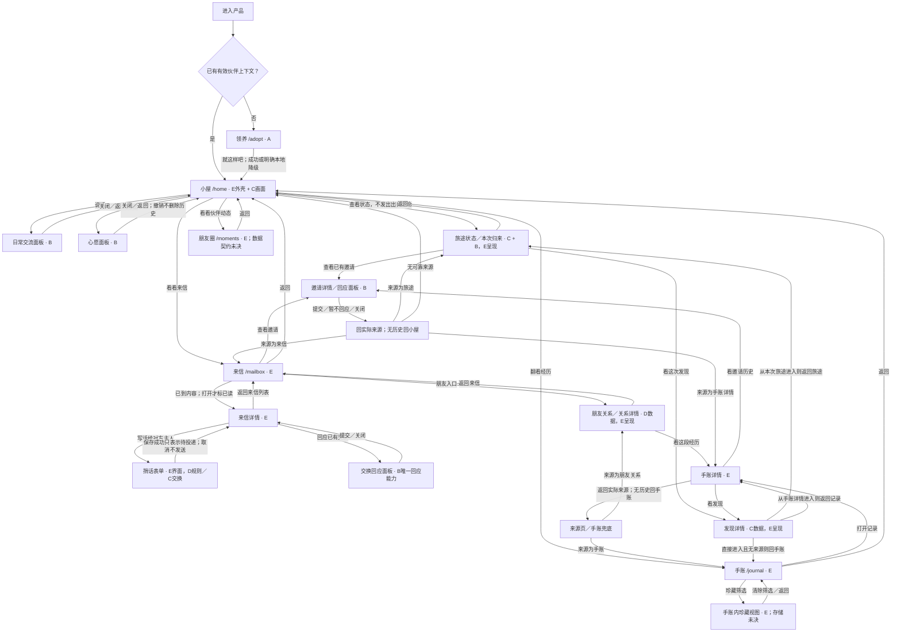
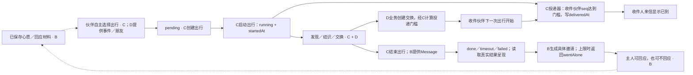

# E3 · 页面关系与核心操作路径 v3

> E · 2026-11-16。v1/v2保留；本轮是流程与交接规范，不是已实现的页面或联调通过报告。团队已选方案1／A「像素生活小屋」，见`1116-e1-像素视觉基线-v3.md`；本文不冻结具体视觉参数。
> 仓库根：`zhihu-hackathon/`。页面URL是建议，实际路由由C确认；`/api`形状来自契约，部署前缀仍由C定。
> 依据：a的《01-功能与交付结构》《给E-标注与线框》《群置顶-产品总纲》，E3 v2，以及本地`origin/c3@f5e607d967744436f26530ce338c53006f9c0a8d`的`contracts/api.md`与C3接口补充v2。没有fetch，不声称远程最新；该C交付也不代表HTTP handler已部署。

## 1. v3改什么、不改什么

- 将“主人导航／提交”和“伙伴自主生活／后端编排”拆开，不把POST出行、finish、发邀请当作看历史的页面入口。
- 将页面空／加载／失败／降级，与出行、投递、邀请业务状态分开；`running`不是空，`timeout`不自动等于请求错误。
- 为页面、抽屉、详情、表单补入口、返回、关闭、取消、重试和无历史兜底；不把所有返回强制送回小屋。
- 纠正“归来一句话从Trip取”的表述：`Message`与`Trip`分表，历史读取接口尚未定义，不以再次finish补读。
- 保留C定义的接口、a定稿文案、延后投递、四处示例标注；补局部降级、草稿保留、提交结果不确定和有限重试。
- 本轮不改contracts、C路由、B/D业务、team/STATUS.md、旧交付、用户原图或.gitkeep；不新增登录、后台、表、契约字段或数据集合。

## 2. Mermaid：主人可操作的页面关系

实线只表示主人的导航／提交／返回，不表示后台执行出行。“朋友关系”是来信内入口；“珍藏”先作为手账内筛选，不额外创造已实现的页面。



图中BACK/SOURCE是返回策略说明，不是新路由。发现从本次旅途打开时返回TRIP；从手账打开时返回RECORD。邀请从来信、旅途、手账打开时，分别回对应入口，不能固定跳小屋。

## 3. Mermaid：伙伴与服务端的自主生活

本图的边是业务编排，不是主人的按钮。B/C/D实现各自写入；E读取结果，不控制伙伴出发、强制归来或催人回应。



目标闭环：它出门 → 带回发现 → 发出具体邀请 → 主人可回应 → 回应成为下次材料。目标一次3–5条且有可点知乎来源；实际空发现、timeout必须可正常呈现，不能为了满足数量补假内容。

## 4. 页面／面板目录与返回约定

| 页面／面板 | 入口与主要内容 | 返回／关闭／取消 | 归属与边界 |
| --- | --- | --- | --- |
| 领养 `/adopt` | 无有效伙伴上下文；起名、喜好，唯一主按钮“就这样吧” | 保留表单；浏览器返回不拦截；无注册墙 | A逻辑，E视觉建议；本地草稿不是有效服务端ID |
| 小屋 `/home` | 返回用户枢纽；在家／准备出门／在路上／归来 | 一级页遵循浏览器历史，不循环重定向 | E外壳，C角色／场景／状态 |
| 日常交流 | 小屋内面板，主人说话 | 关闭回触发按钮；草稿不外泄到快照 | B；接口未决 |
| 心愿 | 小屋内面板，列表、创建、撤销 | 关闭回小屋；未提交输入保留；撤销失败保留原记录 | B；不做立即出门按钮 |
| 旅途状态／归来 | 小屋“查看状态”入口；读取当前Trip及已完成发现 | 返回小屋；开详情后关闭回本次旅途 | C编排／数据，B归来话，E呈现 |
| 来信 `/mailbox` | 小屋；exchange列表＋独立邀请区＋朋友入口 | 返回小屋；详情关闭恢复列表位置和筛选 | E；邀请不是Exchange第五种kind |
| 来信详情 | 已到记录；内容、示例说明、回应／捎话入口 | 返回列表；打开才请求已读，列表刷新不写已读 | E呈现／readAt，B回应，D规则 |
| 朋友关系／详情 | 来信朋友入口；关系、公开伙伴摘要、快照 | 返回来信；从此去手账后可回关系来源 | D关系，E呈现；读取不更新相遇次数 |
| 捎话表单 | 来信详情中的对方主人入口 | 取消／关闭不发送，保留草稿；成功回详情 | E界面，D内容规则，C创建交换；不是即时聊天 |
| 邀请／交换回应 | 旅途／来信／手账，已有来源ID | 可暂不回应；关闭回实际入口；失败保留文字／所选图 | B唯一回应能力；E不另写repliedAt |
| 手账 `/journal` | 小屋／关系；出行、发现、收发交换、邀请历史 | 返回来源；一级直接进入无历史时回小屋 | E；合并按ID去重，不重建经历 |
| 手账详情／珍藏 | 手账记录／筛选，关联已有经历 | 回来源恢复位置；取消编辑不提交 | E；珍藏／笔记存储规范未决，不伪称已同步 |
| 朋友圈 `/moments` | 小屋，只看伙伴动态及伙伴间互动 | 返回小屋；任何降级都有返回 | E呈现；数据及写入方未决，无主人发帖／点赞按钮 |

建议移动端主导航保持小屋／来信／手账／朋友圈四项，朋友、珍藏、交流放在相应上下文，不再叠成多级任务面板。C确认前不创建这组路由。

返回原则：有可靠应用内来源就回来源；直接链接或刷新丢失来源时用上表兜底。禁止无条件`history.back()`把用户送到站外或空白页，也不劫持浏览器原生返回。外链原文与产品内返回分开，开外链不丢当前阅读位置。失效详情给返回入口，不重发写请求以“修复”。

## 5. 读取依赖：查看不会写业务事实

下列GET按C契约形状；实现／部署状态另验。`:id`分别按dog/trip上下文取值，不用sessionID代替，也不让客户端覆盖服务端匿名会话归属。

| 内容 | 已定义读取形状 | 响应／关键处理 | 依赖 |
| --- | --- | --- | --- |
| 当前伙伴 | `GET /api/dogs/:id` | `{ dog: Dog }`；API字段camelCase | A实现；C会话接入 |
| 小屋最近出行候选 | `GET /api/dogs/:id/trips?limit=1` | `{ trips: Trip[] }`，空数组合法，不是current对象；排序／进行中优先选择规则尚未定义，需C确认后才能称最新或据此轮询 | C |
| 进行中出行 | `GET /api/trips/:id` | 契约明确返回status；完整响应包裹形状待C细化，不擅定`{ trip }` | C；700ms轮询，不用SSE |
| 单次发现 | `GET /api/trips/:id/finds` | `{ finds: Find[] }`；没搜到可空，来源按第8节 | C |
| 心愿列表 | `GET /api/dogs/:id/wishes?includeRevoked=false` | `{ wishes: Wish[] }`；历史撤销记录不物理删 | B |
| 邀请／邀请历史 | `GET /api/dogs/:id/invitations?state=all` | `{ invitations: InvitationView[] }`；state由`v_invitation_state`输出 | B |
| 收件列表 | `GET /api/dogs/:id/inbox?filter=all` | `{ exchanges: Exchange[] }`；筛选另可onTheWay或arrived，无read查询枚举 | C |
| 发件列表 | `GET /api/exchanges?from_dog=:id` | `ExchangesResponse`；必填单个from_dog，含全部投递状态 | C读取；D/E调用 |
| 关系 | `GET /api/dogs/:id/relations` | `RelationsResponse`；另一端公开四字段＋最新快照或null，保留isBlocked | C定义，D实现，E读 |
| 手账出行列表 | `GET /api/dogs/:id/trips?limit=10` | `{ trips: Trip[] }`；limit不是分页协议，更多历史机制待C | C |
| 历史归来一句话／已回应正文 | 尚无独立读取契约 | Trip没有Message字段；replyId／repliedAt不能当回应正文 | B/C待补 |
| 朋友圈／种子伙伴集合 | 尚无集合契约 | dog.json只是伙伴资料，不是动态；moment类型Find也不是已定义朋友圈集合 | A/C/D/E待决 |
| 珍藏／笔记历史 | 尚无读写契约 | E负责需求；存储键、范围、迁移／同步与C确认 | E/C |

发件按`createdAt DESC, id DESC`；关系按`lastMetAt DESC, id ASC`，由接口提供。手账outbox＋inbox只按exchange.id去重，保留收／发方向，不能因同一文案就合成一条。`PublicDogSummary`只有`id/name/assembly/isSample`，不能展开完整Dog来展示别人的sessionId、blockedTopics或私有记录。

数据库／fixtures是snake_case，HTTP DTO是camelCase。正式接口在实现边界转换；fixture加载也需要统一适配，不是“只换读取地址就自动接好了”。E页面不各自写不一致的库行转换，未合入C3的本地fixture缺payload.kind时不能静默补字段冒充原始数据合格。

## 6. 写入依赖：谁触发、什么才算完成

| 操作 | 调用形状 | 触发与结果 | E不能做的事 |
| --- | --- | --- | --- |
| 领养 | `POST /api/dogs`，`{ name?, interestCategories? }` | 主人“就这样吧”；服务端返回dog后使用有效上下文 | 不手选personalityTags；不假造服务端成功 |
| 创建心愿 | `POST /api/dogs/:id/wishes`，`{ text, category }` | 主人提交；B返回wish，失败保留输入 | 不将心愿变成必须完成的任务 |
| 撤销心愿 | `PATCH /api/wishes/:id/revoke`，`{}` | 主人撤销；B写revokedAt | 不DELETE；不因关闭面板自动撤销 |
| 创建／开始／结束出行 | `POST /api/dogs/:id/trips`；`POST /api/trips/:id/start`；`POST /api/trips/:id/finish` | C自主编排；finish返回`{ trip, finds, message: Message或null }`，B写message | 查看／刷新／回手账不得触发这些POST；不手写deliveredAt |
| 发邀请 | `POST /api/dogs/:id/invitations`，`{ basedOnFindId? }` | B自主发起；返回invitation或`{ wentAlone: true, tripId }` | 主人打开邀请列表不是“生成新邀请”；不把wentAlone拼成新枚举 |
| 回应邀请／交换 | `POST /api/replies`，`{ invitationId? , exchangeId? , text? , photoUrl? }` | 主人提交，B唯一写入；恰好一个来源，文字或照片至少一种 | 不写空回应，不自行改repliedAt；不把全部CONFLICT当成功 |
| 标记已读 | `PATCH /api/exchanges/:id/read`，`{}` | E在已到内容真正打开时调用，响应exchange确认readAt | 不在列表加载／滚动／预取时写，不给在路上条目标已读 |
| 捎话／交换创建 | `POST /api/exchanges`，`{ fromDog, toDog, kind, payload }` | D负责规则，C计算门槛；E表单通过该边界提交，返回exchange只表示记录已创建 | 不自算deliverAfterTripSeq，不替对方主人回复，不在点击朋友时匹配／赠礼 |

捎话请求形状引用C v2，作为接口交接示意，不是已接通的代码：

```json
{
  "fromDog": "dog_owner",
  "toDog": "dog_seed_07",
  "kind": "co_owner_message",
  "payload": {
    "kind": "co_owner_message",
    "message": "楼下的桂花开了，你那边闻得到吗",
    "fromOwnerOf": "dog_owner"
  }
}
```

成功有返回exchange后，在发件／手账展示“在路上”；不说“对方已收到”。同一条原话只保存在payload，不能进Snapshot或让伙伴把主人的私信当公开材料。`isBlocked`关系同时作用于伙伴和主人，不能保留一条绕过屏蔽的捎话入口；D决定规则，E不另改关系。

## 7. 页面四态与业务态分别验收

### 7.1 业务态：有内容的生活，不是请求状态

| 业务 | 判定来源 | 页面表现 |
| --- | --- | --- |
| 准备出门／在路上 | Trip.status=`pending/running` | 小屋状态区正常内容；信箱、手账仍可打开，不空白，不催促 |
| 正常归来 | Trip.status=`done` | 显示实际发现、已有Message；零发现有平静说明，不编造3–5条 |
| 超时归来 | Trip.status=`timeout` | 一次已经结束的旅途；如有Message用原话，无Message不冒充它说了新话 |
| 出行失败记录 | Trip.status=`failed` | 区分实际失败原因与页面读取失败；保留经历，不将它伪装done，不让“重试”创建新出行 |
| 在路上 | Exchange.deliveredAt为空 | “有东西在路上，还没到。”；可显示投递状态，不展开未到payload、不提前回应 |
| 已到未读／已读 | deliveredAt有值后，readAt或repliedAt有值为已读 | 仅打开内容标记已读；已回应不能仍标未读 |
| 邀请等待／回应／自己去了 | InvitationView.state | waiting保留可回应入口；replied看得出已记下；gone_alone关联真实旅途，不是空／过期 |

不一致数据如deliveredAt为空而readAt已有值，应交C处理并诚实降级；E不补时间把它“修正常”。到达是收件伙伴下一次出行开始，门槛为出行序号而非时间；不设明天到达、秒级倒计时或人操作强制投递。

### 7.2 页面四态矩阵

正常有数据之外，每个页面／面板都需验证以下四态；领养遵照a线框，没有单独“空页面”，初始未填表单就是直接领养。

| 页面／面板 | 空／初始 | 加载 | 失败 | 降级 |
| --- | --- | --- | --- | --- |
| 领养 | a定稿起名／chips线框，均可空 | 等待提交反馈≤2秒 | 就地说明＋再试一次，保留名字／chips | 本地保存真实成功才写“还没保存到线上”；不得带假ID请求远程 |
| 小屋 | 无旅途不等于无伙伴；无有效伙伴回领养 | 角色／状态骨架，入口可用 | 状态未读到不显示假在家；局部重试 | 已缓存小屋可开；明示本地数据，缺图静态回退 |
| 交流 | 初始可输入，无强制开场任务 | B回复反馈≤2秒 | 就地说明，保留原输入 | 接口未接做明确示例，不宣称真实记忆／已送达 |
| 心愿 | 无心愿为平静初始面板，候选文案待B | 列表／提交骨架 | 就地说明，保留输入／类别和原列表 | 已缓存只读，离线草稿不标已创建或已撤销 |
| 旅途／归来／发现 | finds=[]用“今天没找到合适的”；running非空 | GET反馈≤2秒 | 读取失败可重试读取，不能POST新旅途 | 已缓存旅途可看，未确认状态明示非最新 |
| 来信列表／详情 | 无东西用定稿；有在路上用另一条定稿 | 列表／详情骨架 | GET失败给重试；read更新失败不挡已到正文 | 本地记录或fixture显形；详情缺失给回列表，未到正文不开放 |
| 朋友关系 | 无关系是合法空集合，候选文案待D | 关系骨架 | 就地重试／返回，越权NOT_FOUND不显示空朋友 | 缓存关系标非最新；snapshot=null说明暂无近况，不造快照 |
| 捎话／回应 | 未输入不发送，不写none记录 | 同一次提交禁重复；反馈≤2秒 | 保留文字／所选图片，区分未知结果 | 可留本机草稿；没有真实提交确认不标发送成功 |
| 手账／详情／珍藏 | “走过的地方会记在这里。”；空筛选用待确认说明 | 各区独立骨架 | 局部失败可重试且其余区可看 | 断网仍能打开已有本地记录；示例、缺历史话／缺图显形 |
| 朋友圈 | “它还没发什么。等它觉得值得说的时候。” | 数据区骨架 | 真实数据读取失败给重试／返回 | 现阶段明确示例展示；无动态数据就显示空，不用狗资料伪造真实动态 |

2秒限制是**一次读取／提交不能无限停在骨架或等待反馈**，不是伙伴必须2秒结束出行。超过该反馈窗口转为明确状态：可读缓存、显形示例、可重试读取失败，或“提交结果尚未确认”的非阻塞反馈；恢复查询不必伪造TIMEOUT出行。GET可稍后更新，但过时请求响应不能覆盖用户已切换的对象或新的成功结果。

700ms轮询仅C确认的进行中Trip，逐次完成后调度、不重叠；结束态停止。页面离开／后台暂停策略与C确认；NETWORK停止本轮自动轮询并保留最后确认状态，给读取重试。不得无界后台重试，不得用SSE替换公共基线。

### 7.3 错误与提交结果不确定

- GET的NETWORK：说明这次没连上，有缓存则局部降级，没有则失败＋读取重试＋返回；不要把缺数据误说不存在。
- NOT_FOUND：提供返回来源／小屋，不泄露另一session是否有该记录，不以越权错误返回空集合；详情消失保留可复制的未提交草稿。
- CONFLICT：校验失败就地说清并保留输入。重复回应只有确认该来源已回应时，才按B契约当完成；同一个错误码还有空回应、来源冲突等，不能统一吞掉。错误细节detail不能直接给用户。
- 领养／创建心愿POST丢响应：可能已经落库，不能等同确定失败；保留名字／chips或心愿原文／类别，说明结果未确认，不自动重复POST，也不把“再试一次”变成盲目重新创建。领养尚无按本次创建请求找回伙伴的协议，心愿列表可辅助核对但同文案不证明同一请求；A/B/C需补确认与去重机制。明确未提交／已确认未落库的失败才进入普通重试，不编造新查询端点或幂等字段。
- 回应POST丢响应：先读取该邀请state或交换repliedAt确认；B提供重复提交语义，但正文读取仍未决。状态无法确认就保留草稿、说明结果未确认，不假称回应丢失或创建第二份事实。
- 捎话POST丢响应：现契约没有请求幂等键或按本次请求查询的确认协议；outbox可辅助查看，不能仅凭同文案／近似时间断言提交成功。**不自动重复POST**。待D/C补重复／确认规则后再定最终安全重试交互，未补前不声称线上闭环已验收。
- 已读PATCH丢响应：正文仍可阅读，readAt保持最后服务端确认值；可先重读inbox确认。只对可重试网络失败做一次有界恢复尝试，仍失败显示同步未确认与手动重试；幂等实现由C确认，不隐蔽无限重发。CONFLICT/NOT_FOUND不原样重试。
- 限流／鉴权降级按C执行，E显示实际来源；RATE_LIMITED不重试，AUTH细节不向用户暴露。BLOCKED不展示内容或解释原因，TIMEOUT按实际旅途收尾呈现。
- 未定义的照片上传协议／永久URL，不能用本地预览或临时object URL冒充photoUrl已上传；图片原文件本次不移动／删除。文本上限／类型沿用B/C；上传≤5MB与E2静态素材≤300KB不是同一限制。

## 8. 定稿文案、示例与来源

### 8.1 定稿原句（包括标点）

| 使用位置 | 必须原样显示 |
| --- | --- |
| 来信无东西 | 还没有谁捎东西来。它出门的时候会看看信箱。 |
| 来信在路上 | 有东西在路上，还没到。 |
| 手账无记录 | 走过的地方会记在这里。 |
| 朋友圈无动态 | 它还没发什么。等它觉得值得说的时候。 |
| 来信示例记录下方 | 这位是示例伙伴，由团队预置，不是真人养的 |
| 示例捎话当场提示 | 这是一位示例伙伴，可能不会回话。 |

示例四处不可少：来信记录下方用完整句；交换记录名字后“示例”；朋友圈作者后“示例”；手账关系回看“示例”。捎话另有当场提示，不以一个全局页脚代替。身份取可信isSample，未知不默认真人。种子伙伴不能生成真人主人回信，不显示正在打字／最近在线等虚假活跃信息。

### 8.2 sourceMode与页面本地来源

| 知乎发现来源 | 真实条件 | 标签与点击 |
| --- | --- | --- |
| live | 本次请求真正获取知乎内容 | “刚从知乎看到”；可点真实原文 |
| cache | 24小时内真实缓存 | “几小时前看到的”；原文仍可点 |
| fixture | 示例／假数据 | “示例内容”，醒目；不链接假原文 |

`sourceMode`只用于kind=zhihu；scene/moment保持null，不为标示页面示例而加契约字段。整个fixture页面用显眼示例说明包裹各模块；这与单条知乎来源是两维。当前find.json内live/cache占位和假URL不是来源证据，加载边界必须按实际fixture身份展示，不改C原fixture、不保留假链接为可点“原文”。

本地离线记录不是新定义的知乎cache：已验证真实来源可保留出处链接，但旧live不能继续称“本次现拿”；超24小时不能继续冒称24小时真实缓存。旧记录只按历史原文＋本地数据说明呈现，最终适配由C确认，不自行增加SourceMode枚举。正文样例、示例身份、历史／本地提示都是真实DOM文字，不能烘焙进概念图。

## 9. 可先做的fixture设计与不能假装接通的依赖

| 区域 | 可读现有设计材料 | 当前缺口／降级方式 |
| --- | --- | --- |
| 小屋／旅途 | `contracts/fixtures/dog.json`、`trip.json`、`find.json` | 明示示例；只做状态展示，不触发真实出行 |
| 归来／回应示例 | `contracts/fixtures/message.json`、`invitation.json`、`reply.json` | 统一按ID关联；正式历史Message／Reply读取未定，不能靠finish补读 |
| 来信／交换 | `contracts/fixtures/exchange.json` | 统一加载映射；在路上内容不提前开放；fixture交互不请求线上PATCH |
| 关系 | `contracts/fixtures/relation.json`、`dog.json`、`snapshot.json` | 按关联找另一端与快照，不默认为有20只；不存在快照不虚构 |
| 回应照片 | reply.json中已有两个引用 | `/assets/photos/fixture-sleeve.webp`与`/assets/photos/fixture-teacup.webp`实际缺失；显示图片未提供占位，不拿别的照片冒充 |
| 朋友圈 | dog.json提供作者资料，不提供动态集合 | 无合法动态数据先空状态；另做本地设计样例需明确示例且不能伪称团队fixture已有动态 |
| 珍藏／笔记 | 以手账已有经历设计入口与编辑态 | 可设计，不声称已持久化或跨设备同步；E/C需确认存储协议 |

页面框架和状态容器可以先设计；统一fixture适配、真实DTO接口、离线存储、错误分型与会话权限都需分别验证。静态展示通过不等于“接口好了只换地址”或HTTP鉴权已验收。

## 10. 操作体验和验收用例

- 触达区域候选≥44×44px，相邻操作间隔≥8px；关键按钮有文字，不能只靠hover或颜色理解。
- 键盘可打开／关闭面板；可见焦点不被固定导航遮住。对话框合理管理焦点，关闭回触发按钮，Esc行为遵循表单草稿策略，不制造无法退出的陷阱。
- 返回保留列表位置、筛选、当前记录；编辑未提交与已保存区分。草稿仅本机上下文，身份改变不串入另一伙伴／另一主人。
- 错误就地说明，可用role=alert或合适的aria-live宣告；不逐次宣读700ms轮询，不用红点／计数／连续天数／进度条／倒计时制造压力。
- 减少动态时保留信息、降低运动；像素方向已选但正式素材未到位，不以素材不足为由删除示例标签、来源文字或返回入口。

| 验收操作 | 期望 | 当前结论 |
| --- | --- | --- |
| 领养姓名／喜好留空，保存失败再试 | 允许继续且输入不丢；不注册 | 已规定，待A/C运行验证 |
| running时进来信／手账，返回小屋 | 伙伴仍在路上，未创建第二次出行 | 已规定，待页面验证 |
| 开旅途历史、刷新、返回、重试读取 | 仅GET；没有start/finish/新邀请写入 | 已规定，待请求记录验证 |
| 来信只进列表／滚动，之后打开一条已到记录 | 前两者不写readAt，打开才请求PATCH | 已规定，待E/C验证 |
| 在路上记录点击 | 只见投递状态，不读未到正文／不回应 | 已规定，待E/C验证 |
| 从手账开邀请再关闭，从关系开手账再返回 | 回实际来源、恢复位置；深链接有兜底 | 已规定，待路由验证 |
| 断网／超2秒／两个模块只有一个失败 | 非无限加载；已缓存内容可看，未确认模块显形 | 已规定，离线存储待集成 |
| 重复回应、空回应、两个来源都给 | 分型处理；重复需确认，不把校验失败当成功 | 已规定，错误分型待B/C确认 |
| 捎话保存成功／丢响应 | 成功仅在路上；丢响应不自动重复发送 | 安全重试协议待D/C，不宣称已通过 |
| timeout、零发现、Message=null、snapshot=null | 平静呈现实际结果，不假补内容 | 已规定，待fixture／真实数据测试 |
| 示例四处、捎话提示、fixture假链接、旧live离线 | 标签齐全，假链接不可点，缓存不冒充live | 定稿已对齐，待页面检查 |
| 珍藏／朋友圈／照片缺协议时 | 明示缺口／空／示例，无虚假保存与真实动态 | 未接通，不标完成 |

上表是待运行的验收用例，不是本轮测试执行结果。全文的流程图和路径只能验证设计结构，不能证明页面可跑。

## 11. 交接与Git状态

优先请相关负责人确认：C的路由／DTO包裹／出行列表排序与进行中选择／统一加载边界／匿名上下文与离线存储，A/B/C的领养与心愿创建结果确认／去重，B/C的历史归来话和回应正文读取及重复错误分型，D/C的捎话结果确认与安全重试，A/C/D/E的朋友圈数据来源、种子集合、E/C的珍藏／笔记存储及照片上传协议。

- 当前工作分支：`e1-e2-e3-20261116`；开工HEAD：`a9bca03391a62a1bcf57dd637d89dbb157b34d73`。
- 本文件为本地新增v3，未commit、未push、未远程验证；没有本轮commit hash或已验证GitHub文件链接。
- 未改main、contracts、team/STATUS.md、B/C/D/A交付或旧E版本；前述C快照是本地已有引用，不是本轮fetch结果。
- E2联动：`team/2026-11-16/e/1116-e2-资产规范-v2.md`区分实际／概念／计划；未到位的正式素材不能据此自动成为可用路径。
- E3流程规范完成不等于接口或页面实现完成；E1关键稿已完成首轮像素方向，仍待用户评审细节，正式素材和E4/E5实现不在本轮冒称完成。
- 本地结构检查：两张Mermaid分别20节点／44边、13节点／14边，未见重复或未定义节点；主人导航图所有节点可从入口到达且存在回小屋路径。Markdown各表列数一致，定稿文案齐全，20种文内API调用字符串的路径均在所核对C快照中出现。
- 独立只读审阅提出的两个交接风险已明确补入：出行列表尚缺最新／进行中选择保证；领养／创建心愿的丢响应不能盲目重复POST，确认与去重机制待A/B/C。未将团队未决协议改成自行发明的实现。
- 验证限制：本机未提供Mermaid渲染器，本轮只做图结构检查，不冒称完整语法渲染通过；没有运行HTTP、页面、离线、性能或后端契约测试。C自己的历史测试不是E本轮新验证。
- 最终验收修正：将顶部与末尾“E1方向未选”的过时表述改为像素方向已选、具体视觉参数不在此冻结；流程、接口和待确认项未改。
