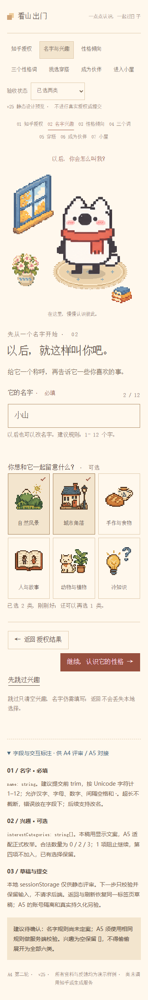
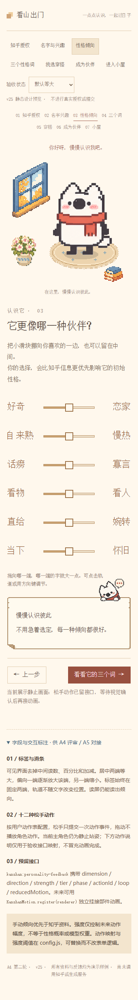
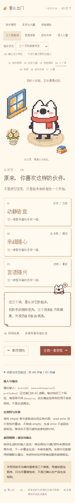
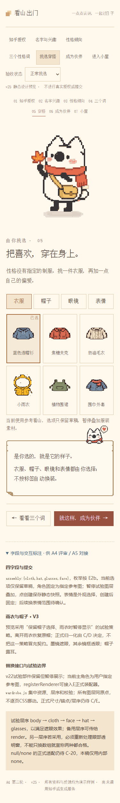
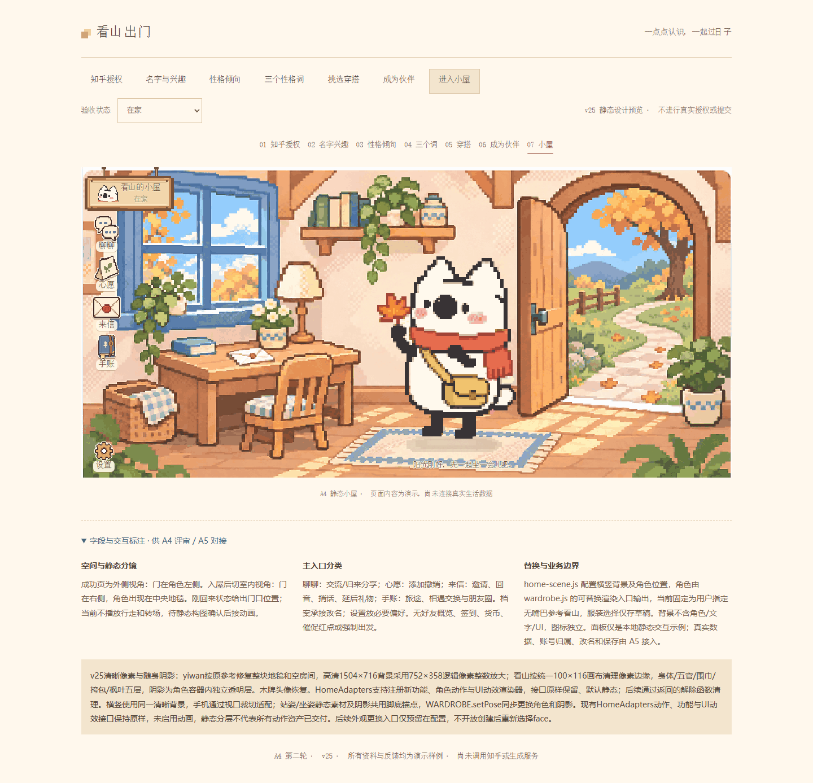
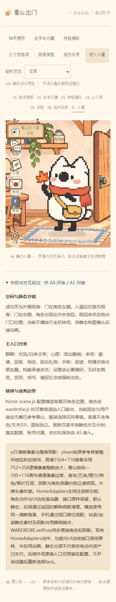
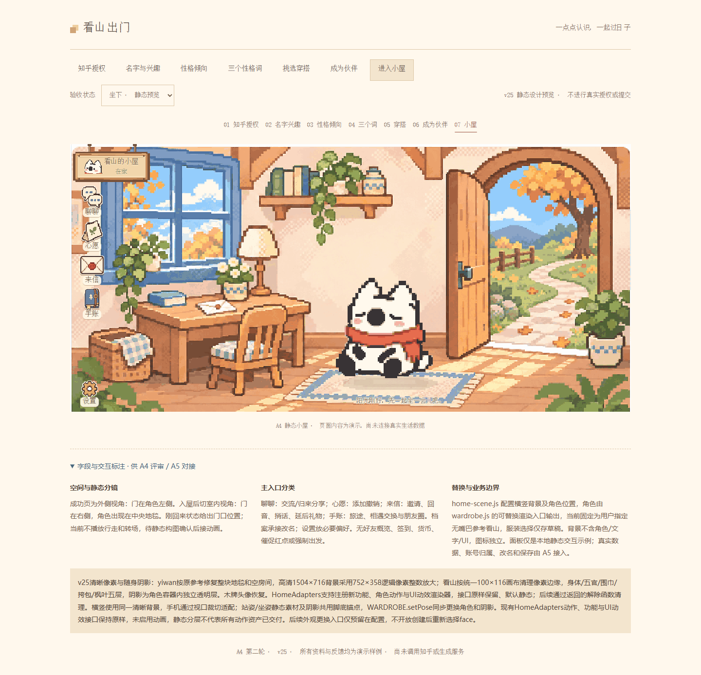

# A4 · 领养页线框与字段标注 · v1

交付日期：2026-11-18。提交者：A（A4）。设计迭代：v25。状态：提交静态评审，未验收合并。

## 本次交付

交付领养流程的可点击静态线框、逐页字段/状态说明和桌面/手机小屋视觉。A4 与 E 视觉并行；真实领养业务为 A5，不作为本次静态稿完成的声明。生产页面、服务端、契约和其他成员模块均未修改。

预览源码：[app/(a)/_design/a4-v25](../../../../app/(a)/_design/a4-v25/README.md)。该目录属于 A；Next.js 私有目录不生成路由。启动和复验方式见其 README。

## 流程与字段

知乎授权 → 名字与兴趣 → 六组性格倾向 → 三个性格词 → 四键穿搭 → 创建 → 小屋。

| 页面 | 字段与反馈 | 交付边界 |
| --- | --- | --- |
| 授权 | 基础身份及基础资料、收藏、关注、创作；入口/等待/取消/失败/读取/成功/空资料/附加资料失败 | 必须知乎授权注册；本稿通过显式演示按钮切状态，不请求真实接口 |
| 名字与兴趣 | name 必填；六类兴趣，可跳过，选则 2–3 类；非法/超长/第四类/返回保留 | 名字 trim 后 1–12 Unicode 字符及字符范围是建议规则，等待确认；当前数据库契约仍是 6 字上限，A5 接入前需收口，未修改契约；跳过兴趣仍要求名字 |
| 性格倾向 | exploration / social / expression / attention / communication / time 六组双极倾向；键盘、点击与拖动 | 手动倾向优先于知乎资料；居中等大、偏向端放大；动作只发接口事件，无角色动画 |
| 三个性格词 | 恰好三个不同维度标签；生成等待/失败/结果/无资料样例 | PreviewService 为确定性 mock，不是服务端生成策略；全居中择维、默认建议和输入变更失效规则待确认 |
| 穿搭 | assembly:{cloth,hat,glasses,face} | 用户自选；当前仅存草稿，固定参考角色不随选项换装；内部 none 不冒充正式 null 契约。雨衣帽子遮挡规则为试验建议 |
| 创建 | 等待/失败保留输入/成功/进入小屋 | 仅浏览器 sessionStorage 演示，没有服务端建狗、账号隔离或跨设备保存 |
| 小屋 | 在家/出门/返回/坐姿；聊聊、心愿、来信、手账，档案与设置 | 各面板为静态/本地样例，无真实聊天、投递、出行或保存；最终业务仍按团队归属实现 |

逐页字段与交互说明直接显示在预览底部，验收状态在顶部切换。建议参数与未确定策略明确标注，不作为已确认需求。

## v25 视觉与扩展接口

保持温暖像素小屋、悬挂原木名牌和左侧紧凑透明图标。背景与角色分离，修复地毯图纹；高清背景用最近邻放大，不使用 CSS 模糊。站姿拆为身体/五官/围巾/挎包/枫叶五层；坐姿为静态整图，不能视作完整动作资产。

独立透明阴影放在 reference-actor 内，随主形象移动/缩放/移除。WARDROBE.setPose 同步切换站/坐姿与阴影，100×116 画布、footAnchor=[50,107.5]。资源清单见 assets/home/v25-actor-manifest.json。

HomeAdapters.registerFeature/registerActor/registerUIEffect、WARDROBE.registerRenderer 及 KanshanMotion.register 保留解除接口；HomeScene.transition 预留进出门接口。未启用角色动作、转场或 UI 动画。本包只提交 v25，不修改仓库外的 v24。

## 验证与尚未验证

本次在交付目录重新运行：verify.cjs（99 视口组合 + 20 交互/接口）、verify-home.cjs（111 项）、verify-v25.cjs（20 项）、verify-shadow-v25.cjs（30 项）。全部通过；另附 [验证结果](1118-a4-验证结果-v1.json)。仓库 scripts/check-all.sh 四道检查也全部通过（退出码 0）。

未验证：知乎真实 OAuth 与资料读取、真实模型生成、服务端创建与持久化、账号归属/隔离、跨设备一致性、正式换装素材及动作动画。视觉提交评审不等于最终验收，也不等于 A5 已完成。

## 截图

