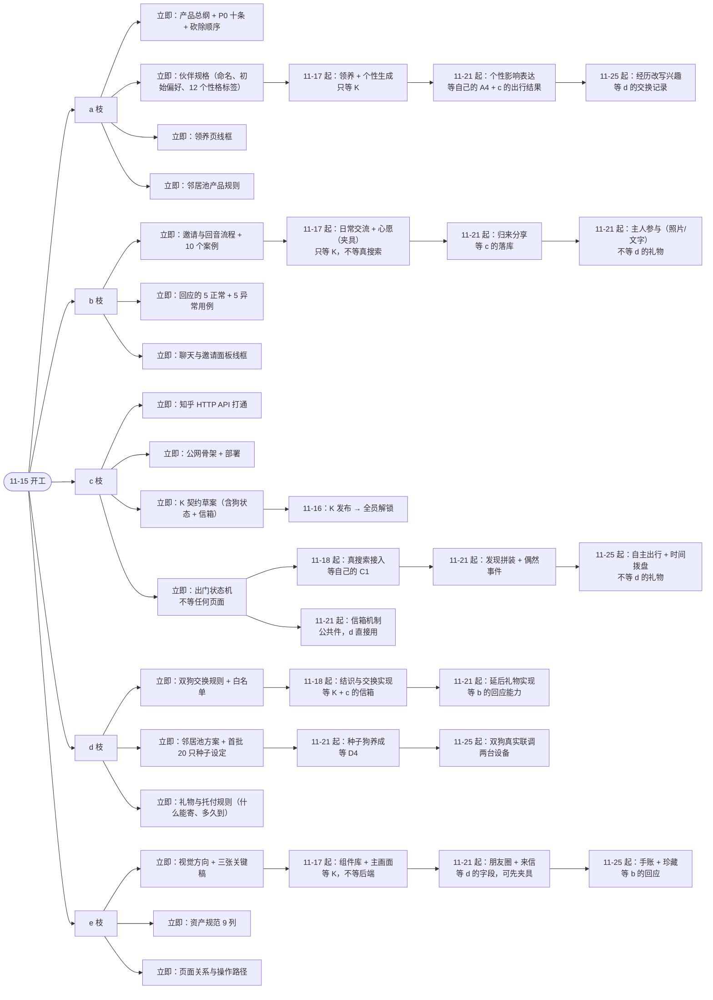

> **11-19最新场景/角色决定：** 等待页采用AI预生成纯像素静态背景＋独立换装角色；两套旧角色停用，以本次用户指定正视图为准。旅途说明已迁入 `team/2026-11-19/a/requests/1119-a-给E-请求-旅途页视觉与行为说明-v2.md`，旧地址仅保留迁移入口。本文已同步修正e2c/e4/e11及形象、尺寸条款；不启动批量生成。

# 看山出门 · 团队实施手册

> 知乎黑客松 S3 · 赛道二「AI × 陪伴与交互」
> 提交窗口 **12-05 10:00 → 12-07 10:00**，我们 **12-05 第一天就交**。
> 本文是给全队看的行动文档。功能依据是《01-功能与交付结构》。
>
> **配套：** 每个功能归谁、决定怎么定下来 → 见《03-功能归属与决策机制》。本文第五部分是个人任务表，03 是归属与决策规则，两份一起看。

---

# 第一部分 · 我们在做什么

## 一句话

**一只刘看山自己过日子。你在旁边看着，它偶尔问你要不要一起；路上认识别的狗，带回来东西，和一份等你回应的邀请。**

开篇 01 就写了四个字：**治愈、低压力**。这两个字决定了后面所有的取舍。

## 核心闭环：邀请与回音

这是整个产品唯一必须成立的循环：

> **它出门 → 带回来发现 → 它发出一个具体邀请 → 你回应 → 你的回应成为它下一次出门的材料**

对应 01 的 **2.4「回应邀请」** 和 **4.4「传递邀请、照片、礼物，等待后续回应」**。

**注意三件事，这是我们的产品立场：**

1. **不回应不惩罚。** 没有红点、没有连续天数、没有进度条、不催。邀请会安静地留着。
2. **回应了关系会长。** 你给的东西会真的进到它下次的旅途里，能被看出来。
3. **「明天还回来」靠的是「世界在等你回话」，不是靠打卡。**

## P0 十条（这就是我们的交付范围）

| # | 做什么 | 对应 01 |
| --- | --- | --- |
| 1 | **领养**：起名、定初始喜好，生成性格标签 | 1.1＋1.2 |
| 2 | **心愿**：告诉它最近想看什么，可撤销 | 2.2 |
| 3 | **自主出行**：不用指令它也会出门 | 3.1 |
| 4 | **沿途发现**：一次带回 3–5 条，至少一条是知乎内容且有可点原文 | 3.2 |
| 5 | **归来分享**：它用一句话讲今天的经历 | 2.3 |
| 6 | **邀请与回音**：它发出具体邀请，你能回应（文字或照片），回应进下一次材料 | 2.4 |
| 7 | **结识与交换**：路上遇到另一只狗，交换发现与近况 | 4.1＋4.2 |
| 8 | **延后礼物**：朋友捎来的东西过一段时间才到，到了在等回应；**礼物有 AI 生成的图标** | 4.4 |
| 9 | **捎话**：写话让狗带给对方的主人，对方在来信里看到并可回 | 4.4「传递邀请」 |
| 10 | **手账回看**：能翻回去看旅途和关系 | 5.3 |

## 砍什么、不砍什么

**已经砍掉的：**

- **5.4 好友概览** —— 整块不做
- **5.1 朋友圈** —— 保留页面，但降级成「只有狗发动态、只有狗之间互动」。人不能发动态、不能点赞留言

**真做不完时的砍除顺序**（从上往下）：4.3 重访 → 3.3 漂流瓶 → 1.3 个性变化的深度（只留标签漂移）→ 5.1 整页删除。

**捎话的降级方式不是砍掉**，是退化成「只能收不能回」——留着看，砍掉写。

**永远不砍这条环**：出行 → 发现 → 归来 → 邀请 → 回应，以及**延后到达**（延迟是 01 的设计重心，正文里出现三次）。

## 时间

- **开工** 11-15 周日｜**冻结** 11-29 周日｜**预留** 11-30 → 12-04 共 5 天｜**提交** 12-05 10:00
- 有效开发时间 **15 天**（11-15 到 11-29）。做不完 P0 十条是正常的，砍除顺序就是为此准备的。

> ⚠️ **两件比代码更硬的事**：报名 **12-04 23:59** 截止，组队 **12-07 10:00** 截止，每人只能加入 1 队。没报名的今天就去报。

---

# 第二部分 · 谁负责什么

| 人 | 负责包 | 额外职责 |
| --- | --- | --- |
| **a** | A 伙伴塑造（第 1 板块） | 队长。产品总纲、范围裁决、**每天唯一合并**、总验收、计划书 |
| **b** | B 主人与狗的陪伴（第 2 板块） | 邀请与回音——**本产品的核心闭环** |
| **c** | C 自主生活与旅行（第 3 板块） | 技术负责人。骨架、部署、K 契约、知乎接入、信箱机制 |
| **d** | D 狗的社交关系（第 4 板块） | **最重的一包**：双狗回合制交换、邻居池、延后礼物 |
| **e** | E 生活记录与呈现（第 5 板块） | 美术负责人。视觉基线、资产、页面、演示视频 |

**每个人纵向切自己的前后端。** 你负责的功能，从按钮到数据库都是你的，不等别人的接口先做完。

**d 这包最重，所以做了两个拆分：**

- **信箱机制交给 c**（属于公共技术件）。d 只管「换什么、怎么算熟悉、礼物怎么来」。
- **邻居池的种子狗由 a 和 d 一起做**（a 出产品规则，d 出实现和养成）。

---

# 第三部分 · 什么时候交什么

## 图一 实施时序（从上往下就是时间顺序）

每一格是一个人在这段时间要交的东西。格子之间是检查点，**不是开工开关**：谁先做完，谁的下游就能提前走。

```mermaid
flowchart TB
    NOW(["开工 11-15 周日"])

    NOW --> W0

    subgraph W0["波段 1 · 11-15 → 11-16 立规矩 · 两天"]
        direction LR
        a0["a · 产品总纲<br/>P0 十条 / 砍除顺序 / 邻居池规则"]
        b0["b · 邀请的写法与回应入口<br/>句式、案例、提交方式（规则见 a 的口径）"]
        c0["c · 骨架 + 部署<br/>IP + 非标端口，陌生人能开"]
        c1["c · 知乎 HTTP API 打通<br/>已确认可行，半小时的事"]
        d0["d · 双狗交换规则<br/>换什么、回合怎么算、白名单"]
        e0["e · 视觉方向<br/>三张关键稿 + 资产规范"]
    end

    W0 --> G1{{"11-16 晚 · 唯一汇合点<br/>K 契约（含狗状态与信箱）+ V 视觉，同时发布<br/>其余三人从这里开始写自己的代码"}}

    G1 --> W1

    subgraph W1["波段 2 · 11-17 → 11-20 各自纵切到「能点开」· 四天"]
        direction LR
        a1["a · 领养 + 个性生成<br/>能建一只有标签的狗"]
        b1["b · 日常交流 + 心愿<br/>能聊、能撤销心愿"]
        c2["c · 出门状态机 + 真搜索<br/>任务跑完、拿回真实发现"]
        d1["d · 结识与交换<br/>出门能遇到另一只狗"]
        e1["e · 组件库 + 小屋 / 旅途主画面<br/>四态齐全"]
    end

    W1 --> G2{{"11-20 · 首次闭环 · 全项目最危险的一天<br/>领养 → 说心愿 → 出门 → 带回来 → 它发出邀请 → 主人回应<br/>跑通一次即可，允许粗糙"}}

    G2 --> W2

    subgraph W2["波段 3 · 11-21 → 11-24 硬化 · 四天"]
        direction LR
        a2["a · 个性影响表达<br/>同主题两只狗说得不一样"]
        b2["b · 归来分享 + 主人参与<br/>回应能带照片和文字"]
        c3["c · 沿途发现拼装 + 偶然事件<br/>3–5 条，都有来源"]
        d2["d · 种子狗养成 + 延后礼物<br/>池子里有真经历的狗"]
        e2["e · 朋友圈 + 消息来信<br/>延后到达的东西在这儿"]
    end

    W2 --> G3{{"11-24 · 每日集成常态化<br/>主干每天可部署，每人每天推一件别人能点开的东西"}}

    G3 --> W3

    subgraph W3["波段 4 · 11-25 → 11-27 串联 · 唯一必须排队的时段"]
        direction LR
        a3["a · 经历改写兴趣<br/>走过的路改变它下次想去哪"]
        b3["b · 边界 + 回应进下次材料<br/>屏蔽主题、回应成为记忆"]
        c4["c · 自主出行 + 时间拨盘<br/>没指令也出门；拨表让延后到达"]
        d3["d · 双狗真实联调<br/>两台设备两个账号，录屏"]
        e3["e · 手账 + 珍藏<br/>能翻回去看关系"]
    end

    W3 --> G4{{"11-27 · 一次完整旅程跑完<br/>能录成 90 秒素材，含延迟到达"}}

    G4 --> W4

    subgraph W4["波段 5 · 11-28 → 11-29 回归、砍范围、冻结 · 两天"]
        direction LR
        a4["a · 总验收 + 遗留清单 + 冻结"]
        b4["b · 陪伴与回应回归"]
        c5["c · 稳定性 + 备份恢复 + 密钥"]
        d4["d · 社交权限与一致性回归"]
        e4["e · 视觉与操作整体回归"]
    end

    W4 --> G5{{"11-29 周日 · 冻结<br/>此后只修阻断缺陷，不加功能"}}

    G5 --> R["预留 5 天 · 11-30 → 12-04<br/>a 计划书 / e 90 秒视频 / c 线上值班 / d 继续养邻居池<br/>12-03 两人独立做一次提交演练"]

    R --> SUB(["12-05 10:00 提交<br/>窗口 12-05 10:00 → 12-07 10:00"])
```



**整张图只有两个真正的汇合点：11-16 的 K+V 基线，和 11-27 的完整旅程。** 其余都是「谁先做完谁先走」。

## 图二 并行树（我现在能不能动手）

这张图不看时间，只回答一个问题：**我现在能不能开工？** 每根枝最左边是开工就能做的，越往右越依赖上游。



## 不用排队的地方（这几条最重要）

- **b 不用等真搜索。** 聊天、心愿、邀请与回音面板用假数据都能做完，c 的真搜索到位后只换数据源。
- **b 的主人参与不用等 d 的礼物。** 「回应邀请」和「回应朋友送来的东西」是两个入口、同一个提交能力，b 做一次，d 复用。
- **e 不用等 d 和 b。** 朋友圈、来信、手账都只有四种状态（新到 / 待回应 / 已回应 / 无回应），按 K 的字段先做静态，数据一到就亮。
- **c 的自主出行不用等社交。** 它依赖「出门任务 + 定时触发」，跟 d 的交换无关，两条线同时写。
- **c 的信箱机制可以先用假数据自测。** 塞两条假交换记录进表，验证幂等和不重复投递，不用等 d。

**真正必须排队的只有 11-25 到 11-27**：双狗真实联调要等交换（d）和信箱（c）都完成；延后礼物要等「回应」能力（b）成立。**这三天之前谁都不许闲着，这三天里允许等。**

---

# 第四部分 · 五条不变量（判断跑偏的唯一标准）

这五句是整个产品的中心。**任何人拿自己的模块对照，30 秒能自检。** 只有 a 能改这五条。

| # | 不变量 | 检测问句（答"会"就是跑偏了） |
| --- | --- | --- |
| 一 | **狗是主体，人是客人** | 这个界面上，有没有可能让一个人直接操作另一个人？ |
| 二 | **一切都不是即时的** | 跨到「另一个主体」的东西，有没有经过至少一次投递或等待？ |
| 三 | **不回应不惩罚** | 做了这个，用户不回应会看到红点、指标、连续天数、进度条、催促吗？ |
| 四 | **真实来源可点，假数据显形** | 这段话如果不是这条请求现拿的，界面上写清楚了吗？ |
| 五 | **一只狗一个主人，一段经历一个出处** | 有没有可能两条路写出同一个事实的两个不同版本？ |

**第五条最容易被忽视，但在本项目里最致命。** 双狗交换、延后礼物、捎话三条线都会写「关系里发生过什么」。同一次相遇在两台设备上显示成两个版本，用户会觉得被骗。所以：**关系类的事实由 d 的模块独家写入，别人只读。**

**「朋友圈只有狗之间互动」不是临时限制，是第一条的推论**——人不发动态，因为狗才是主体。

## 三层，别混着谈

**这是全篇最容易吵起来的地方，所以定义要精确。** 同一个功能有三个层次，分层标准是「这个决定会不会让别人返工」：

| 层 | 是什么 | 谁定 | 示例（以「邀请」为例） |
| --- | --- | --- | --- |
| **一、不变量** | 违反了就不是这个产品 | **只有 a** | 不回应不惩罚 |
| **二、判断口径** | 怎么算违反不变量；会牵动别人的模块 | **只有 a** | 邀请永不过期 / 未回应时它自己去 |
| **三、具体值与实现** | 填什么、怎么呈现、怎么落地 | **功能负责人** | 邀请说什么话、几个字、什么语气、卡片放哪、提交怎么做 |

### 唯一的分界线：别人的模块会不会跟着改

**自检问句 ——「我定的这条，负责人违反了会怎样？」**

- 后果是**别人也得返工** → 它是第二层，**a 定**
- 后果只是**他自己那块不好看** → 它是第三层，**负责人自己定，a 不该管**

举个对照，两条看起来很像、归属完全不同：

| 决定 | 别人要跟着改吗 | 归谁 |
| --- | --- | --- |
| 邀请**永不过期**，未回应就它自己去 | 会。d 的出行逻辑、e 的界面状态都要改 | **a**（第二层） |
| 礼物**跨一次出行**才到 | 会。c 的信箱、e 的延迟占位都要改 | **a**（第二层） |
| 邀请的**句式**和**语气** | 不会。只有 b 的界面 | **b**（第三层） |
| 邀请卡**放第几个位置** | 不会 | **b**（第三层） |
| 性格标签**怎么映射装束** | 不会 | **a 和 e 各自那块**（第三层） |

### 为什么第三层现在不要定

**第三层现在定是白定。** 一条规则好不好，要看见跑起来的界面才知道；没写代码时定的模块规则，11-24 大概率全被推翻。放权不是省事，是因为**提前定等于提前猜**。

### 真正要防的事

不是第三层的分歧，**是有人从第三层里悄悄动了第一层或第二层**——为了自己方便让某个东西即时到达（违反不变量二），或者自己加字段绕过 K 里的那个。这两件事才要防。

### 第二层的清单（a 要盯的就这些）

跨模块的**时间语义必须统一**，否则界面会自相矛盾：a 认为三天前算新、d 认为算旧。11-16 的 K 里要有一张三行的表，至少覆盖：

- **什么算「到达」**：礼物、捎话、交换分别在哪一刻算送达
- **什么算「已读」**：打开算、还是停留算、还是点开内容算
- **什么算「新鲜」**：`live` / `cache` / `fixture` 的时间边界

## 每周一次的「隔壁 10 分钟」

放权不是放任。每个模块都有个专属风险，只有隔壁的人看得见——自己天天看已经麻木了。

每周一次，各 10 分钟，把自己的三条规则讲给隔壁那个人听，**只问一句：这跟你的模块打架吗**。

配对固定：a↔b、b↔d、d↔c、c↔e、e↔a。**不写文档，不出纪要，每周总共 50 分钟。** 目的是让跑偏在当天被发现，而不是在联调时。

---

# 第五部分 · 各自的任务表

**读法：** 「立即」= 开工就能动手。「等」= 拿到前置产物才开工，括号里写清等谁的哪一件。标「夹具」的允许先用假数据，11-24 前必须换真数据，且界面如实显示来源。

## a · 伙伴塑造 + 产品总纲

| 编号 | 任务 | 现在能否开始 / 精确前置 | 交付物（别人能打开的东西） | 验收 | 截止 |
| --- | --- | --- | --- | --- | --- |
| a1 | 产品总纲：**五条不变量** + P0 十条 + 砍除顺序 | 立即 | R 一页，群置顶 | 任何人拿检测问句问自己模块，能当场判断 | **11-15** |
| a1b | **跨模块边界表**：哪两个模块之间有数据流过、各自独家写什么 | 立即 | 一张表 | 每个事实只有一个写入方，无重叠 | 11-16 |
| a1c | **第二层判断口径**：延后多久算延后、邀请会不会过期、未回应怎么处理 | 立即，**只有 a 能定** | 一页口径 | 每条都写明「会影响谁」，负责人照它实现 | **11-18** |
| a2 | 伙伴规格：命名、初始偏好、12 个性格标签、标签如何影响表达 | 立即 | 数据字典一页 | c 能建表，d 能交换，b 能造句 | 11-16 |
| a3 | 邻居池产品规则：池子从哪来、匹配偏好、预置的怎么标注 | 立即，与 d 合并产出 | 规则一页 | d 能照做，e 知道界面怎么写标注 | 11-16 |
| a3b | **收藏夹目的地规则**：收藏内容怎么变成目的地、哪些算它自己选的 | 立即 | 规则一页 | c 能照做；界面能分清来源 | 11-18 |
| a4 | 领养页线框 + 字段标注 | 立即 | 线框 | 与 e 的视觉并行，不互相等 | 11-17 |
| a5 | 领养 / 命名 / 个性生成实现（前后端） | 等 K、e 的资产路径 | `/adopt` 能建一只有标签的狗 | 两浏览器各自独立，刷新保留，不越权 | 11-20 |
| **a5b** | **`/home` + `/trip` 真实路由与 React 外壳**（11-19 新增）：把静态稿变成真页面。`/trip` **同一个路由按 `trip.status` 切两态**——`running` 出**旅途过程页**（等待页：场景画＋角色＋一句状态话，**没有发现列表**，因为 finds 还没生成）；`done` 出**旅途归来页**（路景＋归来一句话＋发现列表 3–5 条） | 立即；e 的组件与素材到了就换 | 两个能打开的真页面 | 手机 375×667 一屏放得下；四态齐全（空/加载/失败/降级）；入口按《入口表》接上；**无倒计时、无实时地点**；`prefers-reduced-motion` 去动效但信息不丢 | **11-19 先出 `/home`，11-20 出 `/trip`** |
| a6 | 个性标签影响表达 | 等 a5、c 的出行结果 | 同主题两只狗的可解释差异 | 差异体现在「选了什么」，不只换语气 | 11-24 |
| a7 | 经历改写兴趣（1.3） | 等 a6、d 的交换记录 | 走过的路改变它下次想去哪 | 三次出行后同类主题选择明显不同 | 11-27 |
| a8 | **每日唯一合并 + 主干守护** | 等 c 的部署可用，此后每天 | 每天 main 可部署，tag 可回滚 | 任何人 30 秒说出线上是哪个 tag | 每日 |
| a9 | 总验收 + 遗留清单 + 冻结声明 | 等 b / c / d / e 的回归 | 冻结声明 | 阻断缺陷清零，或明确裁减并写进材料 | 11-29 |
| a10 | 计划书 + 提交材料 | 11-28 起随开发积累 | 计划书 PDF | 12-03 演练时能被官方流程接受 | 12-04 |

## b · 主人与狗的陪伴（核心闭环）

| 编号 | 任务 | 现在能否开始 / 精确前置 | 交付物（别人能打开的东西） | 验收 | 截止 |
| --- | --- | --- | --- | --- | --- |
| b1 | **邀请与回应规范**（一份 `spec.md`）：好邀请 10 条、坏邀请 5 条（各写明为什么）、好回应 4 条、坏回应 2 条、主人能交什么 | 立即；写法现在就能写，**三条状态的措辞等 a1c 口径** | `app/(b)/invite/spec.md` | 每条都有具体动作；坏例写清为什么坏，c 能直接拿去写提示词 | **今天 11-15** |
| b2 | 回应的验收用例：5 正常 + 5 异常（只写一半 / 图太大 / 重复提交 / 撤回 / 完全不回应） | 立即 | 用例清单 | 每条可复现，是后面回归的底本 | 11-16 |
| b3 | 聊天与邀请面板线框 | 立即 | 线框 | 手机竖屏一屏内能做完 | 11-17 |
| b4 | 日常交流（2.1）+ 心愿表达与撤销（2.2），夹具 | 等 K；不等真搜索 | `/home` 能聊、心愿可撤销 | 每句闲聊不落成长期任务 | 11-20 |
| b5 | 归来分享（2.3） | 等 c 的落库 | 它用一句话讲今天的经历，带出处 | 能点回原文，不许编 | 11-21 |
| b6 | 主人参与（2.4）：回应邀请、上传照片与文字 | 等 b5；不等 d 的礼物 | 回应能提交、能保存 | 不回应也能继续 | 11-21 |
| b7 | 表达偏好与边界 | 等 b6 | 屏蔽主题后不再出现 | 屏蔽优先级高于心愿 | 11-25 |
| b8 | 回应成为下次材料 | 等 b6、a6 | 回应内容出现在下一次出行 | 三次之内能看出因果 | 11-26 |
| b9 | 陪伴与回应回归 | 等 b8 | 回归记录 | 失败不丢输入，重复点击不重复提交 | 11-29 |

**b 今天（11-15）只交 `spec.md` 这一份，不交假数据。** `contracts/fixtures/reply.json` 等界面真要做的那天再让 AI 生成，形状按 `spec.md` 里的三种状态来：**它在等 / 已回应 / 它自己去了**。

**注意第三种状态不是空的。**「它自己去了」是带着这一趟的见闻回来的，界面上应该像一次正常归来，不是缺口或未完成。

## c · 自主生活与旅行 + 技术底座

| 编号 | 任务 | 现在能否开始 / 精确前置 | 交付物（别人能打开的东西） | 验收 | 截止 |
| --- | --- | --- | --- | --- | --- |
| c1 | **知乎 HTTP API 打通**（服务端直接 fetch，不装 CLI） | 立即，已确认可行 | 一条 curl 返回真实结果 | 拿到 Secret 后 30 分钟内出结果 | 11-15 |
| c2 | 公网骨架 + 部署（IP + 非标端口） | 立即 | 一个陌生人能打开的 URL | 每天 24:00 必须活着 | 11-17 |
| c3 | **K 契约基线**：五文件 + 八类实体（含狗状态快照与信箱） | 立即起草，等 a2 / b1 / d1 的最小字段 | `/contracts/` 目录 | 五人都能照它写，一次都不问 | **11-16** |
| c4 | 出门任务状态机 + 700ms 轮询 | 立即，不等任何页面 | 任务能创建 → 执行 → 落库 | 重复请求不重复执行，超时能收尾 | 11-19 |
| c5 | 真搜索接入（3.2 的知乎内容） | 等 c1 + c3 | 关键词 → 真实回答 + 可点原文 | 失败不伪造成功 | 11-20 |
| c6 | 沿途发现拼装（3.2）：风景 / 知乎 / 生活片段，一次 3–5 条 | 等 c5 | 一次出行有 3–5 条发现，都有来源 | 每条都能点回出处 | 11-23 |
| c7 | 偶然事件（3.3）：一次陌生相遇或一个漂流瓶 | 等 c6 | 偶然事件不重复、不硬凑 | 同一只狗短期内不重复同一件事 | 11-24 |
| c8 | **信箱机制**（公共件，d 直接用） | 等 c3 | 交换能落库、能查未读、幂等 | 塞两条假记录能自测不重复投递 | 11-21 |
| c9 | 缓存 / 降级 / sourceMode 打标 | 等 c5 | 三种模式可分别复现 | 断网时降级且如实标注 | 11-24 |
| c10 | 自主出行（3.1）：没有指令也会出门 | 等 c4、c6、a1 的出行规则 | 定时能自己出发 | 不无限重试，重启可恢复或正确结束 | 11-26 |
| c11 | 时间拨盘（**演示件，不是产品功能**） | 等 c10 | 一个把「现在」往后拨的控制 | 拨完延后礼物真的到，界面写清是演示 | 11-26 |
| c11b | **拼装渲染组件**：**四层**叠图 + `image-rendering: pixelated` + 固定锚点 | 等 e2b、d2b | 一个 `Dog` 组件，接受四键装配单 JSON | 同一装配单跨页面跨设备一致；放大不发虚；「不戴」也走叠图不写特判 | 11-24 |
| c11d | 收藏夹接入（P1，见《目的地从哪来》） | 等 OAuth 凭证到位 | 收藏夹 → 目的地 | 拿不到凭证就整条不做，降级路径不受影响 | 11-27 |
| c12 | 稳定性回归 + 备份恢复 + 密钥仅服务端 | 11-28 起，恢复演练可提前 | 恢复演练记录 | 两账号数据隔离 | 11-29 |
| c13 | 提交后线上值班 48 小时 | 12-05 起 | 值班表 | 评审期链接不掉 | 12-07 |
| c14 | **整图合成 + 生图服务 + 三级兜底**（11-16 新增）：`sharp` 叠四张透明 PNG 出 webp；接生图模型；实现重试→狗整图→纯文字三级 | 等 e2b、e11 | 一个生成接口 + 图片落库 | 断网时读的是已有文件不是白屏；连点不重复生成；失败不出现空白框 | 11-22 |
| c15 | **跨设备一致性验证**（11-16 新增）：一台生成，另一台打开 | 等 c14 | 验证记录 | 同一次相遇两台设备显示同一张图；同一份意图不重复生成 | 11-24 |

## d · 狗的社交关系（最重）

| 编号 | 任务 | 现在能否开始 / 精确前置 | 交付物（别人能打开的东西） | 验收 | 截止 |
| --- | --- | --- | --- | --- | --- |
| d1 | 双狗交换规则：换什么（发现 / 近况 / 话题）、回合怎么算、白名单 | 立即 | 规则 + 10 个示例 | 明确写清什么永不交换（主人私聊） | 11-16 |
| d2 | 邻居池：池子来源、匹配规则、首批 20 只种子狗的设定 | 立即，与 a3 合并 | 方案 + 20 份设定 | 任何新用户出门都能遇到一只 | 11-16 |
| d2b | **20 只种子狗的装配单**（20 个 JSON，不用画图） | 等 e2b 部件清单 | 20 个装配单 + 存进 fixtures | 两两肉眼可区分，性格与装束能对上 | 11-21 |
| d2c | **事件池**：`event` 表 + 触发条件 + 30 条首批事件（含冰淇淋这类季节事件） | 立即 | 表 + 30 条带条件的种子事件 | 夏天必出冰淇淋但不每次出；同事件不连续重复 | 11-23 |
| d3 | 礼物与托付规则（4.4）：什么能寄、多久到、不回怎么办 | 立即 | 规则一页 | 无回应不阻断 | 11-16 |
| d4 | 结识（4.1）+ 交换（4.2）实现 | 等 K、c8 | 出门能遇到另一只狗并交换 | 双方事实一致，不串主人隐私 | 11-20 |
| d5 | 种子狗养成：先跑出 5 只有真实经历的狗 | 等 d4 | 5 只性格与经历各不相同的狗在池子里 | 每只的交换话术可区分 | 11-23 |
| d6 | 礼物与托付实现：寄出、延后到达、等待回应 | 等 d4、b6 | 过一段时间到达，到了在等回应 | 幂等，不重复投递 | 11-24 |
| d7 | **捎话实现**：主人写话 → 狗带过去 → 对面在来信里看到并可回 | 等 d6、c8；不等 e6 | 一个人能走完的完整来回 | 种子狗不伪造回复；拉黑生效；话不进狗快照 | 11-25 |
| d8 | 持续来往（4.3）：重访与逐渐熟悉 | 等 d6 | P1，第一个被砍 | — | 11-27 |
| d9 | **双狗 + 捎话真实联调**：两台设备、两个账号、录屏 | 等 d7、c8 | 一段能看的录屏证据 | 交叉刷新一致，不重复送达 | 11-27 |
| d10 | 社交权限与一致性回归 | 等 d9 | 回归记录 | 不读主人私聊，屏蔽生效，举报可用 | 11-29 |

## e · 生活记录与呈现 + 美术

| 编号 | 任务 | 现在能否开始 / 精确前置 | 交付物（别人能打开的东西） | 验收 | 截止 |
| --- | --- | --- | --- | --- | --- |
| e1 | 视觉方向 + 三张关键稿（小屋 / 旅途 / 朋友来信） | 立即，**全员等这一件** | 3 张图 | a 确认构图、色彩、角色方向 | **11-16** |
| e2 | 资产规范：9 列清单 + 命名格式，含 4 种状态变体 | 立即 | 清单表 | c 能照抄路径，不用回来问 | 11-16 |
| e2b | **换装部件与锚点规范**：**四层**结构（衣/帽/镜/脸，共 18 张，含「不戴」透明图）、共享画布、文件名规则 | 立即，与 e1 同时出 | 规范一页 + 1 套最小可跑部件 | d 能照它写四键装配单；c 能直接叠图不用调偏移 | **11-18** |
| e2c | **旅途页备用静态素材**（11-18 用户改）：**单张整图 8–12 张**，覆盖 6 个地点名（清单见 e11 槽位）；**AI提前生成纯像素风背景，不含角色/阴影/文字/UI**；显示比例由E4定义，源图按容器与像素网格输出，不强制1200长边；前端独立叠新角色及换装。**不做场景分层拼装**（原「远景/中景/地面/道具约 30 张」作废） | 等 e2 的命名与尺寸约定 + e11 的地点清单 | 素材文件 + 一张地点名→文件对照表 | 6 个地点名各有一张可用图；同一地点两次出行用同一张（不重新生成）；断网能开 | 11-22 |
| e3 | 页面关系与核心操作路径 | 立即 | 一张流程图 | 无死路，打开即用，不设注册墙 | 11-17 |
| e4 | **组件库 + 旅途页视觉规范与素材**（11-19 用户改：**页面实现归 a，见 a5b**；小屋外壳归 a，见 a5）。按 [请求区旅途页视觉与行为说明v2](requests/1119-a-给E-请求-旅途页视觉与行为说明-v2.md) 做（仓库根路径 `team/2026-11-19/a/requests/1119-a-给E-请求-旅途页视觉与行为说明-v2.md`），**过程态和归来态各一套布局说明**：过程态＝场景画＋角色＋一句状态话；归来态＝路景＋归来一句话＋发现列表。**不要倒计时、不要实时地点** | 等 K、e1；不等任何后端 | **可复用视觉组件 + 两个状态的布局规范**（不交页面） | a5b 能照着装出页面；手机 375×667 一屏放得下；无倒计时/进度；`prefers-reduced-motion` 去动效但信息不丢 | 11-20 |
| e5 | 对领养页、聊天页、邀请面板提供视觉规范与一致性支持（11-17 用户重申纵切：领养含授权、性格调节、穿搭的页面与前后端由 a 实现；聊天与邀请由 b 实现） | 等 e4 + a4、b3 的线框 | A/B 可采用的视觉与组件支持、视觉核对意见 | 手机竖屏操作无阻碍；不由 e 接管 A/B 页面业务实现 | 11-23 |
| e6 | **消息与来信（5.2）+ 捎话界面** | 等 d1、d3 的字段；可先夹具 | 页面可用 | 「在路上」的延迟状态看得懂；捎话入口一屏可达 | 11-25 |
| e7 | 旅途手账（5.3）+ 珍藏 | 等 b6 | 手账页 | 能翻回去看旅途与关系 | 11-26 |
| e8 | 朋友圈（5.1）降级版：**只有狗发、只有狗互动** | 等 e6 | 页面可用 | 界面上没有人的点赞/留言入口 | 11-26 |
| e9 | 视觉与操作整体回归 | 等全员 | 问题清单 | 目标屏幕无阻碍，问题闭环 | 11-29 |
| e10 | 90 秒视频分镜 + 录屏 + 成片 | 11-28 起写分镜，12-01 录 | 分镜 → 录屏 → 成片 | 12-03 前成片 | 12-04 |
| e11 | **生图提示词规范**（11-18 用户补）：**必须分三套模板**——① `gift` 礼物图标 64×64、**背景透明**、无场景；② `moment` 朋友圈图 1200 长边、走现有 SOP；③ `scene` 旅途页AI预生成纯像素背景，不含角色/阴影/文字/UI，源图按E4容器比例和像素网格输出（不强制1200长边）、**视角固定平视**、槽位**只允许填地点名**（附 6 个地点名的固定清单，e2c 按它出图）。每套写全：模板全文（画风段/构图段写死）+ 槽位清单 + 枚举边界 | 立即 | 规范一页（三套模板） | c 拿着它不用回来问一个字就能拼出请求；三套模板互不混用 | 11-19 |
| e12 | **图库与尺寸落地**（11-16 新增）：18 张部件 → 合成整图样例；礼物图标 64；朋友圈图 1200 | 等 e2b | 样例 + 规格 | 拿一个装配单能渲出整图，拿那张整图能喂出模型结果 | 11-22 |

---

# 第六部分 · 四条协作硬规矩

这四条比任何功能都重要，它们决定「出错了能不能当天修好」。

**一、主干永不坏。** c 负责的线上 URL 每天 24:00 必须活着。坏了超过 2 小时，a 直接下令回滚到上一个 tag，当天不许再合主干。所有人从 11-17 起只往共享主干合并，**不允许出现「我本地那份才是对的」**。

**二、契约只由 c 改，改动 24 小时内必须生效。** 改字段先在群里贴 diff，然后只加不删——旧字段留到 11-29 冻结后再清。这样任何一个人改结构，另四个人最多被卡一天。

**三、每人每天推一件别人能点开的东西。** 没推等于没做。文档、设计稿、页面、接口、一个能跑的脚本都算，但**「今天研究了一下」不算**。

**四、假数据必须显形。** 夹具和预置种子狗，UI 上如实写出来。这条不商量——**尤其种子狗，装成真用户养的，是这个产品最容易被戳穿的地方。**

## 每天 15 分钟怎么开

每人只说三句，不许展开：**昨天交了什么东西（给链接）／今天准备交什么（第一个动作）／卡在哪（等谁的哪一件）**。

a 当场判三件事：今天的合并做不做、谁的任务转给谁、P1 要不要再砍一个。

## 冻结之后只修阻断缺陷

阻断只有五种：**主流程走不完、越权看到别人的数据、重复投递、伪造真实用户内容、泄露密钥。** 其余一律进遗留清单。

## 让每个人都满意

**满意的来源不是达成共识，是署名和看得见的交付。** 三条：

1. **每个任务编号署名到人，不写「团队」。**
2. **每人每天推一件别人能点开的东西。** 同时解决「进度可见」和「有成就感」。
3. **a 只否决，不代做。** a 可以说「这个不做」，但不能说「这块我来改」。一旦 a 开始替别人写代码，那个人就从负责人变回执行者。**代价是 a 要接受别人的东西比他亲手做的差一点。**

---

# 第七部分 · 已经查实的技术定论

**这一部分不需要再研究，照着做。**

## 知乎能力：服务端直接 HTTP 调用

`zhihu-cli` 只是命令行外壳，底层是标准 REST，任何语言都能调。鉴权两个头：

```
Authorization: Bearer <Access Secret>
X-Request-Timestamp: <秒级 Unix 时间戳>
```

| 能力 | 地址 | 当日额度 |
| --- | --- | --- |
| 知乎搜索 | `GET https://developer.zhihu.com/api/v1/content/zhihu_search` | 5000 / 天 |
| 全网搜索 | `GET .../content/global_search` | 5000 / 天 |
| 知乎热榜 | `GET .../content/hot_list` | 100 / 天 |
| 直答 | `POST https://developer.zhihu.com/v1/chat/completions` | 100 / 天 |

- 知乎搜索 `Count` 最大 10。返回里 `Url` 是可点原文，`ContentText` 是摘要
- **挑内容用 `AuthorityLevel`（1 低—4 超高）和 `VoteUpCount` 排序**，别让 AI 判断谁可信
- 直答是 OpenAI 兼容格式，`stream: false` 拿完整结果更省事
- Access Secret 在 <https://developer.zhihu.com/profile> 生成，**只放服务器环境变量，不进代码、不进仓库**
- 错误码：`20001` 鉴权失败、`30001` 频率限制、`10001` 参数错误。**遇到 30001 不重试，直接降级并如实标注来源**

**c 的第一条命令**（拿到 Secret 后 5 分钟验证整条链路）：

```bash
curl -sG 'https://developer.zhihu.com/api/v1/content/zhihu_search' \
  --data-urlencode 'Query=想看雪' \
  -d 'Count=3' \
  -H "Authorization: Bearer $ZHIHU_ACCESS_SECRET" \
  -H "X-Request-Timestamp: $(date +%s)"
```

返回带 `Url` 的 JSON 就是通了，后面全是写代码。

## 部署：IP + 非标端口

官方对提交物的要求只有一句「提供**公网可访问**的线上 Demo 链接」，OAuth 是「推荐」不是必须。FAQ 明确「推荐使用云主机部署」。

**不用 AIWorks**：它限定「前端 + Node 后端、不含数据库写入」，我们要写 SQLite 不满足；而且它部署后先给带 `preview` 的预览地址、仅作者本人可访问，**内容审核通过前拿不到正式公网链接**，审核时长无人承诺。12-05 要交一个评委能直接打开的链接，不能押在不可控的审核上。

**用已经跑通的 IP + 非标端口**，顺便绕开 ICP 备案。

**代价提前接受：** 链接带端口不好看，微信内可能提示不安全。**解法是在计划书和视频里用短链或二维码包一层**，别指望这段 URL 本身好看。

## 目的地从哪来：心愿 + 收藏夹

「它去哪」有三个来源，对应 3.1「围绕主人心愿、自身兴趣、朋友牵挂行动」：

1. **主人的心愿（2.2）** —— 主要来源，永远可用
2. **它自己的兴趣** —— 来自性格标签和过往经历
3. **朋友的牵挂** —— 来自双狗交换和捎话

**关于知乎收藏夹（2026-11-14 查实）：**

`zhihu-cli` 确实提供收藏夹接口：`GET /api/v1/user/favlists`（收藏夹列表）、`GET /api/v1/user/favlist_contents`（收藏夹内容，需 `FavlistUrlToken`）、`GET /api/v1/user/collections`（近期收藏，无分页）。**所以读收藏夹这件事是真的，不需要新做功能。**

**但有一个硬限制，必须知道：**

| 身份 | 怎么鉴权 | 能读到谁的收藏 |
| --- | --- | --- |
| 只有 Access Secret | `Authorization: Bearer <secret>` | **只有这个 Secret 所属账号自己的收藏**（也就是我们自己的账号） |
| 要读访问者的收藏 | 额外传 `X-OAuth-Token` | 该用户完成知乎 OAuth 授权后的收藏 |

**而且 `zhihu-cli` 本身不发起 OAuth**，它只用自己的账号。要读用户的收藏，必须自己走一遍 OAuth。

**还有一个时间上的坑，比接口本身更要紧：** 官方说明里，OAuth 的 App ID / App Key 是「项目创建后由赛事页面分配」，而「创建项目」被放在**作品提交入口开放之后**（12-05），**没有说明开发期间怎么提前领**。也就是说——**我们很可能在 11-29 冻结前拿不到 OAuth 凭证，没法真机联调。**

**所以结论：**

- **P0（必须有）：** 目的地用**心愿 + 性格标签 + 朋友牵挂**。这条路不需要 OAuth，永远可用，占了 3.1 的全部产品意义。
- **P1（有余力才做）：** 收藏夹接入。**先做代码和配置模板 + Mock 测试，凭证一到就联调。拿不到凭证就整条不做，P0 不受任何影响。**
- **绝对不要**把「读收藏夹」排成 P0 的依赖项——它卡在一个我们控制不了的发证时间上。

**还有一个产品点要 a 拍：** 收藏夹里存的是**知乎内容**（回答、文章），不是「地点」。要变成「去某地玩」，中间需要一步提取（从收藏内容里抽出地点、主题或氛围）。这一步写进 a3b 的规则，并且**界面上要能分清「这个目的地来自你的收藏」还是「它自己选的」**（不变量四）。

**如果凭证在 11-29 前没到手，收藏夹这条整条不做，用 Mock 演示 + 在计划书里如实写明「设计为可接入，凭证未到位」。** 这不是缺陷，是诚实披露。

---

# 第八部分 · 形象系统

> **11-19最新角色基准：** 使用用户本次指定的刘看山无服饰正视图；96×96试验角色与100×116 reference-actor均停用。正视图原样参考附件与旅途新说明见 `team/2026-11-19/a/requests/`。小屋、旅途共享新底身、同一装配单与渲染入口；底身/衣帽镜/表情的画布与脚底锚点按新图重定，不修改Assembly契约。

## 一条总原则：角色绝不生成，只拼装

**角色要求「个体一致」——同一条狗必须永远是同一只。** 扩散模型保证不了这一点，而一旦它变了脸，「同一只狗陪着我」的设定当场崩掉。

**换装把这个问题消掉了：形象 = 部件组合 + 参数。** 同一个组合永远渲染同一结果，一致性 100% 而不是 95%。性格标签还能映射成默认装束（喜欢安静的狗默认戴围巾）。

**为什么选像素风：** 一是它可以是治愈的，温暖来自配色和构图；二是**错误看得见**——真实风格生成图里歪脸、多余手指、光影不合理，零经验团队审不出来；像素风由有限方块组成，错了就是错了。**对 15 天零经验团队，错误可发现性比画面精美度重要得多。**

## 四层结构（顺序不能乱）

> **11-16 改：体型、配色、花纹三层删除。** 刘看山 IP 只有一种体型与一套配色，那是边界不是工期。
> 删键而不是收窄成单值枚举，因为 schema 层只对**键数**有强制力；留着单值字段，d 直接产 JSON 时能填错而库不拦。
> 装配单从六键变四键，`base` 与 `skin` 两个键删除，写法见 `contracts/types.ts` 的 `Assembly`。

| 层 | 内容 | 数量 |
| --- | --- | --- |
| 2 服装 | 上衣 | 6 件 |
| 3 配饰 | 帽子 / 墨镜 | 各 4 件（含「不戴」，见下） |
| 4 脸 | 按新正视图的脸部设计制作，不沿用旧素材嘴部 | 4 种：开心 / 累 / 期待 / 在等回应 |

**脸仍然单独一层，且叠在服装之上**——否则一戴墨镜就看不见它。但 11-16 起它**不再随状态变**：是领养时定下的身份，不是情绪状态。原先「朋友的东西到了，在等你」靠表情层传达，这一句的设计落点没有了，改由文案和界面状态承担。

**「不戴」要占一张图。** 帽子 4 件、墨镜 4 件里各含一张**全透明 PNG**。它必须存在，否则渲染器（`c11b`）和生图服务（`c14`）都要写一遍「如果是 none 就跳过这一层」的特判，两处特判两处都能写错。放一张透明图进去，两边统一当成「叠一张图」，零特判。

总量 **18 张部件**（衣 6 + 帽 4 + 镜 4 + 脸 4），组合 **384 种**。

**20 只种子狗靠它区分够用，但要排得用心。** 小头像尺寸下衣服细节会糊，能认的只剩「帽子轮廓 + 墨镜 + 脸」。给 d 一条可执行的做法：**同款衣服不超过 4 只，帽子尽量不重复。** 这不是新规矩，是把 `d2b` 那条「两两肉眼可区分」的已有验收落成动作。

## 三条硬约束

**一、所有部件共用按最新正视图确定的画布（不预设64×64、96×96或100×116），靠锚点对齐，不做后期位移。** 帽子的 PNG 里狗头位置是空的，帽子就画在头上该在的位置，换上去直接叠。

不做这条会怎样：换一件衣服要手调一次偏移，18 部件 × 4 层 = 组合爆炸，**而且没有任何自动化检查能发现**。

**二、配色只用 CSS filter 调场景天幕，狗不用。** 11-16 起狗的配色跟着 IP 走、不再变化，这条对角色失效；但**场景的时段与天气仍靠 filter 调**，那部分照旧，不要整条删掉。

**三、文件名带层号**：`layer2-cloth-hoodie.png`，排序即渲染顺序。

## 渲染

一个固定尺寸的 div 叠四张图，**`image-rendering: pixelated` 是命门**（放大不发虚）。

组件只接受一个 props：**装配单 JSON**

```
{ cloth: 'hoodie', hat: 'beanie', glasses: null, face: 'hopeful' }
```

**存库、进快照、传给对方，都是这个 JSON，不是图片。** 这是跨设备还原「对方那只狗长什么样」的唯一办法。

## 两条路：拼接与生成（11-16 新增）

**这不是二选一，是各管一段。** 曾经有人把它理解成「拼接 vs 生图」选一个——错了。

| | 路 A · 拼接 | 路 B · 合成整图 + 生成 |
| --- | --- | --- |
| 干什么 | 把四张部件叠成实时画面 | 叠成一张位图，喂给生图模型当参考图 |
| 什么时候 | 每次渲染 | 一次生成时 |
| 产物 | `<Dog>` 组件渲染结果 | 一个图片文件 + 库里一个路径 |
| 断网 | 正常 | 读已存的静态文件，正常 |
| 成本 | 零 | 每张要钱 |
| 对应任务 | `c11b`（**保留，不砍**） | `c14`（新增） |

**交接点就是那张位图。** 路 A 渲出来的图，就是路 B 喂给模型的东西——所以「模型知道这只狗长什么样」不靠文字描述，靠直接给它图，而那张图和界面上是同一只，因为它来自同一套部件。

**这一条决定了路 B 不能绕开路 A。** 谁想跳过拼接、直接用文字提示词描述狗的外形，就是在造第二套形象系统，同一次相遇会出现两个长相。

完整 SOP 见 `team/2026-11-16/a/1116-a-生图SOP与架构-v1.md`。其中角色参考图用于含角色的归来照片/朋友圈用途；等待页scene是空场景，不把狗送进背景生成。只复用风格固化、后处理、校验、保存流程。

## 场景：按「是不是每帧都在变」选路（11-19等待页方案收口）

**等待页已定：AI预生成纯像素风静态背景＋独立换装角色。** 不使用含角色整图替代换装；预生成、保存后复用，页面不现生成。背景与角色分别渲染不是恢复c11c远/中/近场景合成。场景可同图裁切或两态分别出图；辅助句可选，不承诺结果、不暗示实时行踪。先交静态样张，不把走路或背景连续后移/轮播列为本轮必交。

过程375×365可用750×730，归来375×260可用750×520或同图等比裁切；尺寸随最终375×667布局复核，不能拉伸。8—12张/六地点是既有计划，不表示现在自动启动批量生成；先核一张背景与新角色换装合成样张。

**原来这张表是按「场景数量」分路的，那是错的**：分路的依据不是多少张，是**这张图需不需要每时每刻变化**。

| 这张图要变吗 | 做法 | 例子 |
| --- | --- | --- |
| **每帧都在变**（地面滚动、角色动作、逐帧位移） | **代码画**（CSS + SVG + 精灵位移），绝不能靠生成 | 走路时脚下的地面、角色喘气 |
| **换一张就够**（同一个画面，换背景） | **静态素材**，AI 提前生成、固化成 PNG | 旅途页的阿尔卑斯山 / 故宫 / 便利店门口；小屋的房间 |
| 要**组合出变化**（同一地点换天气、换时段、换道具） | 分层拼装 | ⚠️ **11-18 已砍**：原 e2c 的 30 张分层素材作废，`c11c` 场景合成器删除。理由：没有契约实体消费它，且用户确定旅途页用单张整图 |

**关键澄清：AI 生成 ≠ 实时生成。** 这张表约束的从来是「每次渲染都现生成」（断网白屏、每次不一样、每次都花钱），**不约束「提前生成好存成 PNG 的静态素材」**。后者断网能开、永远同一张、成本一次性，是允许且推荐的。

**一致性怎么保证（不再靠拼装）**：同一张 PNG 重复使用 + 生图 SOP 第 6 步的后处理（降采样 → 量化到固定色板 → 最近邻放大）。所以「同一棵樱花树每次都一样」这条仍然成立，只是靠固定素材而不是靠部件组合。

**「天热了想吃冰淇淋」这类不是生成，是规则抽卡：** 一张 `event` 表，每条带触发条件（季节 / 时段 / 天气 / 兴趣标签），出门时过滤后抽一条。能保证「夏天一定会出现冰淇淋，但不每次都出现」，成本为零。一张冰淇淋中景板可以被三个事件复用。

## 如果确实要生图：没有现成 skill，四层控制

**先给查证结果：没有现成的 skill 能替你生图，也没有能锁画风的。** 本地 skills 和插件库都没有图像生成条目；官方给的 800 美元是看山工作台的 Agent 算力 + zhihu-cli 额度，**不含生图能力**。真要用得自己接服务，**这笔钱走自己预算**。

四层控制，叠起来才叫可控：

1. **选专用像素风模型**（PixelLab API / Retro Diffusion / Qwen 像素 LoRA）。通用模型做出来只是「看起来有像素感」，放大后网格是歪的。
2. **参考图锁风格**（图生图喂已定的关键稿）。这一层最有效——是「照着这张图画」，不是「用文字描述风格」。
3. **提示词模板锁死，只换场景词。** 画风串一个字都不能改。有人为了让樱花好看顺手加个「唯美」，整批图就跟前面不一致了。
4. **后处理才真正保证一致。** 降采样 → 量化到固定 16/32 色板 → 最近邻放大，代码不到 30 行。不管模型画成什么样，出来都是一个色系。

**顺序不能反：先拼装把「场景够用」解决掉，生成只补最后一小块。** 反过来你会同时面对画风漂移、费用、延迟、审核、失败兜底五件事，而它们都不是核心难点。

**所有 AI 生成的图必须标注。** 这是合规要求，也和我们的诚实原则一致。

## 官方素材怎么用

官方包只有刘看山一个角色：《刘看山动态》是一批 **320×320、20fps、透明 GIF**，《看山三视图》是参考图。**没有别的狗的形象。**

- 官方 GIF 用在**小屋、旅途主画面**这些只有一只狗的大场面
- 朋友圈、来信、交换里的狗用**拼装形象**
- **两套会并存，配色和比例必须对齐**，否则同一条狗会出现两种长相
- 若要像素化刘看山，需明确标注二次创作，**e 须读官方条款原文**，计划书如实披露

---

# 第九部分 · 双狗交换怎么做

这是最重、也最容易崩的一处。**做成「双人在线对话」一定失败**，必须做成回合制。

## 是寄信，不是通话

| | 实时对话（不要做） | 回合制交换（要做的） |
| --- | --- | --- |
| 要求 | 两个人同时在线 | 只要求对方**存在过** |
| 单人可以体验吗 | 不能 | 能 |
| 对方是什么 | 一个正在线的人 | 一份已经存在的狗的状态 |
| 实现 | WebSocket / SSE / 房间 | 一张信箱表 |

**落地形态：** A 的狗出门时读取信箱里 B 的狗留下的东西，留下一句自己的，然后回家；B 下次出门时读到 A 的。

**全程不需要两个人同时在线，但对方确实是另一只真实的狗，由另一个人养大，有自己的性格和经历。** 这仍然是真正的双狗交换——对方的状态是独立产生的，不是我们编的。

## 三张表就够

```
dog            一只狗：名字、主人的匿名 session、性格标签、兴趣
dog_snapshot   状态快照：最近三段经历摘要、当前在等什么、版本号
exchange       信箱：from_dog、to_dog、类型（发现/问候/礼物/捎话）、
               内容、送达时间 deliver_at、已送达 delivered_at、已回应 replied_at
```

`exchange` 一张表同时服务双狗交换、延后礼物和捎话，因为它们在机制上是同一件事：**有人在等另一只狗的东西，到点了才送到。**

## 邻居池：冷启动的唯一解法

新用户第一次出门时，池子里必须有别人的狗，否则 P0 第 7 条当场落空。三个来源，按优先级：

1. **队员养的 5 只**（d 在 11-23 前养成，有真实经历）
2. **其他参赛者的狗**（12-05 之后自然增长，也是人气奖的来源）
3. **预置种子狗 20 只**（兜底，**界面必须标「示例伙伴」**）

匹配规则：先按性格标签和兴趣找相近的，找不到就随机。**不要做「最相似的」这种排序**——两只一模一样的狗交换起来没意思。

## 三件必须防的事

**一、串味（最严重）。** 主人 A 跟自己狗说的私房话，绝不能被 B 看到。所以快照里**只允许**放：性格标签、兴趣、最近经历摘要、正在等什么。**主人的聊天原文一个字都不进快照。** 这条要在 K 契约里写成硬规则，联调时必须专门测。

**二、无限循环。** 礼物不能互相回礼刷屏。每只狗同时在途的礼物上限 3 个，每回合计次上限。

**三、重复送达。** `delivered_at` 必须有幂等保护，同一份礼物不能送两次。

## 演示怎么做

**时间拨盘**：一个把「现在」往后拨的控制。拨一下，`deliver_at` 到点，延后礼物真的送达、真的出现在来信里。

三条纪律：只拨时间不换数据；界面上写清这是演示；**不做纯假动作**（比如放预录动画假装有东西到了，评委连点两次就看得出来）。

**双狗联调必须两台设备两个账号，录屏留证据。** 一个人演示时「对面回话」那一环不能是真的，**所以让 d 或 b 拿第二台手机扮演对方**——这样整条链是真的。

---

# 第十部分 · 捎话怎么设计

「能联系对方狗主人」有三种形态，**只有一个能要**：

| 形态 | 长什么样 | 后果 |
| --- | --- | --- |
| **① 直接聊天窗**（要避免） | 实时打字 | **狗变摆设**；且需两人同时在线，回到死局 |
| **② 预置短语** | 从 10 句里选 | 安全但四句就腻，撑不住「关系会长」 |
| **③ 狗带话**（要做的） | 写一句话交给自己的狗，它下次出门捎过去；对方在来信里看到并可回 | 狗始终在中间，异步，**复用信箱机制，零新增基础设施** |

**选 ③ 不只是省事，是它守住了产品定位。** 01 的主体是狗不是人。一旦人能直接对话，狗就退化成头像。

**「你得通过你的狗才能跟对方说话」本身就是这个产品最独特的地方**——它同时是约束和仪式感，也是「低压力」的实现方式：你不必即时回复，狗会等。

## 落地：信箱表加一个类型

`exchange` 表加 `类型 = 'co_owner_message'`，其余字段完全复用。**c8 那条任务的范围增加约半天，不需要新表、不需要新机制。**

## 四条边界

**一、必须经过一次投递，不能即时到达。** 写完不是立刻出现在对方屏幕上，要等自己的狗下次出门带过去。**这听起来是限制，其实是产品**——它把等待变成了体验，也是 01 里「延后到达」的第三个落点。

**二、对方是预置种子狗时，不能伪造回复。** 种子狗没有真人主人。用户捎话过去，界面显示「这是一位示例伙伴，可能不会回话」，**绝不能让 AI 假装成主人回一句**。踩了就是伪造真实用户内容，直接算阻断缺陷。

**三、内容必须有边界和举报入口。** 长度上限 200 字、敏感词过滤、举报/拉黑路径。**拉黑要同时作用于狗和主人。**

**四、主人的话不能进狗的状态快照。** 和防串味是同一条铁律。狗之间交换的是它自己的经历；主人之间传的话是另一条线，**两条线在数据上必须物理分开**。

---

# 第十一部分 · 验收标准怎么定

下面每一条都给「合格长什么样」和「不合格长什么样」。**不合格的样子比合格的更有用，因为它能当场判死。**

## 范围冻结

一页「做 / 不做」清单，贴群置顶。必须包含：**五条不变量、P0 十条、P1 冷宫、砍除顺序、每条 P0 的一句验收。**

- **合格：** 任何人问「这个做不做」，30 秒内有答案，不用问第三个人
- **不合格：** 「优化整体体验」「完善社交体系」「提升 AI 表现」——出现这种词等于没冻结

## 资产规范（9 列）

文件名（`{场景}-{对象}-{状态}-{宽}w.{格式}`，全小写连字符）、场景、用途、状态变体、尺寸（主画面长边1600、朋友圈图长边1200、头像256、图标64；旅途背景按E4两态容器比例输出，不强制长边1200）、格式（照片 webp、图标 SVG）、体积（单张 ≤300KB、首屏 ≤1.5MB）、来源与版权、存放路径。

**要进清单的四类：** 官方 GIF 动作清单；换装部件 **18 张**（四层结构 + 共享锚点 + 「不戴」透明图）；20 只种子狗的四键装配单 JSON；**旅途页备用静态素材 8–12 张单图**（11-18 改，原「场景素材约 30 张」作废）。

- **合格：** c 打开清单照抄路径就能用，一次都不问
- **不合格：** 「狗.png」「背景图 2.png」，或者只有一个网盘链接没有命名规则

## K 契约基线

一个 `/contracts/` 目录，五个文件：`schema.sql`、`types.ts`、`fixtures/*.json`、`errors.md`、`api.md`。

**覆盖八类实体：** 伙伴 dog、状态快照 snapshot、心愿 wish、旅途 trip、发现 find、交换与礼物 exchange、消息 message、回应 reply。

- **合格：** b / d / e 没看过 c 的代码，靠目录里的东西就能做出页面、接上夹具、跑起来
- **不合格：** 「字段到时候再定」、只有一个 Figma 链接、接口只有名字没有入参出参

## 邀请与回音

**合格的一次邀请包含：** 一个具体动作（「下次看到晾着的被子拍一张给我」，不是「多陪陪我」）、一个理由（接它自己的兴趣）、一个不做的余地。

**三个状态不能少：** 它在等（明确入口）／已回应（能看出它记下了）／没回应（**安静地留着，不催、不惩罚、不显示指标**）。

- **不合格：** 邀请是「要不要一起玩」这种没有具体动作的话；或者不回应就把内容锁住

## sourceMode 诚实标注

| 值 | 什么时候用 | 界面必须写 |
| --- | --- | --- |
| `live` | 这次请求真的打到知乎 | 「刚从知乎看到」 |
| `cache` | 用的是 24 小时内的真结果缓存 | 「几小时前看到的」+ 还能点开原文 |
| `fixture` | 假数据（含预置种子狗） | 「示例内容」加醒目样式 |

**一条规则：数据不是这条请求现拿的，就不能标 live。**

## 形象与场景

- **合格：** 任意两个装配单渲染出的狗肉眼可区分；同一装配单在任何页面、任何设备渲染结果一致；放大 2 倍不发虚；断网仍正常显示；合照是布局出来的不是生成的
- **不合格：** 换一件衣服要手调偏移；同一只狗在两个页面长得不一样；放大后发虚；某个部件位置错位

**任一出现按阻断缺陷处理——因为这类错误用户一眼就能看见。**

---

# 第十二部分 · 名词表

没有开发经历的人，这些词躲不开。三列：词、大白话、在我们项目里是什么。

## 版本与协作

| 词 | 大白话 | 在我们项目里 |
| --- | --- | --- |
| 仓库 repo | 云端一个文件夹，放全部代码 | 只有一个。c 建，a 拥有合并权 |
| 主干 main | 那条「可以拿去给人看」的代码线 | 任何时刻都必须能跑、能打开 |
| 分支 branch | 你拷一份出来改，改完合回去 | 每人每天一个，名字带任务号，如 `d6-gift` |
| 合并 merge | 把你分支上的改动并回主干 | **每天只有 a 合并一次** |
| tag | 给某一刻的主干拍快照起名 | 如 `v0.3-1124`，用于「坏了退回去」 |
| 回滚 rollback | 线上出问题时换回上一个快照 | 30 秒恢复，不许现场查 bug。a 下令 |
| 联调 | 两个人各写的东西第一次接在一起跑 | 最容易出问题。**d 的双狗联调是最大的一处** |
| 回归 | 改完新东西，把老功能再走一遍 | 11-28 到 11-29 整天干这个 |
| 阻断缺陷 | 让作品不能见评委的错误 | 五种：主流程走不完、越权、重复投递、伪造真实内容、泄露密钥 |

## 数据与接口

| 词 | 大白话 | 在我们项目里 |
| --- | --- | --- |
| 契约 contract | 先说好「我给你什么形状的数据」，写成文档当法律 | 有它，做界面的人就不用等做后端的人 |
| 字段 field | 数据里的一个格子 | 一只狗有 name、personality_tags、interests |
| 数据字典 | 所有格子的一张表：叫什么、什么类型、举例 | a2 的交付物，c 照着建表 |
| schema | 数据库的表结构 | 一个 `schema.sql`，启动时自动建表 |
| 样例 JSON | 一段看起来像真数据的假数据 | 每个接口都要附一段，别人拿着就能开工 |
| 夹具 fixture | 提前准备的假数据 | **铁律：用了夹具，界面必须写出来** |
| 状态快照 | 把一只狗拍平成一段可传输的数据 | 双狗交换靠它。**不是实时的，是寄信** |
| 信箱 mailbox | 一张表，存谁给谁留了什么、什么时候到 | 双狗交换、延后礼物、捎话共用 |
| 回合制 | 你寄一次、我下次读到再寄一次 | 不需要同时在线 |
| 装配单 | 一只狗长什么样的一段 JSON | `{cloth, hat, glasses, face}`（11-16 起四键） |
| 错误语义 | 出错时返回什么、界面显示什么 | 要分：没搜到 / 网络断 / 超次数 / 内容不合规 / 被屏蔽 |
| 状态机 | 一个东西有几种状态、允许从哪跳到哪 | 出门任务：待开始 → 进行中 → 完成 / 失败 / 超时 |
| 幂等 | 同一个操作点两次，结果跟点一次一样 | 防重复投递礼物、重复扣搜索次数 |
| 落库 | 数据真写进数据库，刷新还在 | 跟「在内存里、刷新就没」相对 |
| 轮询 polling | 界面每隔一会儿问一次服务器「好了没」 | 每 700ms 一次。更高级的推送（SSE）我们不用 |
| 冷启动 | 全新用户第一次打开，什么数据都没有 | **本项目要害**：新用户的狗出门时池子里必须已有别人的狗 |
| session | 服务器记住「这个浏览器是谁」 | 匿名 session，打开就能玩，不要求注册 |

## 工程与部署

| 词 | 大白话 | 在我们项目里 |
| --- | --- | --- |
| 骨架 scaffold | 一个能跑起来但几乎没功能的空壳 | 先有它，所有人才有地方放代码 |
| 部署 deploy | 把代码放上公网服务器，让别人用链接打开 | 「在我电脑上能跑」不算部署 |
| 环境变量 / 密钥 | 不该写进代码的密码和 API key | 放服务器环境变量。泄露 = 阻断缺陷 |
| 四态 | 页面必须能显示：空的 / 加载中 / 失败 / 降级 | 只做「正常有数据」是最常见的假完成 |
| 组件库 | 按钮、卡片、气泡这些重复小块的统一版本 | 为了五个人做出来的页面像同一个产品 |
| 前后端纵切 | 一个人负责「这个功能从按钮到数据库」的整条竖线 | 反义词横切，横切会让全员卡在等接口上 |

## 本产品专有

| 词 | 大白话 | 在我们项目里 |
| --- | --- | --- |
| **邀请与回音** | 它问你要点什么，你给它一点，这个「给」进下一次 | **核心闭环。不回应不惩罚** |
| **邻居池** | 一批已经养成的狗，供新用户出门时遇到 | 冷启动的解法，也是人气奖的解法 |
| **种子狗** | 池子里的狗，可以是队员养的，也可以是预置的 | 预置的**必须标「示例伙伴」** |
| **时间拨盘** | 把「现在」往后拨的控制 | **演示件，不是产品功能** |
| **漂流瓶** | 3.3 的「捡到漂流瓶」，一种没有具体对方的意外发现 | 必须先有内容，不能是空瓶 |
| **纪念物** | **＝礼物**（4.4）。别的狗送来的东西，不是自己在路上捡的 | 11-16 用户拍：两词合并成一个，不另建表、不加 P0 条目。手账里能收藏就是 4.4 的延后礼物 |
| **捎话** | 写话让狗带给对方的主人 | **不是聊天窗**，必须经一次投递 |
| **伙伴塑造** | 起名、定喜好、生成性格 | 1.1＋1.2 |
| **沿途发现** | 它路上看到的东西 | 3.2。风景 / 知乎内容 / 生活片段 |

---

# 第十三部分 · 预留 5 天干什么

| 日期 | 干什么 |
| --- | --- |
| 11-30 | 全队歇半天。a 整理遗留清单，c 做备份 + 恢复演练 |
| 12-01 | a 写计划书主体，e 录 90 秒视频素材，b / d 补技术证据 |
| 12-02 | 计划书定稿，视频剪完，GitHub 仓库整理公开 |
| 12-03 | **两人各自独立做一次提交演练**：链接陌生人能打开、测试账号可用、计划书能被接受 |
| 12-04 | 材料定稿。**只改文案，不改代码。** a 把提交流程写成三步贴群里 |

## 用 AI 写代码的三条实践

**一、一次只让 AI 改一件事，改完立刻在本地跑起来。** 一次让它写五个功能，报错时你分不清哪行错的。跑不起来就把**整段报错原文**贴回去，不要自己概括成「它说有问题」。

**二、接口先按 K 里的样例写死，别等对方。** 页面先读 `fixtures/` 里的假数据，对方接口好了只换读取地址，界面一行不动。**这是纵切能并行的全部原因。**

**三、每天必须推主干一次，哪怕只改了一个按钮。** 攒三天再合并，冲突量翻十倍，以你们的经验处理不了。**宁可交四分之一个功能，不要交一个攒了三天的分支。**
