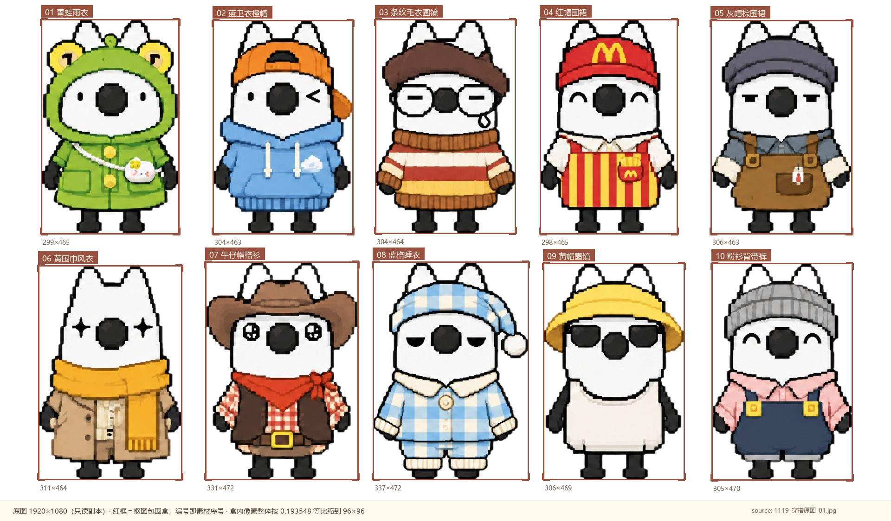

# 1119-e-穿搭抠图 · 原图与 10 个独立 PNG 的对应关系 v1

- 日期：2026-11-19
- 岗位：E
- 对应源图：`original/1119-穿搭原图-01.jpg`（1920×1080，只读，未修改、未覆盖）
- 输出规格：96×96 RGBA PNG，`centerX = 47.5`、`footBaseline = 92`，与 `1119-e2b-锚点清单-v1.json` 的 `body.png` 基准对齐
- 配套文件：`1119-e-穿搭抠图-对应关系-v1.json`（机器可读，含每个素材的源包围盒、缩放后几何、内容框、不透明像素数、色数、alpha 取值）

---

## 1. 一句话结论

一张原图里的 10 个刘看山，按「先上排后下排、每排从左到右」编号 01–10，各自导出为独立 PNG；10 张共用**同一个缩放比例 0.193548**（= 90 / 465，465 为 10 个源包围盒高度的中位数），脚底一律落在第 92 行、水平中心对齐 47.5。

---

## 2. 编号与阅读顺序

原图是 **5 列 × 2 行** 的排布。编号规则只有一条，写死在脚本里，换图也不会变：

1. 先按行分：`y0 < 520` 为第一排，否则为第二排；
2. 行内按 `x0` 从小到大排。

所以 01–05 是上排，06–10 是下排。**编号即文件名序号，也即 `mapping.json` 里的 `index`**，三处一致，不存在第二套编号。



上图中每个红框就是一个素材的**源包围盒**（前景连通域的紧外框），框上标签即序号与名称，框下标注源尺寸。

---

## 3. 10 条对应表

| # | 名称 | 文件名 | 原图包围盒 `x0,y0–x1,y1` | 源尺寸 | 缩放后 | 96 画布内容框 | 不透明 px | 色数 |
|---|---|---|---|---|---|---|---|---|
| 01 | 青蛙雨衣 | `1119-e-穿搭-01-青蛙雨衣-96-v1.png` | 88,41–386,505 | 299×465 | 58×90 | x19–76 / y3–92 | 4046 | 2706 |
| 02 | 蓝卫衣橙帽 | `1119-e-穿搭-02-蓝卫衣橙帽-96-v1.png` | 458,43–761,505 | 304×463 | 59×90 | x18–76 / y3–92 | 3752 | 2258 |
| 03 | 条纹毛衣圆镜 | `1119-e-穿搭-03-条纹毛衣圆镜-96-v1.png` | 808,41–1111,504 | 304×464 | 59×90 | x18–76 / y3–92 | 3770 | 2324 |
| 04 | 红帽围裙 | `1119-e-穿搭-04-红帽围裙-96-v1.png` | 1163,41–1460,505 | 298×465 | 58×90 | x19–76 / y3–92 | 3612 | 2309 |
| 05 | 灰帽棕围裙 | `1119-e-穿搭-05-灰帽棕围裙-96-v1.png` | 1531,43–1836,505 | 306×463 | 59×90 | x18–76 / y3–92 | 3650 | 1864 |
| 06 | 黄围巾风衣 | `1119-e-穿搭-06-黄围巾风衣-96-v1.png` | 82,572–392,1035 | 311×464 | 60×90 | x18–77 / y3–92 | 3785 | 1868 |
| 07 | 牛仔帽格衫 | `1119-e-穿搭-07-牛仔帽格衫-96-v1.png` | 442,564–772,1035 | 331×472 | 64×91 | x16–79 / y2–92 | 4037 | 2633 |
| 08 | 蓝格睡衣 | `1119-e-穿搭-08-蓝格睡衣-96-v1.png` | 803,564–1139,1035 | 337×472 | 65×91 | x15–79 / y2–92 | 3997 | 2647 |
| 09 | 黄帽墨镜 | `1119-e-穿搭-09-黄帽墨镜-96-v1.png` | 1170,567–1475,1035 | 306×469 | 59×91 | x18–76 / y2–92 | 3725 | 1445 |
| 10 | 粉衫背带裤 | `1119-e-穿搭-10-粉衫背带裤-96-v1.png` | 1533,567–1837,1036 | 305×470 | 59×91 | x18–76 / y2–92 | 3770 | 1631 |

「内容框」指 96×96 画布内**不透明像素的实际外框**，不是图片尺寸——图片尺寸一律 96×96。

### 为什么 01–06 顶行是 3、07–10 顶行是 2

源高度在 463–472 之间浮动（相差 1.9%）。统一比例 0.193548 之后：

- 463–465 px → 90 px 高 → 脚底 92 时顶行落在 3（与 `headTop = 3` 一致）
- 469–472 px → 91 px 高 → 脚底 92 时顶行落在 2（比 `headTop = 3` 高 1 px）

这是「统一缩放比例」和「headTop 容差为 0」两个要求在这批源图上的直接冲突。本次选择**保统一比例**，把 1 px 的顶行差异记录在质量报告 P6 里，并给出改法；没有为了凑 3 而逐张改比例。

---

## 4. 命名规则

```
1119-e-穿搭-{序号:02d}-{中文装扮名}-96-v1.png
```

| 段 | 含义 | 备注 |
|---|---|---|
| `1119` | 交付日期 | 与 `team/2026-11-19/e/` 一致 |
| `e` | 岗位 | |
| `穿搭` | 素材类别 | 若以后出第二类（如表情、动作）另起类别词，不混编 |
| `{序号}` | 原图内编号 | 两位，01–10 |
| `{中文装扮名}` | 人眼可读的装扮描述 | 从原图直读，不臆造；描述的是**看得见的三件主特征**（上衣/帽子/配件） |
| `96` | 画布边长 | 与 `body.png` 同规格 |
| `v1` | 版本 | 返工不覆盖，出 v2 |

**多张原图如何扩展**：本次只有 1 张源图，所以序号 01–10 唯一。若以后有第二张原图，文件名需带原图号，建议 `1119-e-穿搭2-01-…-96-v1.png`（`穿搭2` 表示第二张源图），不要出现两个都叫 `01` 的文件。这一点写在这里是为了避免以后撞名，**本次未产生第二张源图**。

---

## 5. 落位公式

10 张用的是同一段逻辑，换素材不需要改参数：

```python
CANVAS, CENTER_X, FOOT_Y = 96, 47.5, 92

# 1) 按源包围盒裁出 RGBA（alpha = 前景掩码）
# 2) 统一比例缩放（面积平均，非最近邻）
w = round(src_w * 0.193548); h = round(src_h * 0.193548)
small = sprite.resize((w, h), Image.BOX)

# 3) alpha 二值化：>=128 → 255，否则 0，并清零全透明像素的 RGB
# 4) 裁到真实内容框，再按锚点落位
bbox = small.getchannel("A").getbbox()
small = small.crop(bbox)
left = floor(CENTER_X - cw / 2 + 0.5)
top  = FOOT_Y - ch + 1      # FOOT_Y 是「最后一行不透明像素的行号」，不是高度
```

第 3 步的 alpha 二值化是关键：不做的话 96 px 下会出现半透明灰边，叠到场景上就是一圈毛边；做了之后 alpha 只有 0 和 255 两个值，和 `body.png` 的 alpha 取值完全一致。

---

## 6. 与锚点清单的逐项对照

| 锚点 | 规范值 | 容差 | 本批实测 | 结果 |
|---|---|---|---|---|
| 画布 | 96×96 RGBA | — | 10/10 为 96×96 RGBA | 通过 |
| `centerX` | 47.5 | ±1.0 | 6 张 47.5、4 张 47.0（偏差 −0.5） | 通过 |
| `footBaseline` | 92 | 0 | 10/10 落在 92 | 通过 |
| `headTop` | 3 | 0 | 6 张为 3，4 张为 2 | **不通过**，见质量报告 P6 |
| `earTip` 左 | 34 | ±1.0 | 37.5 | **不通过**，见质量报告 P5 |
| `earTip` 右 | 58 | ±1.0 | 58.5 | 通过 |
| alpha 取值 | {0,255} | — | 10/10 只有 0 与 255 | 通过 |
| 四角透明 | 全透明 | — | 10/10 | 通过 |
| 触边 | 不触画布边 | — | 10/10 不触边 | 通过 |

`earTip` 左偏差的成因不在抠图，而在**源图本身**：这批生成图的耳朵比正式 `body.png` 窄且靠内。这是原图内容差异，按任务要求「不得改变刘看山形象」不能靠拉宽耳朵去凑锚点，只能记录（P5）。

---

## 7. 待确认

1. **这批素材是「整身一体」，不是分层部件。** 10 张各自已经把身体、衣服、帽子、配饰合成在一张图里，无法拆成 `body / cloth / face / hat / glasses` 五层，因此**不能**作为 `wardrobe.js` 的 `cloth` 或 `hat` 层输入。如果 A 想用它们，只有两条路：当作「整体立绘」单独一套显示逻辑，或者由 E2b 重新按层出图。需要 A / E2b 定。
2. **序号命名是否沿用「看得见的三件主特征」**（如「蓝卫衣橙帽」）。若团队希望改成官方服装名（如 `hoodie`、`apron`），我可以按 `manifest` 的 key 重命名，但需要先确认映射表。
3. **是否需要同步产出一份 `manifest` 形状的 JSON**（`{id, file, layers}`）。本次只给了中性的 `mapping`，没有写进任何正式 manifest。

---

## 8. 变更记录

| 版本 | 日期 | 变更 |
|---|---|---|
| v1 | 2026-11-19 | 首次交付，10 个素材、统一比例 0.193548、9 项自动校验全通过 |
