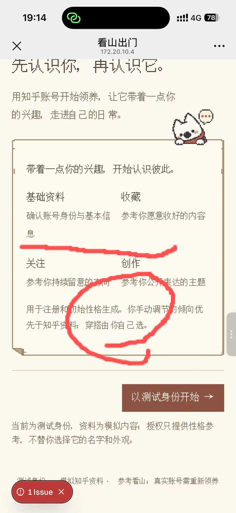
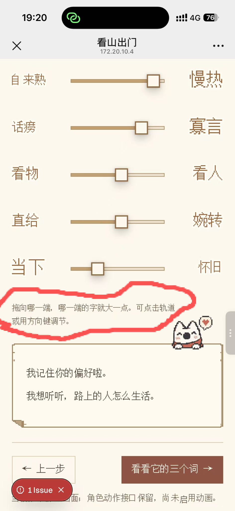
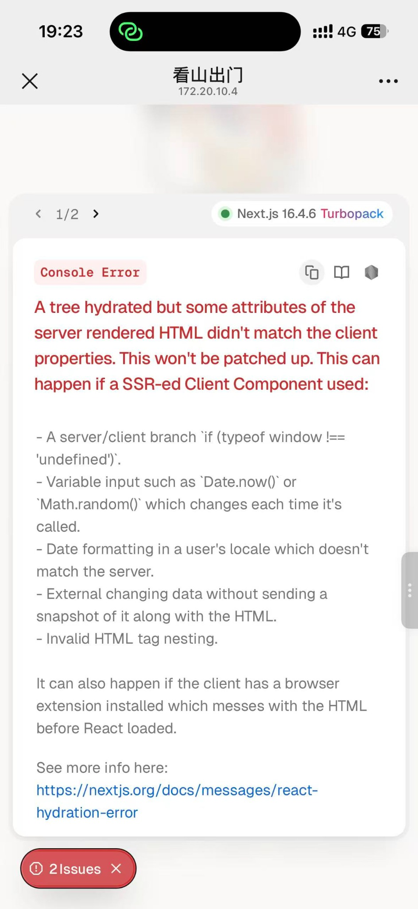
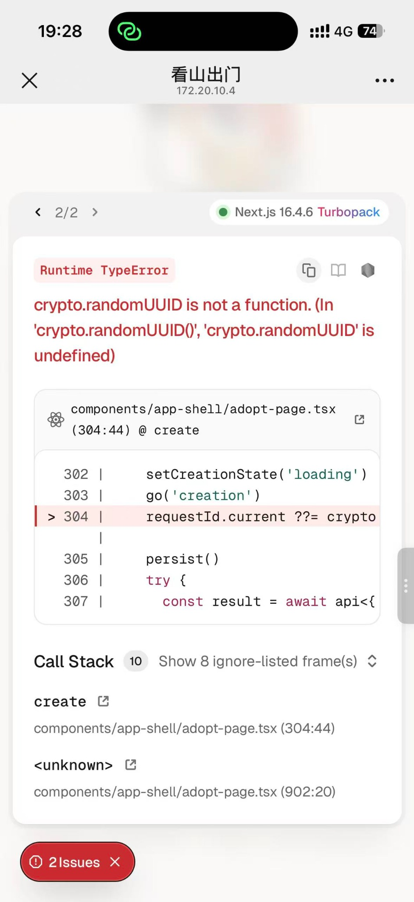
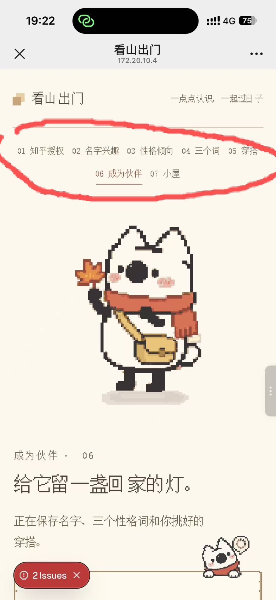

# E5 手机实测反馈 v2 · 2026-11-23

状态：用户真机反馈与WB场景裁切回报已分开登记。**设备、系统、浏览器已由用户确认（2026-11-23 20:28，见 §9）**；真机运行代码关联仍待核实。WB场景验收已本地提交；本反馈是否推送以WB后续远端回执为准。v1保留为原始记录，不覆盖。

## 1. 实测环境与范围

| 项目 | 当前记录 |
|---|---|
| 设备 | **iPhone 15 Pro**（用户确认） |
| 系统 | **iOS 26.7.1**（用户确认，不据截图猜测） |
| 浏览器 | **微信 8.0.80 内置浏览器**（用户确认）；UA未采集 |
| 网络 | 电脑接iPhone热点；手机访问局域网HTTP服务 |
| 入口 | /adopt、/home、/trip；原地址172.20.10.4:3000，只作本次环境记录，不是公网交付链接 |
| 日期 | 2026-11-23；截图状态栏约19:14–19:28，时区按GMT+8记录 |
| 分支、HEAD、工作区改动 | **真机实测HEAD未确认**；不得用桌面测量的dd5f53e或远端main冒充本地实测版本 |
| 访问与身份 | 测试身份、模拟资料；用户在创建伙伴阶段被阻断 |
| 已覆盖 | 领养前半流程、性格滑块、穿搭步骤到创建入口 |
| 未覆盖 | 创建成功、小屋、聊天、归来邀请；不能计为通过 |

WB此前报告390×844全新无cookie模拟可渲染，不等于本次手机创建成功。用户截图有运行时错误。场景裁切任务独立记录，不代替E5。

## 2. 问题与建议总表

下列优先级是E建议，由A确认。技术原因区分已见事实与待验证推断。

| ID | 类型与建议优先级 | 反馈 | 主责建议 | 状态 |
|---|---|---|---|---|
| E5-01 | 视觉缺陷，中 | 授权资料卡分组与说明缺少清楚分隔，窄屏换行易串读 | A | 待处理 |
| E5-02 | 可选体验请求，低 | 尝试简单AI背景音 | A决定范围，E制作候选 | 待A决定 |
| E5-03 | 交互缺陷，高 | 拖动初始性格滑块时闪动／跳动 | A，WB复现 | 待定位 |
| E5-04 | 设计建议，中 | 冗长说明采用渐进式披露 | A，E复核 | 待确认 |
| E5-05 | 开发诊断，高 | Issues显示两类错误，不能只隐藏浮层 | A，C协助 | 待修复 |
| E5-06 | 导航设计，中 | 顶部步骤像可点击栏目，数字不易理解 | A | 待确认 |
| E5-07 | 装配接入与问题 | 当前无实时试穿，非批准r2外观；保存后换装入口待确认 | A/C | 待接入与答复 |
| E5-08 | 主流程阻断，最高 | 一直正在保存，不能进入小屋 | A，C配合 | 未通过 |
| E5-09 | 流程疑问 | 后续登录是否再领养；三个入口为何相同 | A/C确认身份规则 | 当前代码已有部分答案 |

## 3. 逐项反馈及证据

### E5-01 授权资料卡分隔

用户原意：圈画部分应设置分隔，否则下方错位、阅读有问题。截图确认四项资料说明与底部用途说明视觉层级不清；具体是否存在CSS重叠仍需复现，不将所有换行都判为错位。

建议：基础资料／收藏／关注／创作使用清楚网格与行距；底部用途说明独立分区，适度细分隔线。必要时窄屏改为单列。保留模拟资料与授权用途等必要告知。

验收：窄屏文字不串读、不重叠，说明与四项分组清楚。

### E5-02 简单AI背景音

用户提出：尝试AI制作简单背景音。E可以自行准备候选音频，页面接入与产品范围由A决定；当前未生成音频、未取得范围批准，也未声称已有音频生成能力或完成授权核验。

建议：短、轻柔、无歌词、可循环，不抢聊天阅读注意力；默认关闭，主动开启，可随时静音并记住偏好。不把背景音作为完成领养的条件。保留生成工具、提示词、生成日期、所用套餐授权依据及原始文件记录。

正式请求见同包《1123-E-给A-请求-轻量AI背景音试做-v1.md》。此项不阻塞修复。

### E5-03 性格滑块闪动

用户观察：滑动初始性格时界面会闪。录屏16.7秒，记录滑块操作和视图上下位置变化。抽帧不能证明所有瞬时闪烁，具体渲染原因未定。

建议排查：拖动时两端字号改变是否引起换行或行高变化；反馈卡尺寸、滚动锚定及重渲染；分别验证微信内置浏览器与Safari。不要未经验证归因于hydration错误。

验收：拖动与松手过程中周围布局稳定，无意外跳屏，数值和选择保留。

[打开原始手机录屏](evidence/02-slider-recording.mp4)

### E5-04 渐进式披露

用户希望：先给常用信息，特殊或高级说明收进二级；界面更简洁，也保留探索感。建议tooltip，在靠近、聚焦或拖动时出现，可先用第一个滑块引导。

落地建议：保留一句最短必要提示，其余放“操作说明”。桌面支持hover与focus，手机支持点按或首次操作提示；不要手机仅靠hover。提示不挡滑块、不引起页面重排；提供重新打开方式，不强迫用户在短暂自动消失前读完。方向键说明适合键盘场景，不必长期占据手机主界面。开发实现说明可移出用户主界面，但必要的模拟身份告知不应一并删除。

### E5-05 Issues及渲染错误

用户问：左下角Issues是什么，是否给用户看，会不会删掉？

答复：是Next.js开发错误工具，不是产品功能；生产构建通常不展示该开发工具，但必须修复其揭示的错误，不能只隐藏工具。

截图A：hydration mismatch，服务端HTML与浏览器首次渲染不一致。具体属性diff、组件栈与触发条件待WB采集，当前不能确定原因。

截图B：Runtime TypeError，crypto.randomUUID is not a function。错误定位adopt-page.tsx:304，与创建卡住直接相关，见E5-08。

### E5-06 顶部步骤像栏目

用户第一反应是点击上方栏目，未理解01–07代表进度。当前所核对main的步骤是span，不是可点击导航。

建议：用清楚的阶段进度展示，标注当前阶段，去除重复编号与拥挤多行文本。若允许返回已完成步骤，由A明确范围、保留草稿，不能允许绕过未完成的前置步骤。进度表达只用于这次领养过程，不增加打卡、催促或持续天数指标。

### E5-07 实时穿搭与保存后修改

用户问：装扮能否实时查看；不喜欢怎么办；是否临时衣柜，而非E设计的衣柜？

当前所核对main明确提示“当前使用参考看山，选项只保留草稿，暂停叠加服装素材”。仓库公告说明原E素材归档、A批准r2，新契约后再接正式页面。因此当前画面不能当作r2效果验收。

保存前有返回穿搭修改的代码路径。保存后的完整换装入口及可修改范围尚未在本轮确认，需A说明。请求新选择器提供即时实际图层预览，确认前可修改；后续换装按A/C批准契约执行，不私自使用旧枚举冒充新版ID。

### E5-08 创建伙伴卡住

用户描述：正在保存很慢，进不去07小屋。截图证明实际存在运行时异常，不能只归类为网络慢。

所核对main中create()顺序：setBusy(true) → loading → go('creation') → crypto.randomUUID() → persist() → try内POST /api/dogs。UUID调用在try之外；若抛异常，创建请求尚未发起，正常catch与finally无法处理该次异常。截图报错与该代码一致。本地运行源码与网络日志仍需WB核对。

局域网HTTP不属于常规HTTPS安全上下文，randomUUID的可用性限制是高度可能触发条件，需在真机同条件下验证。请求A提供兼容方案及完整错误处理；C确认请求标识与幂等约束。不得用每次重试重新生成标识破坏防重复创建。

验收：真机能够创建、进入小屋，刷新后仍同一只狗；异常可退出等待态，保留草稿并能重试；重复点击或重试不重复创建。

### E5-09 首次领养、后续登录、三个入口相同

当前所核对main：有狗的当前会话访问/adopt会转/home；无身份或无狗访问受保护页面转/adopt。它取决于当前身份及保存记录，不是设备仅出现一次。

本次创建被阻断，三个入口回领养与该保护逻辑一致，但需WB核对实际响应。换浏览器、清cookie或换身份后不保证沿用测试记录。真实知乎账号的后续登录、测试身份切换真实身份后的归属处理需A/C确认，不能将当前模拟登录当作真实登录已完成。

## 4. 仓库核对依据与事实边界

本轮整理时读取GitHub main的以下文件；不是用户手机运行commit的证明：

- components/app-shell/adopt-page.tsx，blob SHA 5cc96351107bbe6e57ab107654f674258c06a5d5
- components/app-shell/shell.tsx，blob SHA c0db6167ebca6b66e5419028b29aef8704a633fc
- components/v25/presentation.tsx，blob SHA f79457f3671a2c15aa999bab6a5f48f1b15a059f
- team/今日变更.md，blob SHA a156ac1f03e689cdff0ddb9be008d100eae74421

参考：
- https://developer.mozilla.org/en-US/docs/Web/API/Crypto/randomUUID （安全上下文限制）
- https://nextjs.org/docs/app/api-reference/config/next-config-js/devIndicators （开发指示器，隐藏不等于修复错误）

## 5. 明确的处理顺序

1. 先给WB《设备与实测版本补录请求》，补设备、系统、浏览器、commit及本地diff。无法自动取得的信息由用户在手机设置中确认，不能猜。
2. 信息补齐后，再将本反馈及背景音请求交给A/C。A负责产品与页面，C配合身份、写入幂等和新版装配，B目前无已覆盖的聊天缺陷，不向B声称聊天已测。
3. A确认修复与请求范围后，分别修复。用户复测创建，再继续小屋、聊天、邀请。
4. WB在当天独立E分支归档反馈、证据、请求及补录信息，回交精确SHA。只推分支，A审查合并；不碰main及其他成员业务实现。

## 6. 验收状态

领养：部分完成，创建阻断。聊天：未测。邀请：未测。场景裁切：另项执行。背景音：待A裁定、未制作。r2正式穿搭：未在本次手机页面完成验收。

## 7. v2补录：电脑环境与真机信息分开

以下为WB回报，整理者未复跑其本地服务或读取40张截图，不能将回报写成独立复验。

- 电脑：Windows 11家庭中文版；WB报告10.0.26300 / Build26300.9711（26H2），64位；en-US / China Standard Time。版本名称沿用WB原报，不做额外系统版本认证。
- Node v24.20.0、npm11.19.0、Next16.4.6、React19.3.1；服务next dev --hostname 0.0.0.0，端口3000。
- 出图浏览器：Chromium148.0.7778.96 / Playwright1.65.1，headless shell1223；DPR1、Win32、isMobile=false、hasTouch=false、桌面UA。
- 因此375×667与320×568属于桌面窄视口；不是手机真机，也不是已启用触摸的移动模拟。即使日后启用isMobile，也只能标移动模拟。
- 真机待填：iPhone型号、iOS版本、实际浏览器宿主与版本；尚不把场景测量HEAD自动认定为用户19:14–19:28领养实测HEAD。

## 8. v2补录：场景裁切回报与交接请求

### 版本与证据口径

WB分支e5-scene-crop-20261123；测量执行时HEAD为dd5f53ebb214bc5f8ee4959b95bfeac74a055200，夹具当时未跟踪。验收包提交3c166fec280ba84f2d7a19609a80e52b8a185121；补录0b98bae464084dfeb47ad21290b40c2ba0b9c3f3；口径修正后当前HEAD1cc87ab3a8c5262e67013d082afadd60d7481377。后三个提交仅验收资料与夹具，不代表页面代码修复。

WB报告未推送，工作区next-env.d.ts及next.config.ts有本地改动。精确本地diff及其影响由WB留档核实。

### WB实测回报

1. 正式/trip的Dog、tripScenes、tripVisuals未绑定；三档真实页面hasBackdrop=false、hasActor=false，记阻塞。
2. 另用真实TripPage组件夹具运行12场景×3视口。不是正式/trip接线通过。WB报告40图：36矩阵、3真实/trip、1running。
3. 舞台内容盒为339×316、284×316、1048×316。WB报告窄屏横裁约31.3/86.3px，脚底悬空约16.4/15.1px；桌面纵裁约578.3px、脚底位置严重偏移。
4. WB分析角色盒底边、内联基线留白及精灵透明区域混用，导致可见脚底与锚点不一致。数值和原因待A依据原截图与测量JSON复核，不擅自修改实现。
5. ReferenceActor作用域依赖[data-v25]；WB另试绑定时三次卡死、未取得图，原因未定位。不能认定CSS作用域就是卡死原因，也不能把该轮当角色通过。
6. 非整数缩放不单独判为缺陷；结合清晰度和截图判定。单图背景没有前景遮挡层不等于所有视觉遮挡都合理，仍需人工看合成结果。

### 两张书店不属于缺失制作

原12图在仓库，新增书店两图在1123-E-bookstore-delivery-v1.zip，已制作750×640及素材叠加预览。WB扫描仓库只得12图不能说明总交付缺少两张。请先将书店包归档，再核对路径和正式取用。未正式接线时仍记阻塞，不凭本地素材预览升级为页面通过。

### 给A的新增反馈

请A接入批准素材与正式Dog，统一背景和角色坐标变换。若采用cover，须根据实际缩放与裁切偏移换算脚底；若改舞台比例，按750×640素材及页面整体设计明确规则，不能随意采用另一个比例当等价替换。角色锚点应对齐可见脚底，并消除基线与透明边距干扰。Dog应能在/trip实际作用域稳定渲染。

1440×900属于本轮已测范围，不自行删去失败项；如A决定降低桌面优先级，请在结果表保留失败事实及裁定。

创建、滑块、授权卡、渐进式披露、顶部进度、r2预览、后续换装和背景音请求仍按本反馈前文处理。背景音未生成、待A定范围。

## 9. 补录：真机信息已由用户确认（2026-11-23 20:28）

| 项 | 确认值 | 来源 |
|---|---|---|
| 手机型号 | **iPhone 15 Pro** | 用户确认 |
| 系统 | **iOS 26.7.1** | 用户确认 |
| 浏览器 | **微信 8.0.80 内置浏览器** | 用户确认 |

- 详见同包《1123-E-给WB-请求-设备与实测版本补录-v2.md》；补录v1保留不覆盖。
- **未采集UA**，本文件不提供UA字符串，也不据型号推断iOS补丁行为差异。
- **真机实测HEAD仍未确认**，与桌面场景测量的 `dd5f53e` 严格分开；不能用桌面数据填充真机口径。
- §1 环境表已同步更新；v1 原文保留。本次仅改环境口径，§2–§8 的问题判断、优先级与验收结论不变。
